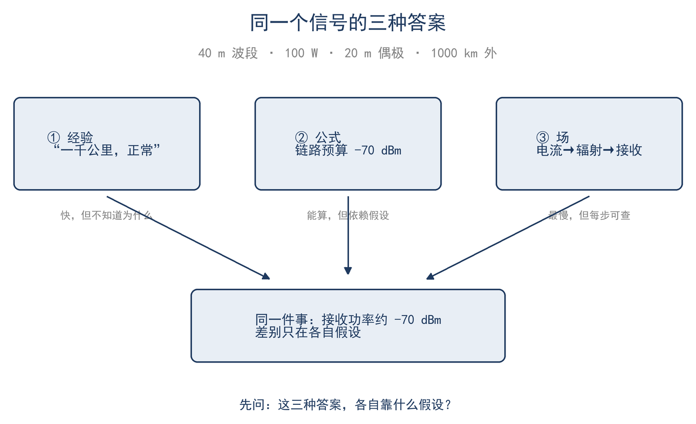

# 序章 一个信号的三种答案

晚上九点，40 米波段，100 W 单边带，一副 20 米长的半波偶极，目标是 1000 公里外的一个省。频率上有人回答："你信号 59，正常。"另一位补充："40 米这个距离，晚上靠一跳天波，100 W 加偶极够了。"也有人打开计算器，或使用建模软件。同一件事，经验、公式和场给出的说法并不一样。

这三种答案各有来源：经验来自长期通联的积累，公式来自手册与计算器，场来自课本与建模软件。它们的分歧不在于谁对，而在于能回答到哪一层：经验判断正不正常，公式给出是多少，场说明为什么是这个数。

本章把同一个问题用三种方式回答一遍，看每种答案能给出什么、在什么条件下会失效。

## 一、经验的答案

老手说的是："40 米、1000 公里、100 W 加半波偶极，正常。"这句话没有推导，却很有用：它把功率、天线、传播、噪声这些变量压成一个可以立刻使用的判断。信号对不上这句话时，可以立即判断"哪里可能不对"；对得上，也不必逐项核算每个 dB。

经验答案成本最低、速度最快，来自大量台站的重复。它给出结论、操作方法与适用边界，不追究原因；对日常判断而言，这已足够。

例如，更换馈线后开机通联，对方仍报 59。经验丰富的操作者会说："40 米晚上就这条件，别指望换个接头多出 3 dB。"这句话的价值不在于精确，而在于排除了"设备故障"这一可能，避免了一次不必要的拆装。经验实际上编码了很多变量：季节、昼夜、太阳活动、本地噪声、天线高度、地面的情况，只是它不把这些变量分开说。

经验还有一个作用，是给"异常"下定义。没有一条"正常应该是什么样"的基线，测到的数据也无从判断好坏：SWR 1.8 算高还是低？没有基线，这个问题没有答案。所以经验不是要被公式取代的东西，它是测量的参照系。

但经验不能外推。把 40 米的判断直接用到 160 米或 2 米，常常出错：160 米噪声大、天线效率低，2 米基本是视距；同一个"59"，背后的条件完全不同。

经验失效的场合也很清楚：传播异常、天线有隐伤、噪声环境变了、换了波段或距离。这时它只能说明"不正常"，不能告诉你哪一环不正常、为什么、改哪里。要回答这些，需要换一种写法。

## 二、公式的答案

把这条链路写成 dB 的加法（链路预算）：

$$ 50 + 2.15 + 2.15 − 1.5 − 109.5 − 13 ≈ −70 dBm $$

各项依次是：100 W 发射功率换成 50 dBm；收发两副偶极各 2.15 dBi（这个数的来历在第 9 章）；十几米细同轴的馈线损耗约 1.5 dB；7.1 MHz、1000 公里的自由空间损耗约 109.5 dB；40 米波段天波路径的电离层吸收、地面反射与极化损耗合起来按 13 dB 估。算下来，接收端约 −70 dBm，也就是 10⁻¹⁰ W 量级。

每一个数都可以单独查。50 dBm 是 100 W 的另一种写法；109.5 dB 不是常数，它由频率和距离决定，距离翻倍这一项加 6 dB，频率翻倍也差不多加 6 dB。13 dB 是唯一估出来的项，也是最值得怀疑的一项。第 15 章会把 13 dB 分成吸收、地面反射、极化三项，逐项给条件。

公式答案的特点是能算、能改参数、能比较。把馈线换成粗一号，损耗从 3 dB 降到 1 dB，结果就是 +2 dB；功率从 100 W 加到 400 W，是 +6 dB；距离从 1000 公里拉到 2000 公里，自由空间损耗再加 6 dB。每个假设的变化都可以立即换算为新的数值。

它还能反过来用。对方收到 −70 dBm，如果他的本地噪声底是 −100 dBm，信噪比就是 30 dB，听感良好；若噪声底为 −85 dBm，信噪比仅剩 15 dB，辨别就会困难。同一部电台、同一个信号，落在不同的噪声环境里，结果相差明显。这也解释了为什么信号报告不能只看功率。

公式答案的边界同样清楚：它依赖假设。第 15 章用更完整的损耗假设（馈线 3 dB、电离层吸收 10 dB、地面与极化 3 dB）重算同一条链路，得到 −71.2 dBm；和这里差 1.5 dB，全部来自假设不同，并非计算错误。再比如把 13 dB 改成 20 dB，结果立刻从 −70 降到 −77，7 dB 的差相当于功率差 5 倍。公式不是真理，而是带条件的估算；单位错、模型错，它也能给出精确但错误的数值。这也是书中每个公式都注明适用条件的原因。

## 三、场的答案

场论不问"总共多少 dB"，它从电流开始：偶极上的驻波电流分布决定远场的方向图；方向图决定某个方向上的功率密度；功率密度乘上接收天线的有效面积，就是接收功率。

电流为什么是驻波？半波偶极的两端开路，电流在末端无处可去，只能反射回来，和前进的波叠成驻波：中心电流最大、末端为零，电压反过来。电流来回加速，周围的场不再只是贴着导线的无功场，一部分开始向外辐射。辐射出去的场在远场按距离倒数衰减，方向分布由电流分布决定。

沿着这条路算一遍：100 W 送进增益 1.64（2.15 dBi）的偶极，1000 公里处的功率密度约 1.3×10⁻¹¹ W/m²，场强约 70 μV/m；7.1 MHz 的接收偶极有效面积约 233 m²，接收功率约 3×10⁻⁹ W，即 −55.2 dBm。再扣掉馈线 1.5 dB 和传播 13 dB，回到 −70 dBm，和公式答案一致。如图 0-1，三条路径最后指向同一个数，区别在于每种答案所能提供的信息不同。

这里有两处容易误解之处。第一，增益不是"放大"：无源天线的总辐射功率不会超过输入功率，它只是把能量压进更窄的方向；1.64 描述的是最强方向比平均方向强多少。第二，有效面积不是天线的物理截面：一副 20 米偶极的金属面积不到 1 平方米，有效面积却有 233 平方米，因为它和来波共振，能从更大的波前上截获能量。这两件事，公式答案说不清，场答案能说清。

场的答案最慢，但每一步都能查：增益为什么是 2.15 dBi、有效面积为什么和波长有关、频率越低天线为什么越大，都在这一步里说清楚。它的代价是输入多：电流分布、地面、极化、障碍物，任一项估错，结果就错；边界是复杂环境：地面、建筑、电离层一变，解析式即无法求解，要靠数值方法或实测（第 17 章）。

## 四、三种答案合起来

三种答案不是互相否定，而是三种精度、三种成本、三种适用场合：

**表 0-1 三种答案的分工**

| 答案 | 提供什么 | 什么时候用 | 什么时候失效 |
|---|---|---|---|
| 经验 | 快速判断"正不正常" | 日常通联、现场排查的第一步 | 传播异常、天线隐伤、环境变化 |
| 公式 | 数量级与方案比较 | 设计链路、算预算、换器件前 | 假设不成立、单位错、模型越界 |
| 场 | 每一项的来龙去脉 | 追问"为什么"、判断模型可信度 | 复杂环境算不动 |

以一个具体问题为例。假设 40 米波段无法通联 1000 公里：经验先给判断——"这个季节、这个时间，不应该"；公式给出预期——按 100 W 和偶极，理想条件应该收到 −70 dBm 上下；场答案再往下拆：是哪一项掉了？馈线、接头、地面、极化还是传播？最后靠测量定案，假负载先排除发射机，分析仪量天线，日志记录当天条件。三种答案各管一段，缺少任何一段，排查就会退化为"更换天线"式的试探。

实际工作通常走四步：先估算（经验加数量级），再推导（公式或场），然后测量（最终判据），最后记录（变成下一次的经验）。本书坚持四条原则：先写方程，再代数字，最后回到物理；每个公式注明适用条件；估算优先；测量是最终判据。

测量发现偏差时，顺序也有讲究：先查最可控的项（接头是否拧紧、馈线是否进水、假负载是否正常），再查环境项（高度、地面、附近金属），最后才怀疑传播。这个顺序和链路预算里各项的不确定度一致：越是估出来的项，越晚怀疑。

读完本书，多数"大家都这么说"可以还原成一句可以验证的理由，并且能自己算一遍。

## 五、这本书怎么读

全书 17 章分两种。**普通章 12 章**是主线，只用到高中代数、三角、对数和第 3 章的复数；**★ 拓展章 5 章**（★5 振荡与衰减、★6 电与磁、★10 阵列与方向图、★14 采样与数字信号、★17 建模）数学密度更高，整章可以跳过。

两条路线：

- **主线**：序章 → 1 → 2 → 3 → 4 → 7 → 8 → 9 → 11 → 12 → 13 → 15 → 16 → 结语，约 5.6 万字；
- **全读**：全部 17 章，约 7.8 万汉字。★ 章按兴趣加读：想懂 Q 与谐振加 ★5，想懂场与波加 ★6，想懂八木加 ★10，想懂 SDR 加 ★14，想懂建模加 ★17。

四部分各管一段：第一部分（第 1–4 章，★5）把电台写成数；第二部分（第 7–9 章，★6、★10）讲信号怎么离开电台；第三部分（第 11–13 章，★14）讲信息与噪声；第四部分（第 15–16 章，★17）算整条链路。每部分开头有一句接口说明，说明这一段接着上一段的哪个概念。

**表 0-2 全书地图**

| 部分 | 章 | 回答的问题 |
|---|---|---|
| 一、把电台写成数 | 1–4，★5 | 数、比值、复数、变化率、方程怎么写 |
| 二、信号怎么离开电台 | 7–9，★6、★10 | 场、波、反射、辐射、叠加 |
| 三、信号里的信息与噪声 | 11–13，★14 | 频谱、概率、噪声、采样 |
| 四、算整条链路 | 15–16，★17 | 传播、测量、建模 |

公式分三档：正文里的主线公式带编号和适用条件；【推导】框可跳过，主线不依赖；附录 C 是查表用的公式表。每章末有 5 道分级习题（★ 直接套用、★★ 两步、★★★ 上机或测量，可跳过），答案在附录 D；每章末另有小结。

时间上不必紧张。主线 5.6 万字，精读大约 5–7 小时，加上做练习和动手测量，按每天半小时算需要 2–3 周；全读再加 3–5 小时。真正占用时间的是测量与记录，而非阅读。

★ 章并非重复主线，而是补全主线中点到为止的推导。主线尚未读通便跳读 ★ 章，收益有限。读法没有统一要求，先读最需要解决的那一章也可以；每章开头的"这一章会用到"框会说明需要哪些前置。

开始之前可以做一次自查。附录 A 末有"数学底线 15 题"：会做，第 1、3、4 章的复习段落可以快读；不会做，按提示补三页即可。天线方面的术语（增益、驻波比、馈线损耗、极化）在第 2、9 章都会重新定义，不必预先准备。

读法建议：先按主线走；时间碎就先读第 2、7、8、9、13、16 章，★ 章想深挖再回来。读完第 2 章，就可以先算一遍自己天线的链路预算。

本书与同系列的《业余无线电天线概述》关注点不同：那本讲天线的类型、性质与架设实践，本书讲这些做法背后的数学物理原理。两本书各自独立，可以分开读，也可以对照读。
