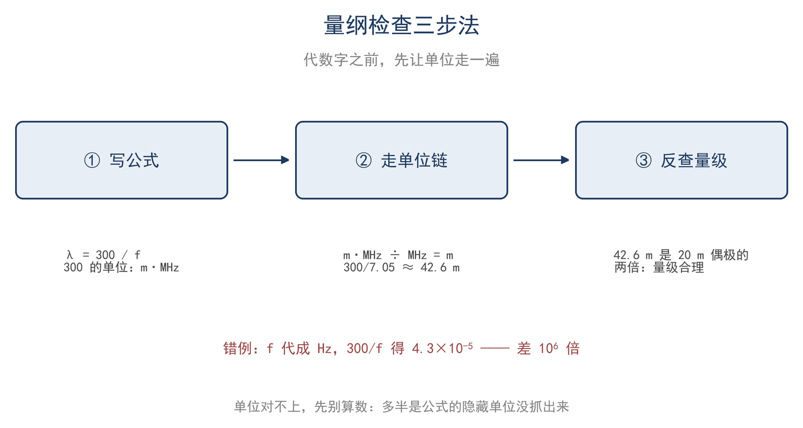
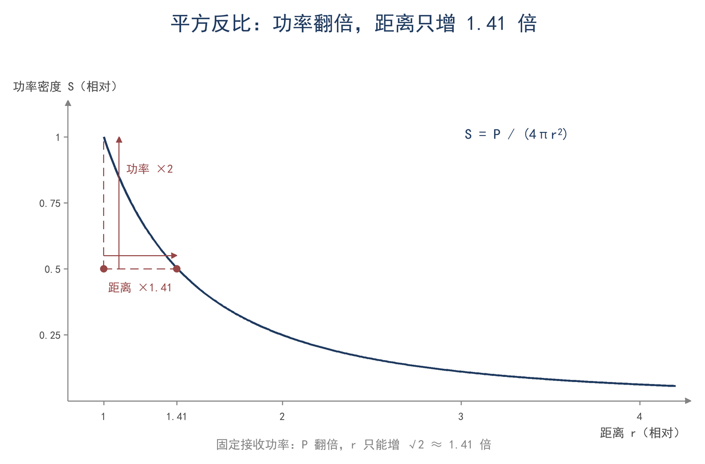

# 第 1 章 先估个数量级：30 秒判断答案

## 一、十米外的 100 W：一个还没有公式的问题

14.1 MHz、100 W，天线架在楼顶。你站在 10 米外，邻居探出头问：“这么大功率，这儿场强有多少？会不会影响我家电视？”手边没有场强仪，公式一时想不起来。30 秒内能不能给出一个数字？

能，但给出的是数量级和条件，不是精确值。现场先估算，是为了拦住三类错误：把毫瓦当瓦，功率差三个数量级；把厘米当米，功率密度差四个数量级；把近场当远场，公式的适用条件已经不成立。

同样一句“十米外一百瓦”，用球面模型或曝露规范模型，答案可能相差一个数量级。先确定模型与条件，再代数字。需要具体判断是否超过曝露限值时，估算只说明是否值得测量，结论仍要按标准与测量给出。

流程固定为三步：写公式；把数值连同单位代入；用另一条路或极端值反查。三步都不需要计算器。

落到纸上只有一个动作：写单位。把 W、m、Ω 跟着数字一起乘除，错误会在单位上暴露：该得 W/m² 却得到 W/m，说明少除了一个长度；该得 V/m 却得到 V，说明漏了开方或除以距离。

问题于是变成：用什么模型，把 100 W 和 10 m 变成功率密度。

## 二、单位与量纲：一条链

100 W 在 10 m 处摊到多大面积上？取最简模型：发射源向各方向均匀辐射，距离 r 处的功率摊在半径 r 的球面上，球面积是 4πr²。这里的“各向同性”指各个方向功率密度相同；真实天线有方向性，地面还会反射，修正见第 9 章。

球面模型只做了两个假设：能量不被吸收，且各方向相同。自由空间近似成立时，第一个假设够用；各向同性则是最保守的估计，真实天线只会把某些方向增强、另一些方向减弱。先用它定下量级，再乘天线增益修正。

S 表示功率密度，单位 W/m²；P 表示发射功率，单位 W；r 表示距离，单位 m。三者满足（F1-1）：

$$ S = P / (4πr²) $$

4π 无量纲，r² 是 m²，所以右边只能是 W/m²。代入 P=100 W、r=10 m，得 S=100/(4π×100)≈0.0796 W/m²，取两位有效数字为 0.080 W/m²；有效数字的取舍下一节说明。

功率密度还能从场强反算。自由空间中，电场有效值与磁场有效值之比为 377 Ω，且 S=E_rms²/377，其中 E_rms 是电场有效值，单位 V/m。377 Ω 是自由空间的波阻抗，由真空的介电常数与磁导率决定，与频率、距离无关；它把电场与磁场捆在一起，所以知道其中一个就能求另一个。把 F1-1 与这条关系联立，可以直接从 P 和 r 求 E（F1-2）：

$$ E = √(30P) / r $$

> **【推导】E=√(30P)/r 里的 30 从哪来**
>
> 由 S=P/(4πr²) 与 S=E²/377 消去 S，得 E²=377P/(4πr²)=30P/r²，开方即得。30=377/(4π)，单位是 Ω；√(Ω·W)/m 正好是 V/m。适用条件仍是自由空间、远场、各向同性，E 取有效值。

代入 100 W、10 m，得 E=√3000/10≈5.48 V/m，取 5.5 V/m。回代 S=E²/377=30/377≈0.0796 W/m²，与正算一致。反查的作用不是再算一遍，而是换一条独立路径，确认没有抄错公式或代错位置。

电工公式同样要靠单位链检查（F1-3）：

$$ P = VI = V²/R = I²R $$

P 用 W，V 用 V，I 用 A，R 用 Ω，三式的量纲一致。50 Ω 系统里 100 W 对应的电压与电流，留到算例 2 一次算清。

经验公式的风险更高，因为常数里含有单位换算。例如

$$ λ = 300 / f $$

λ 用 m，f 必须用 MHz；300 是光速 3.0×10⁸ m/s 除以 10⁶，单位是 m·MHz。14.1 MHz 代入得 λ≈21.3 m；若把 f 写成 1.41×10⁷ Hz，结果会小 10⁶ 倍。数字常数都隐含单位约定，代入前先确认。

图 1-1 把这段检查画成一条链：写公式、带单位代入、反查。

单位对了，接下来决定这个数写几位。

## 三、数量级、科学记数法与有效数字

同一个功率密度，该写成两位、三位，还是把计算器显示的所有位数都抄下来？位数不是小事：写多了，等于宣称输入精确到百万分之一。

科学记数法把数写成 a×10ⁿ，其中 1≤|a|<10；指数 n 直接给出数量级。一个数落在哪个十的幂区间，看指数即可；乘除时尾数照常运算，指数相加或相减。

有效数字决定写到哪一位。两条规则够用：乘除的结果取各输入中最少的有效位数；加减的结果对齐到最末一位。输入只有两三位可靠数字，结果就留两三位，中间步骤可以多留一位，最后再收。把计算器显示的全部位数原样抄进记录本，是在宣称输入可靠到百万分之一，而功率与距离都只是两位。

有效数字不是不确定度。功率计的读数可能标着百分之几的误差，那才是不确定度的来源；有效数字只说明这个数写到哪一位。不确定度的合成与传递在第 16 章处理。

数量级本身也是一道校验：结果应当落在预期的十的幂区间；若高出好几个数量级，先怀疑 r 忘了平方，或功率多乘了一个千倍。

现场多数问题不必重算，只需比较两个状态。

## 四、比例关系：平方反比与 n 次方

如果功率从 100 W 增到 200 W，同场强的距离能推远多少？

比例关系不需要重新推导公式。只要知道某量在分子还是分母、带不带平方，就能判断条件变化时结果往哪边走、变化多少。

若 y 与 x 的 n 次方成正比，记作（F1-4）：

$$ y ∝ xⁿ $$

n=1 是线性，n=2 是平方，n=−2 是平方反比，n=1/2 是平方根。判断 n 是多少，看这个量在公式的分子还是分母、带不带平方。

由 F1-2，E=√(30P)/r∝√P/r：对距离 n=−1，对功率 n=1/2；由 F1-1，S∝P/r²：对距离 n=−2。距离加倍时 S 变为 1/4、E 减半；功率翻倍时 E 只乘 √2≈1.41，同场强的距离推到 1.41 倍。要让距离翻倍，功率需增到 4 倍，因为 √4=2。

增益也归入比例。半波偶极在最大方向比各向同性强 1.64 倍（第 9 章从辐射电阻推出），相当于功率乘 1.64，距离可推远 √1.64≈1.28 倍。无源天线不增加总功率，只把能量集中到某些方向；距离变远来自方向性，不是来自更强的发射。

增益用 dB 表示时，距离的变化要开方：10 dB 增益相当于功率十倍，距离只能推远 √10≈3.16 倍。方向图越尖，最大方向的倍数越大，但覆盖的角度越窄，通信链路要按实际方向取增益。

两个量同时变，比例相乘：功率变 4 倍、距离也变 2 倍，S 正好不变。

图 1-2 把距离加倍与功率翻倍画在一起。

把单位链、比例和有效数字合起来，做两个估算。

## 五、算例与误区

**算例 1（估算级）：100 W 各向同性源在 10 m 处的曝露对照**

正文已得 S≈0.080 W/m²、E≈5.5 V/m。校验一步：S=E²/377=30/377≈0.0796 W/m²，与正算一致。

常见射频曝露参考水平在 1–10 W/m² 量级，具体限值按现行标准与频率查。0.080 W/m² 比它低一两个数量级；这个比较只适用于各向同性、自由空间、远场。换成半波偶极，最大方向强 1.64 倍，S≈0.13 W/m²、E≈7.0 V/m，仍按同一比例放大。

10 m 在 14.1 MHz 上刚过 2D²/λ≈9.4 m 的边界（D 为天线最大尺寸，约 10 m；λ≈21.3 m），r≫λ 并不满足，近场与地面反射能让实际值差几倍。这个数只回答“大概在什么量级”，不能当合规判断；真要判断，需要现行标准、远场条件和第 9 章的曝露算法，远场判据见第 6 章。

曝露判断还要看平均功率、占空比与频率。CW 与 SSB 的峰值功率相同，平均功率不同；便携操作、屋顶天线与室内天线的场分布也不同。估算只能告诉你“这个量级是否值得拿仪器测”，不能替代规范里的测量程序。

**算例 2（精确级）：100 W 送进 50 Ω 的电压与电流**

条件：P=100 W、R=50 Ω。公式：V_rms=√(PR)、I_rms=P/V_rms。代入：V_rms=√5000=70.71 V，I_rms=100/70.71=1.414 A。结果：有效值 70.7 V、1.41 A。校验：V_rms²/R=5000/50=100 W，V_rms×I_rms≈100.0 W。正弦峰值是有效值的 √2 倍：V_p≈100.0 V，I_p≈2.0 A。

这两个数决定假负载、电缆接头、电容与绝缘按百伏级选取；调谐时不要触碰馈线接头和加感线圈，因为节点上可能出现上百伏的射频电压。若功率计读 100±5 W，V_rms 的不确定度约 ±2.5%，即 ±1.8 V；估算到两位有效数字，与这个精度匹配。假负载的额定功率要按连续功率选，而不是按峰值；短促发射也会让电阻发热，重复测试之间留出冷却时间。

**误区**

1. **代数字不带单位。** λ=300/f 中把 f=7.1 MHz 写成 7.1×10⁶ 代进去，得到 4.2×10⁻⁵ m，差 10⁶ 倍。数值与带单位的量不能混为一谈。
2. **有效数字写太多。** 市电写成 220.0 V，等于宣称精确到 0.1 V，而电网电压本身有 ±10% 的波动。计算器的位数不是测量精度。
3. **把远场公式用在近场、地面反射或定向天线上。** E=√(30P)/r 是自由空间、远场、各向同性的结果；在 10 m、14.1 MHz 这种边界距离上，或天线有强方向性、地面反射明显时，它只能给量级。

## 六、小结

估算把问题放到正确的数量级：先用模型写出公式，带单位代入，再换一条独立路径反查；结果的位数按输入最少有效位数收；比例关系用来判断趋势，不必重算公式。边界始终是自由空间、远场、各向同性，近场、地面反射与定向天线只把它当量级参考。

> **只记一个关系**
>
> 估算 = 公式 + 单位链 + 比例关系 + 2–3 位有效数字；先量级，后精确。

> **一组数**
>
> 100 W 各向同性源在 10 m 处约 0.080 W/m²、5.5 V/m；100 W 进 50 Ω 为 70.7 V、1.41 A，峰值约 100 V、2 A；同场强下功率翻倍，距离只增 1.41 倍。

> **一个适用条件**
>
> S=P/(4πr²) 与 E=√(30P)/r 只适用于自由空间、远场、各向同性；近场、地面反射与定向天线都要修正。

自检三问：

1. 为什么估算要求先写单位、后写数值？举一个单位错导致结果差若干个数量级的例子。
2. 若估算结果偏离预期数量级好几个 10 的幂，应优先检查公式中的哪一类运算？
3. 在什么条件下，估算结果不能用来判断是否超过曝露限值？

习题（答案见附录 D）：

1. ★ 400 W 各向同性源在 20 m 处的功率密度与场强；与 100 W、10 m 的结果比，为什么相同？
2. ★ 用 λ=300/f 算 7.05 MHz 的波长（f 用 MHz），再把 f 换成 Hz 算一次，说明两次差多少倍、哪个对。
3. ★★ 某天线最大方向比各向同性强 4 倍，100 W 在 10 m 最大方向的 S 和 E 是多少？
4. ★★ 50 Ω 系统、25 W 时，V_rms、I_rms 和峰值各是多少？用 P=V²/R 反查。
5. ★★★ 用 50 Ω 假负载和功率计做一次短促发射，记录功率与驻波比（SWR），算出 V_rms 和 I_rms，并与“百伏级”的判断对照；写一条操作安全注意。
