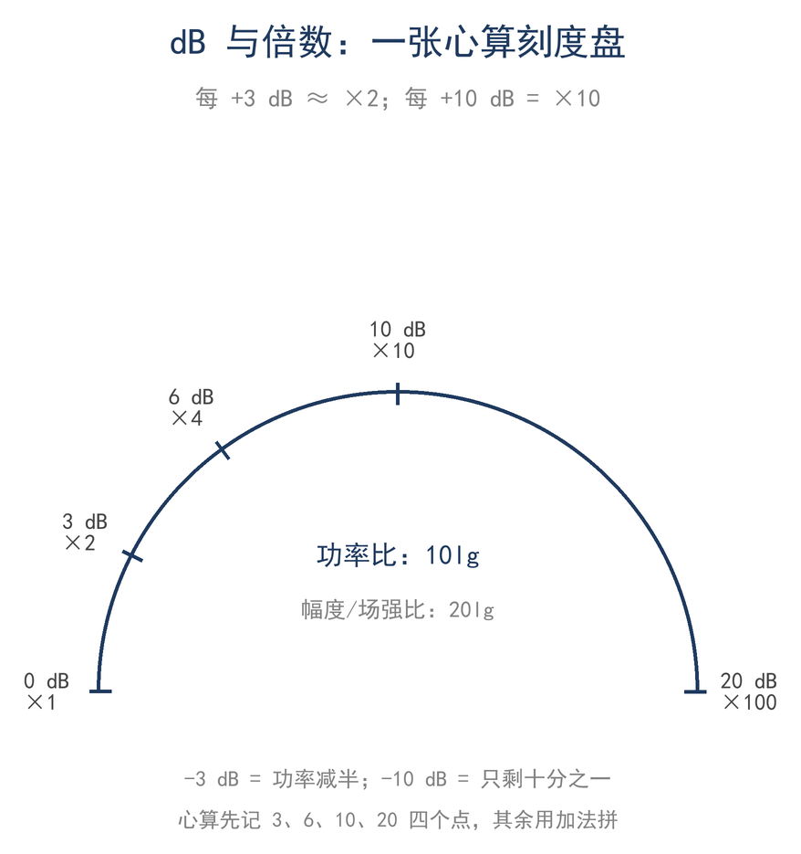
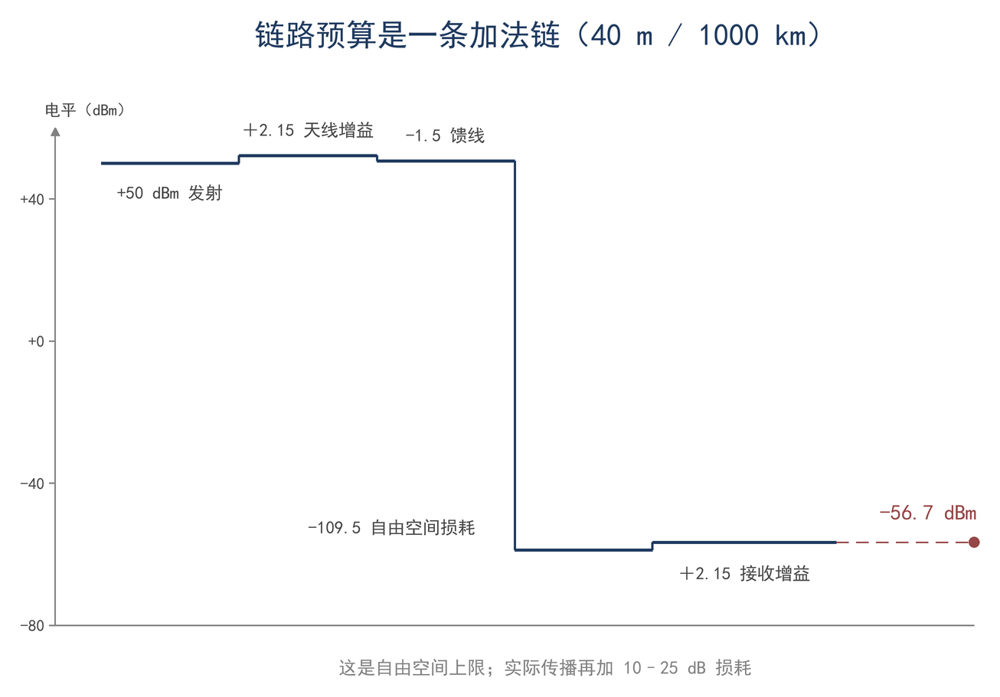

# 第 2 章 dB 的语言：对数、比值与链路预算

> **这一章会用到**：第 1 章的科学记数法与单位链。

> **读完本章能多懂什么**：会在倍数与 dB 之间换算，会在 dBm、dBW、dBμV 之间换算，会把一条链路写成加法表并估出接收功率的数量级。

## 一、S 表为什么按"格"读

夜间在 40 米波段工作时，对方报告信号为 S7；减小 RF gain 后，表针落到 S5，更换馈线后读数仍为 S7。这个"格"对应多少功率，需要从 S 表的刻度方式说起。

S 表采用对数刻度。若按线性刻度绘制，从 S1 到 S9 的接收功率相差上万倍：强信号占满刻度右端，弱信号集中在左端很小的范围内，无法在同一表盘上分辨。对数刻度使等宽的格对应相等的倍数，S 表、功率计、场强仪和频谱仪的纵轴都采用这一方式。

由此，表针移动一格表示功率乘以某个倍数，而不是增加固定的微伏数。不同机器的校准点不同，同一副天线的读数可能相差一格，因此不同设备的格数不能直接比较。要把读数变为可比较的量，须先校准，再换算为 dBm 或 μV，并同时记录频率、天线与仪器条件；只写一个格数，事后无法判断其对应的功率。本章讨论 dB 的计算、换算与相加。

## 二、指数与对数：把乘法变加法

链路是串联的：功率从发射机输出后，依次经过天调、馈线和天线等环节，每个环节都使功率按比例增减。若直接用倍数连乘，计算步骤多，更换一个环节就要全部重算。

对数把乘法变为加法。设两个功率之比等于 10 的 L 次方，

$$ P_2/P_1 = 10^L $$

则指数 L 称为该比值的分贝数（F2-1）：

$$ L = 10lg(P_2/P_1) $$

式中 lg 为以 10 为底的常用对数，P₂、P₁ 为同类功率，L 的单位为 dB。比值 1 对应 0 dB，十倍对应 10 dB，百倍对应 20 dB。乘一个倍数等于加一段 dB，除一个倍数等于减一段 dB，因此整条链路的增益与损耗可逐段换算后相加，顺序不影响结果。若某一环节算错，只需检查对应的那一段加减，无需重算整条链路。

例如，功率先放大 6 dB、再损耗 3 dB，净变化为 +3 dB，约为原功率的两倍。若用倍数计算，需要先乘 4 再乘 0.5；用 dB 只需一次加法。用 dB 表示后，各环节数值可以直接相加或相减，无需先换算为倍数，环节较多时尤为方便。

每 10 dB 对应一个十进制数量级，因此动态范围、前后比等大范围比值可以用两三位数表示。适用条件为：功率必须为正；dB 是比值，不带单位；两个 dB 相加对应两个倍数相乘。

对数尺度还使小信号与大信号可以在同一坐标系中比较。线性坐标下，微弱信号的变化往往无法显示；对数坐标下，相同的倍数变化对应相同的间距，因而适合描述跨数量级的功率关系。这一性质是 dB 成为射频工程通用表达方式的原因之一。

## 三、10lg 与 20lg：功率比和幅度比

同一个"dB"，为什么有时用 10lg，有时用 20lg？

dB 的定义建立在功率比上。对同一阻抗 R，功率为 P=V²/R；把电压比代入功率比，平方项会出现在对数之前。

> **【推导】20lg 从哪来**
>
> 同一阻抗上 P=V²/R，所以 P₂/P₁=V₂²/V₁²；取对数，平方变成系数 2，10lg 就写成 20lg。这一步只用到"功率正比于电压平方"，不涉及其他假设。

因此，功率比用 10lg，同一阻抗下的电压比、电流比和场强比用 20lg，定义见 F2-2：

$$ L = 20lg(V_2/V_1) $$

式中 V₂、V₁ 为同一阻抗上的电压（或电流、场强），L 仍以 dB 为单位。若两个电压不在同一阻抗上，20lg 给出的不再是功率比，必须先用 V²/R 换算成功率比再计算。两个不同阻抗的系统直接比较电压并套用 20lg，结果会产生偏差。

10 和 20 并非两套 dB，而是同一个定义在两种量上的写法。检验方法是把幅度比平方后再用 10lg 计算，结果应当相同。看到 6 dB 时应先确认对象是功率还是幅度：在功率上是四倍，在电压上是两倍。dB 只定义在功率比上，电压、电流、场强的 dB 都是先换算成功率再套定义，20lg 只是把平方提前算掉的简写。因此，功率比始终用 10lg，只有同一阻抗下的幅度比才能用 20lg 代替；不同阻抗之间应先换算成功率，再取 10lg。

当 x 较小时，有近似式 10lg(1+x)≈4.34x。反射系数只有几个百分点时，失配损耗只有零点几 dB（第 8 章给出计算）。该近似把百分比与 dB 直接对应，可用于判断小失配是否需要处理。

20lg 也用于信噪比与场强。同一阻抗上，电压信噪比与功率信噪比相差一个平方；场强以 dBμV/m 表示时同样采用 20lg，场强翻倍对应功率密度翻四倍。两种说法并不矛盾，但须说明比较的是电压还是功率。

使用 20lg 的前提是阻抗相同。若阻抗不同，电压比不能直接换算为功率比，应先用 P=V²/R 把两端折算到同一功率基准再比较。实际测量中电压表读数与功率计读数能够互相核对，正是因为测量点处于同一阻抗系统。设同一功率作用于 50 Ω 与 75 Ω 两种系统，对应的电压并不相同；若把两个电压读数直接按 20lg 比较，会得到并不存在的增益或损耗。正确做法是先将两端各自折算为功率，再按 10lg 比较。若系统阻抗改变，同一功率对应的电压随之改变，dBm 与 dBμV 之间的差值也会改变，这一点在 第四节中给出。

## 四、基准量：dBm、dBW、dBμV、dBi/dBd

dB 只表示两个量之比，因此写成 dB 时必须说明基准。工程上把基准写进单位：dBm 相对于 1 mW，dBW 相对于 1 W，dBμV 相对于 1 μV，dBi/dBd 相对于两种天线。

最常用的是 dBm（F2-3）：

$$ L(dBm) = 10lg(P / 1 mW) $$

0 dBm 对应 1 mW，30 dBm 对应 1 W。以这两个值为基准，其余可按每 10 dB 一个数量级推算。dBW 以 1 W 为基准，常见于大功率计算；0 dBW 等于 30 dBm。dBW 与 dBm 的换算只改变基准，不涉及阻抗，因此大功率数值常用 dBW 表示。

dBμV 以电压为基准：0 dBμV 对应 1 μV。接收机灵敏度常用 μV 表示，换算为 dBm 需要知道阻抗。50 Ω 纯电阻负载下存在固定关系（F2-4）：

$$ L(dBμV) = L(dBm) + 107 $$

该常数的来源见下面的推导框。

> **【推导】107 从哪来**
>
> 1 μV 加在 50 Ω 上，功率是 (10⁻⁶)²/50 = 2×10⁻¹⁴ W，即 −107 dBm。所以 0 dBμV 对应 −107 dBm，107 这个常数由这一行算术给出。换一种阻抗，常数就变：75 Ω 系统约 109。

该关系以 50 Ω 纯电阻负载为条件。换基准前应确认系统阻抗，不能将 107 视为通用常数。检验方法是用 P=V²/R 回算：0 dBm 为 1 mW，在 50 Ω 上对应 107 dBμV，与 dBm 的差值正好抵消。

基准为读数提供参考面。dBm 是绝对功率，不随位置改变；dBμV 是电压，只在指定阻抗下才能折算为 dBm；dBi 和 dBd 是同一副天线的两种标法，相差一个固定常数。记录时基准与数值应一并写出，仅写一个 dB 数没有意义。基准量之间不能直接相加；不同基准的数值须先换算到同一基准，才能比较或合并。

**表 2-1 常用基准与换算**

| 写法 | 基准 | 关键换算 | 典型用途 |
|---|---|---|---|
| dBm | 1 mW | 0 dBm=1 mW；30 dBm=1 W；50 dBm=100 W | 发射功率、接收功率 |
| dBW | 1 W | 0 dBW=30 dBm | 大功率、场强计算 |
| dBμV | 1 μV | 50 Ω 下 dBμV=dBm+107 | 灵敏度、场强 |
| dBi / dBd | 各向同性 / 半波偶极 | 两者差 2.15 dB | 天线增益 |

天线增益必须说明参考天线。dBi 以各向同性点源为参考，dBd 以半波偶极为参考；同一副天线的两种写法相差一个固定常数，第 9 章从同一个积分给出该常数。混用 dBi 和 dBd 比较两副天线，相当于用两种基准量同一对象。部分产品资料将 dBd 换算为 dBi 后标注，数值看似增大，天线本身并未改变。

dB 与 dBm 不能混用。"增益 30 dB"与"功率 30 dBm"含义不同；"接收 −70 dB"缺少基准，无法解释。dB 只表示两个量之比，记录时应写明基准。

记录测量结果时，应同时写明数值、单位与条件。例如接收功率 −70 dBm、频率 7.1 MHz、天线为半波偶极，比只写 S 表格数或只写一个 dB 数值更有参考价值。条件缺失时，同一个数值可能对应不同含义。dBm 与 dBW 只相差一个固定常数，因为 1 W 等于 1000 mW；dBμV 与 dBm 的换算则必须给定阻抗。

## 五、心算表与反向换算

多数换算可归结为两个基准值：3 dB 对应两倍，10 dB 对应十倍。**表 2-2** 给出常用档位。

**表 2-2 dB 与倍数（功率比、同阻抗电压比）**

| dB | 功率比 | 电压比（同阻抗） |
|---|---|---|
| 0 | 1.00 | 1.00 |
| 1 | 1.26 | 1.12 |
| 2 | 1.58 | 1.26 |
| 3 | 2.00 | 1.41 |
| 4 | 2.51 | 1.58 |
| 5 | 3.16 | 1.78 |
| 6 | 3.98 | 2.00 |
| 7 | 5.01 | 2.24 |
| 8 | 6.31 | 2.51 |
| 9 | 7.94 | 2.82 |
| 10 | 10.0 | 3.16 |

三个基准点为：3 dB 翻倍、10 dB 十倍、20 dB 百倍。其余数值可用加法拆分，例如 13 dB 拆为 10 dB 与 3 dB，对应二十倍；17 dB 拆为 20 dB 减 3 dB，对应五十倍。表中功率比按 10lg 计算，电压比按 20lg 计算，电压比只在同一阻抗下等价于功率比。

拆分的基本方法是将任意 dB 值写成 10 dB、3 dB 与其他小量的组合。例如 7 dB 可拆为 10 dB 减 3 dB，对应五倍；23 dB 可拆为 20 dB 加 3 dB，对应二百倍。拆分只需保证 dB 的加减关系与倍数的乘除关系一致。

反向换算按指数关系进行：由 dB 求倍数，取 10 的（L/10）次方；由功率求 dBm，先将功率写成 mW 再取对数。例如 5 W 等于 5000 mW，10lg5000 得 37 dBm。换算时应先回到功率或电压的比值，再作指数运算；不同基准的 dB 值不宜在 dB 层直接相加减。

如图 2-1，将几个基准点标在刻度轴上，换算时先取最近的基准点，再按较小的 dB 数修正。

工程图常采用半对数坐标：横轴取对数后，乘法变为加法，指数曲线变为直线。绘制时把横轴设为对数轴即可。心算近似在 dB 值较小时误差较小，超过 10 dB 时宜用表或计算器；需要精确到 0.1 dB 时直接计算。

换算表与坐标图是同一关系的两种表示。实际使用时可先由表定位，再用加法修正；两种方法得到的结果应当一致，可互相核对。心算结果用于判断量级与方向，精确值仍由计算器给出。

## 六、链路预算是一条加法链

将发射机到接收机之间各环节的增益与损耗写成 dB 并依次相加，即得到链路预算。链路预算回答的问题是：给定发射功率，到达接收端还剩多少功率。

链路预算的写法为：发射功率（dBm）加发射天线增益（dBi），减发射馈线损耗（dB），减路径损耗（dB），加接收天线增益（dBi），再减接收馈线损耗（dB），得到接收功率（dBm）。所有项均为 dB，可直接加减，顺序不影响结果。对数的作用是把整条链路的乘除转化为一张加法表。

列预算表时，每一行只放一个环节，并注明其条件：增益写 dBi，损耗写 dB，功率写 dBm。增益与损耗在表中是同一类量，只是一加一减。逐行相加后，最大项与最不确定项均可看出，改动某个器件后的预期收益也可以估算。

各环节统一用 dB 表示后，串联链路的计算变为加法：总增益等于各增益之和，总损耗等于各损耗之和。若链路中增益与损耗交替出现，仍按代数和计算，顺序不影响结果。这一性质使链路预算可以用表格逐行完成。

路径损耗中最大的一项是自由空间损耗，其工具式为（F2-5）：

$$ L_fs = 32.45 + 20lg f(MHz) + 20lg d(km) $$

式中 f 为频率（MHz），d 为距离（km）；32.45 是光速、单位换算与 4π 合并后的常数。适用条件为自由空间、远场、收发天线对准、无地面反射与遮挡。该式在此仅作工具使用，推导见第 15 章。

> **【推导】自由空间损耗为什么是 20lg**
>
> 各向同性天线在距离 d 处的功率密度是 P/(4πd²)；接收天线的有效面积正比于 λ²，比例里带着 G。把两件事合起来，接收功率比是 (λ/(4πd))²。取 10lg 得 20lg(λ/4πd)，把 λ=300/f 代进去、频率换成 MHz、距离换成 km，常数合并即得 32.45。所以公式里的两个 20lg，一个是频率、一个是距离，都是平方关系跑到对数前面造成的。

自由空间损耗并非由介质吸收造成。自由空间中没有吸收，损耗来自几何：能量分布在不断扩大的球面上，功率密度按距离平方下降；同时接收天线的有效面积与波长平方成正比，频率越高，面积越小。因此距离翻倍加 6 dB，频率翻倍也加 6 dB，两个平方关系对应两个 20lg。大气吸收、电离层吸收与地面反射是另外几项，第 15 章分别计算。

**表 2-3 40 m 波段、1000 km 的链路预算**

| 环节 | 数值 | 说明 |
|---|---|---|
| 发射功率 | +50 dBm | 100 W |
| 发射天线增益 | +2.15 dBi | 半波偶极，来历见第 9 章 |
| 收发馈线合计 | −1.5 dB | 十几米细同轴，两端合计典型值 |
| 自由空间损耗 | −109.5 dB | 7.1 MHz、1000 km |
| 接收天线增益 | +2.15 dBi | 同上 |
| 小计（自由空间上限） | −56.7 dBm | 还没算传播与地面 |
| 电离层、地面、极化 | −13 dB | 估计值，第 15 章拆开 |
| 接收功率 | −69.7 dBm | 约 −70 dBm |

如图 2-2，将表中各环节画成瀑布图：从发射功率出发逐行相加，最终得到接收功率；最长的一段对应最大的一项。

表中最大的一项为自由空间损耗，距离翻倍需再加 6 dB。馈线损耗数值较小，但最容易控制，更换粗线可减少一部分损耗。传播项为估计值，是整张表中不确定性最大的一项，条件变化时可相差十几 dB。

级联规则为：增益相加，损耗相减。两级放大器的增益直接相加，中间串接的滤波器与电缆按损耗扣除。此处只计算增益；噪声与失真不能按此方式简单相加，第 13 章讨论噪声系数。

该加法链有明确边界：近场、地面反射明显、存在遮挡、天线未对准或为电离层路径时，自由空间损耗公式只给出下限或参考值，实际情况需要测量或建模（第 17 章）。预算表的作用是判断哪一项最大、哪一项应优先改进：某一环节的损耗远大于其他环节时，该项即为改进重点；各环节数值相近时，单独改动一项的收益有限。

预算表要求每一行都有数值、条件与出处。缺少出处的数字应查证后再填，不应先填估计值。表应随器件与距离的改动而更新，其价值在于可核对，而非给出绝对数值。

## 七、算例与误区

**算例 1（估算级）**

40 米波段、7.1 MHz、100 W、收发都是半波偶极、距离 1000 km，先按自由空间算上限：

$$ 50 + 2.15 + 2.15 − 1.5 − 109.5 = −56.7 dBm $$

即不考虑传播、地面和极化时，接收端最多约 −57 dBm。实际天波路径还要再扣 10–25 dB：

- 乐观：扣 10 dB → −67 dBm；
- 中间：扣 13 dB → 约 −70 dBm；
- 悲观：扣 25 dB → −82 dBm。

数量级检查：−70 dBm 是 10⁻¹⁰ W，即 100 pW。100 W 出去收到 100 pW，总衰减约 120 dB；其中自由空间约 110 dB、馈线 1.5 dB、传播约 13 dB，天线增益补回约 4.3 dB，合起来约 120 dB，各分项之和与总衰减一致。该检查可发现单位或 10lg/20lg 用错：如果算完发现"100 W 出去收到 1 μW"，则上述分项无法相加得到 120 dB。

**算例 2（精确级）**

条件：50 μW、50 Ω 纯电阻，写成 dBm、电压和 dBμV 三种读数。公式：L(dBm)=10lg(P/1 mW)，V=√(PR)，L(dBμV)=L(dBm)+107。代入：P=0.05 mW，10lg0.05≈−13.0 dBm；V=√(50×10⁻⁶×50)=0.05 V；−13.0+107=94 dBμV。结果：−13.0 dBm、50 mV、94 dBμV。适用：三个数只在 50 Ω 下等价；换阻抗后 107 不成立，dBm 与 dBμV 不能混写。

**三个误区**

1. **把 dB 的加法当成倍数的加法。** 一条链路有两处 3 dB 损耗，合起来是 6 dB，这没错；但把"6 dB"等同于"6 倍"则错误，6 dB 是 4 倍。错在把 dB 的加法直接套用到了倍数上；dB 相加，等于倍数相乘。

2. **电压比用 10lg。** 电压翻倍，有人算成 3 dB，实际是 6 dB（20lg2）。错在把功率的公式套到了电压上；同一阻抗下，功率比与电压比差一个平方。反过来，把功率比用 20lg 也会把损耗算大一倍。

3. **dBm 与 dB 混用，或者丢掉基准。** "增益 30 dBm"是把比值说成了绝对功率；"收到 −70 dB"则没说是相对 1 mW 还是 1 μV。错在 dB 只表示"两个量之比"，一定要带基准；记录时应写明单位为 dBm。

## 八、小结

> **只记一个关系**
>
> dB 是比值：功率比用 10lg，同阻抗的电压比用 20lg；dB 相加，等于倍数相乘。

> **一组数**
>
> 3 dB=2 倍，6 dB=4 倍，10 dB=10 倍，20 dB=100 倍；0 dBm=1 mW，30 dBm=1 W，50 dBm=100 W；50 Ω 下 dBμV=dBm+107；40 m/1000 km 的自由空间损耗约 109.5 dB。

> **一个适用条件**
>
> 20lg 只在同一阻抗下才是功率比；自由空间损耗公式只在远场、无遮挡、天线对准时成立。

自检三问：

1. 功率 100 W 变 400 W 是几 dB？电压翻倍是几 dB？两者为什么不同？
2. 50 Ω 下 0 dBμV 等于多少 dBm？−13 dBm 又等于多少 μV？
3. 40 m 波段、1000 km 的自由空间损耗约多少 dB？为什么实际链路还要再加 10–25 dB？

习题（答案见附录 D）：

1. ★ 把 3 dB、7 dB、13 dB、23 dB 换成倍数；把 2 倍、10 倍、100 倍换成 dB。
2. ★ 把 2 W、0.5 W、5 mW 换成 dBm；把 −10 dBm、−20 dBm 换成瓦；把 −14 dBμV 换成 dBm（50 Ω）。
3. ★★ 40 m/1000 km：发射 50 dBm，收发偶极各 2.15 dBi，馈线共 1.5 dB，求自由空间接收功率；距离改成 2000 km 时，接收功率变多少？
4. ★★ 一部接收机灵敏度写 0.2 μV（50 Ω），另一部写 −120 dBm。谁更灵敏？差几 dB？
5. ★★★ 用电子表格或 Python 画一条 40 m/1000 km 链路预算瀑布图，标出最大的一项；再把传播损耗从 13 dB 改成 20 dB，看接收功率变化，并解释变化量相当于功率的几倍。
