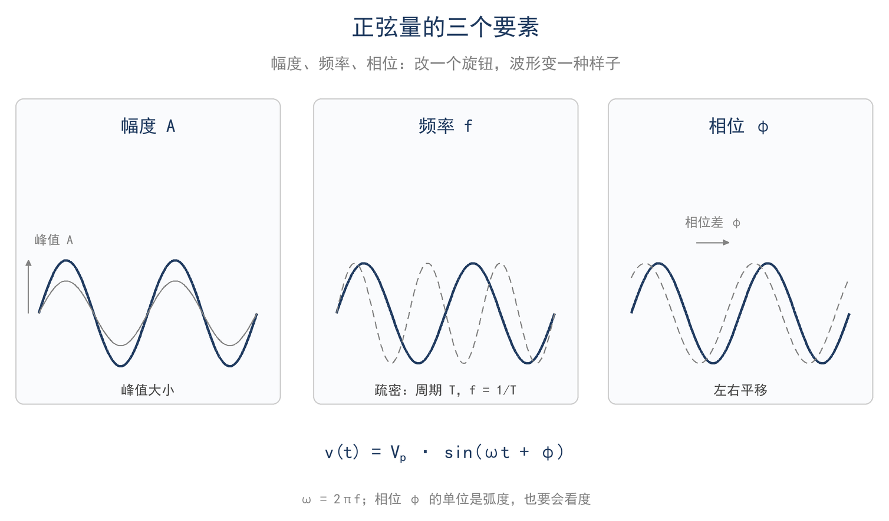
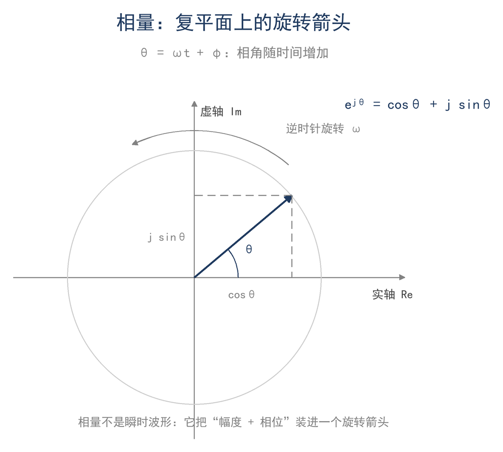
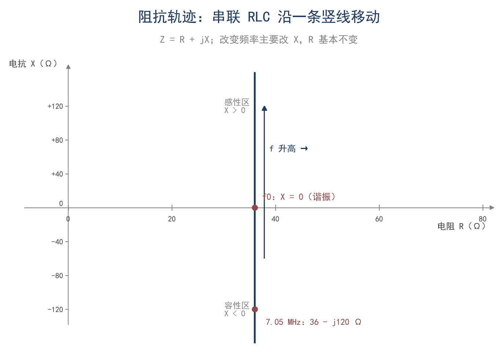

# 第 3 章 j 是什么：交流电的写法

> **这一章会用到**：第 1 章的单位链、第 2 章的 dB。

## 一、天线分析仪上的负号

7.05 MHz 时，天线分析仪将一副缩短的 40 m 垂直天线读为 36 − j120 Ω。该读数包含两个部分：实部与虚部。实部为电阻项，虚部为电抗项。负号的来源需要说明：电阻项本身并不为负。

负号属于电抗 X。X 的单位同样为 Ω，但电抗不消耗平均功率。−120 Ω 表示该频率上天线呈容性，等效于一只 120 Ω 的电容，其两端电压滞后电流 90°。天线短于谐振长度时呈容性；若读数为 +j120 Ω，则天线偏长，呈感性。分析仪同时给出实部与虚部，可以直接判断天线偏短或偏长以及偏差大小。

采用复数表示的原因在于，单频稳态下电压与电流除大小外还有相位差。一个实数只能表示幅度之比，无法同时表示相位；复数包含两个分量，其运算规则对应幅度的加减与相位的旋转。分析仪内部完成电压与电流相量之比，并把商拆成实部与虚部；若只记录幅度，无法判断天线呈容性或感性，也无法确定应串联电感还是电容。

不同分析仪的显示方式不同，有的给出 R 与 X，有的给出 |Z| 与相角，有的只给出 SWR。三者描述同一对象的不同表示：|Z| 与相角为极坐标，R 与 X 为直角坐标，SWR 只反映 |Γ| 的模。读取时应先看虚部符号，再比较虚部与实部的量级；实部中辐射电阻与损耗电阻的划分需另行确定（第 9 章）。

j 为虚数单位 √−1。电学中不用 i，是因为 i 已表示电流。a + jb 中 a 为实部，b 为虚部。

## 二、正弦三要素：幅度、频率、相位

单频稳态下，电压为正弦波，写成（F3-1）：

$$ v(t) = V_p sin(ωt + φ)，ω = 2πf $$

V_p 为峰值（V），ω 为角频率（rad/s），f 为频率（Hz），φ 为初相（rad），t 为时间（s）。适用条件为频率单一、幅度不随时间变化，即稳态。按键与开关动作的瞬间不属于稳态。

三个参数分别描述幅度、频率与初相。相位是同一频率的两个信号之间的相对量，单独一个信号的相位值没有意义。7.05 MHz 的周期约 142 ns，90° 相位差对应四分之一周期，约 35 ns。周期与相位差的关系可用于判断两个同频信号的时间先后。

相位差决定平均功率。电压与电流同相时，平均功率等于两者有效值之积；相差 90° 时，乘积在正负之间交替，平均功率为零，能量只在电源与电抗元件之间往复交换。功率因数即相位差的余弦；射频电路中通常不用功率因数，而用阻抗的实部与虚部分别表示消耗与交换。

幅度有三种口径：峰值 V_p、峰峰值 2V_p、有效值 V_rms。示波器通常读峰值或峰峰值，功率计、dBm 与天线分析仪内部使用有效值。正弦的峰值与有效值相差 √2（F3-2）：

$$ V_rms = V_p / √2 ≈ 0.707 V_p，P = V_rms² / R $$

V_rms 为有效值（V），R 为纯电阻（Ω），P 为平均功率（W）。该关系只对正弦成立，方波、键控包络与噪声不能套用正弦的峰值系数。市电的有效值为 220 V，峰值约 311 V；绝缘与电容耐压按峰值考虑。

如图 3-1，三个参数画在同一张图上，同时标出峰值与有效值的差别。

## 三、复数：直角坐标与极坐标

一个复数由两个实数组成：a + jb。在复平面上，横轴为实部，纵轴为虚部，该数对应平面上的一个点，也可视为从原点指向该点的箭头。同一复数有两种写法：直角坐标 a + jb 与极坐标 A∠φ。换算关系为 A = √(a² + b²)，φ = arctan(b/a)。arctan 只给出 ±90° 范围内的值，还需根据 a、b 的符号修正到正确象限。

极坐标便于乘除运算：两复数相乘，模相乘、角相加；相除则模相除、角相减。复数运算的基本规则为 j² = −1，代入即化简。乘以 j 相当于把箭头逆时针旋转 90°，该性质在相量分析中反复使用。乘除的几何意义是模的伸缩与角的旋转，这一性质也可用于作图检验。

复数除法可用复共轭完成。Z 的共轭为 Z* = a − jb，Z·Z* = a² + b² = |Z|²；分子分母同乘分母的共轭即可将分母变为实数。这是手算 V/I 的常用方法。复数没有大小顺序，比较时应分别比较模、实部或相角。两阻抗并联时，用导纳相加可以避免复数除法；串联时则直接相加实部与虚部。两种形式应回到同一复数值，可据此核对计算。

最常见的除法是 V/I：电压相量除以电流相量，商为阻抗相量。上述读数可解释为：加 1 A 有效值电流时，两端电压为同一个复数量，相位比电流滞后约 73°。这一表示把两个读数与电压、电流的相位关系联系起来。

表 3-1 列出几个常用特殊角，匹配网络中最常用的是 45° 与 90°。

**表 3-1 特殊角的正弦、余弦与复指数**

| θ | 0° | 30° | 45° | 60° | 90° |
|---|---|---|---|---|---|
| sin θ | 0 | 0.5 | 0.707 | 0.866 | 1 |
| cos θ | 1 | 0.866 | 0.707 | 0.5 | 0 |
| e^(jθ) | 1 | 0.866 + j0.5 | 0.707 + j0.707 | 0.5 + j0.866 | j |

## 四、欧拉公式与相量：旋转的箭头

将单位圆上的点写成复数，得到欧拉公式（F3-3）：

$$ e^(jθ) = cos θ + j sin θ $$

θ 为弧度（rad），e 为自然对数的底。该式表明，复指数对应单位圆上的一个点；乘以 e^(jθ) 相当于把箭头逆时针旋转 θ。θ = ωt 时，箭头以角速度 ω 匀速旋转，旋转一周的时间为一个周期，如图 3-2。

正弦的幅度与初相可以提取出来，写为复数 V = V_rms∠φ，称为相量（phasor）。完整波形为 v(t) = Im(√2 V e^(jωt))。取虚部是因为本书以正弦为参考，而 e^(jωt) 这一旋转因子在所有同频信号中相同，列方程时可以直接省略。省略后，对 √2 V e^(jωt) 求时间导数相当于乘 jω，因此相量域中 d/dt 对应乘 jω。该关系是第 4 章 v = L·di/dt 的写法来源，也是第 5 章微分方程的入口。

相量的乘除同样有用：两相量相乘，幅度相乘、相位相加。分压、放大器增益与馈线相移在相量域中均为乘法；电压除以电流得到阻抗，为相量除法。天线分析仪完成的正是这一除法，并把商拆成 R 与 X 两个实数显示。采用相量表示后，同频信号的相位关系转化为复数的角，幅度关系转化为模；相量只描述稳态，不描述建立过程，频率改变或幅度突变时需要重新计算。

本书的相量默认采用有效值，即 V 对应 V_rms。采用有效值相量时，纯电阻上的平均功率为 P = |V|²/R；若采用峰值相量，计算功率还需除以 2。功率计、场强表与电压表的读数通常为有效值，示波器例外。记录时应注明所采用的量；按不同口径记录同一相量，功率计算结果相差一倍。

## 五、阻抗与导纳：Z = R + jX

电压与电流均为相量，其比值为复数，称为阻抗（impedance）（F3-4）：

$$ Z = R + jX，X = ωL − 1/(ωC) $$

R 为电阻（Ω），X 为电抗（Ω），L 为电感（H），C 为电容（F）。适用条件为线性元件、单频稳态、串联组合；L 与 C 不随电压、电流变化。

该式来自三种元件各自的电压电流相位关系，列于表 3-2。电阻上电压与电流同相，比值为实数 R；电感上电压超前电流 90°，阻抗为 jωL；电容上电压滞后电流 90°，阻抗为 −j/(ωC)。三个元件串联时，电阻部分相加得 R，电抗部分相加得 X。第 4 章将用 v = L·di/dt 与 i = C·dv/dt 重新给出这两个相位关系，此处先将其作为已知结论使用。电抗的正负与元件性质一一对应：电感使电压超前电流，故 X 为正；电容使电压滞后电流，故 X 为负。串联电路中感抗与容抗直接相减，二者相等时电抗为零，电路呈纯电阻性。

**表 3-2 三种元件的阻抗与相位**

| 元件 | 阻抗 | 电压与电流的相位 |
|---|---|---|
| 电阻 R | R | 同相 |
| 电感 L | jωL | 电压超前 90° |
| 电容 C | −j/(ωC) | 电压滞后 90° |

阻抗的模与角分别为 |Z| = √(R² + X²)，∠Z = arctan(X/R)，同样需要判断象限。X 的符号直接决定性质：X > 0 为感性，X < 0 为容性，X = 0 为谐振。分析仪扫频时分别给出 R 与 X；X 从负变正穿过零点，表示天线由偏短经谐振变为偏长。谐振附近 X 的斜率较大、R 的斜率较小，因此通常先用 X 确定谐振点，再根据 R 判断匹配。实部与虚部分开显示，正是为了分别处理幅度与相位这两类信息。阻抗的模反映电压与电流幅度之比，阻抗的角反映二者的相位差；两项合起来才能完整描述端口特性。

串并联计算与电阻电路相同，只是数值为复数：串联 Z = Z₁ + Z₂；并联采用导纳 Y = 1/Z = G + jB，Y = Y₁ + Y₂。两条支路并联也可写为 Z_p = Z₁Z₂/(Z₁ + Z₂)。导纳的实部 G 为电导，虚部 B 为电纳；容性负载的 B 为正，与 X 的符号相反。并联时实部与虚部会同时改变，不能认为并联电容只影响虚部。

将电感、电容与电阻串联，令频率由低到高变化，阻抗在复平面上的轨迹为一条竖直线：实部保持不变，虚部随频率由负穿过零变为正，如图 3-3。

## 六、相量法算电路：低通、分压与谐振

相量法能把微分方程化为代数方程，其成立条件为单频稳态与线性时不变系统。单频意味着所有电压、电流含有相同的 e^(jωt) 因子，该因子可在方程两边约去，只余幅度与相位；线性意味着叠加与比例关系成立，不产生新的频率成分。满足这两个条件时，d/dt 对应乘 jω，积分对应除以 jω，含 L、C 的微分方程转化为相量的代数式，可直接用四则运算求解。条件不满足时不能使用相量法：按键瞬态、方波与多频信号、饱和非线性元件都会破坏"同一频率、同一旋转因子"的前提，需要回到时域，或把信号分解为多个频率分别处理。相量法的价值在于把微分关系转化为代数关系：电感与电容的电压电流关系原本包含导数与积分，转换为相量后只包含乘除，电路分析因而可以使用与电阻电路相同的方法。

串联分压公式与电阻分压形式相同，只需将 R 换成复阻抗 Z：V_out = V_in·Z₂/(Z₁ + Z₂)。用于 RC 低通时，Z₁ = R，Z₂ = 1/(jωC)，于是

V_out / V_in = 1/(1 + jωRC)

其模与角分别为 |H| = 1/√(1 + (f/f_c)²) 与 ∠H = −arctan(f/f_c)，其中 f_c = 1/(2πRC)。取 R = 1 kΩ、C = 100 pF，截止频率 f_c = 1.59 MHz。在 7.05 MHz 处，幅度降到 0.220，即衰减 −13.2 dB，相移 −77°。该结果表明，电阻与小电容组成的低通即可对 40 m 波段信号产生明显衰减；频率远低于 f_c 时，|H| ≈ 1、相移 ≈ 0。低通的衰减与相移来自容抗随频率下降：频率升高时容抗减小，输出电压降低，同时相位滞后于输入。幅频与相频是同一电路的两个侧面，分析时不能只注意幅度。

串联谐振时，Z = R + j(ωL − 1/(ωC))，电抗为零，电流最大，I = V/R。电感与电容上的电压可以高于源电压 Q 倍。由 I = V/R 得 V_L = X_L·I = (X_L/R)·V，而 X_L/R 即 Q。取 L = 1 μH、C = 100 pF，谐振频率为 15.9 MHz；此时电抗约 100 Ω，电阻 10 Ω，Q = 10。源电压为 10 V 有效值时，电感两端电压约 100 V。此现象并非放大，而是能量在 L 与 C 之间往复交换，使元件上的电压高于源电压。第 5 章将给出其方程描述。

并联回路的性质与串联回路相对应：L 与 C 并联时，谐振点附近阻抗最大，电流在 L 与 C 之间循环，电源只需补充损耗。接收机中频回路与天调谐振回路常采用这种接法，因为其对谐振频率呈高阻，对偏离频率呈低阻。串联回路则常用于陷波或阻抗变换，两种接法的选择取决于所需的频率特性。

天线分析仪的读数可据此解释：扫频时 X = 0 对应谐振点，此时的 R 为谐振电阻。若 R 偏离 50 Ω 较远，说明还需要匹配（第 8 章）；若 X 在整个波段均为负，说明天线偏短，需要加感或加长。扫频结果可逐点对应到上述模型：X 随频率的变化由 L、C 决定，R 的变化反映损耗与辐射。

## 七、算例与误区

**算例 1（估算级）**：7.05 MHz 上，1 μH、1 pF、100 pF 的电抗各是多少？

先算角频率：ω = 2π × 7.05 × 10⁶ = 4.43 × 10⁷ rad/s。

1 μH：X_L = ωL = 4.43 × 10⁷ × 1 × 10⁻⁶ = 44.3 Ω。
1 pF：X_C = 1/(ωC) = 1/(4.43 × 10⁷ × 1 × 10⁻¹²) = 22.6 kΩ。
100 pF：X_C = 1/(4.43 × 10⁷ × 100 × 10⁻¹²) = 226 Ω。

量级检查：容抗与电容成反比，1 pF 到 100 pF 电容差 100 倍，容抗也差 100 倍，22.6 kΩ 除以 226 Ω 等于 100，对得上。

结论：40 m 波段上，μH 级电感只有几十欧，pF 级电容却有几十千欧。所以 HF 的调谐电路用电感在 μH 级、电容在几十到几百 pF；也所以 1 pF 的杂散电容在 7 MHz 可以忽略，到 145 MHz 就只有约 1.1 kΩ，VHF 的布局必须短。估算时先算 ω，再把 L 或 C 代进去，这个顺序能避免单位错：ω 的单位是 rad/s，L 用 H、C 用 F，出来的才是 Ω。

**算例 2（精确级）**：把 36 − j120 Ω 变成一只串联元件。

条件：7.05 MHz 上 Z = 36 − j120 Ω，虚部为负，呈容性，需串电感补偿。公式：补偿电抗 X_L = 120 Ω，由 X_L = ωL 得 L = X_L/ω。代入关键值：ω = 2π×7.05×10⁶ ≈ 4.43×10⁷ rad/s，L = 120/(4.43×10⁷) ≈ 2.71×10⁻⁶ H = 2.71 μH。结果：串入 2.71 μH 后 Z = 36 + j0 Ω，电抗抵消；复核 ωL ≈ 120.0 Ω。适用条件：只在 7.05 MHz 附近成立；电抗归零不等于匹配，实部 36 Ω 仍需第 8 章处理。

**误区 1：把 j 当成普通字母，或者把复数当实数比大小。** 错在忘了 j² = −1，也错在把二维的东西压成一维。复数没有大小顺序；读阻抗要分开读 |Z| 和 ∠Z。还有一处是 arctan 不判象限：−36 − j120 Ω 如果只按 b/a 算会得到 +73°，正确角度是 −107°（第三象限），差了 180°，匹配方向就全反了。

**误区 2：把相量当成瞬时波形。** 相量只保留幅度和相位，旋转因子 e^(jωt) 被省掉了；相量本身不随时间变，画图时箭头转是为了帮助理解，计算时它不转。看到相量就想到"某个时刻的电压值"，会把"乘 j 表示相位提前 90°"误解成"电压在 y 轴上"。

**误区 3：RMS 与峰值混用。** 把 100 V 峰值当成有效值去算 50 Ω 上的功率，会得到 200 W，实际是 100 W；反过来把功率计的读数当峰值，会把电压估低 √2 倍。另外，计算器的 DEG/RAD 混用也归到这一条：30° 在 RAD 模式下被当成 30 rad，结果完全不对。

## 八、小结

> **只记一个关系**
>
> 正弦量可以写成一个复数相量；阻抗是电压相量与电流相量之比，Z = R + jX。实部是消耗功率的部分，虚部只决定电压与电流的相位差。

> **一组数**
>
> 7.05 MHz 下 1 μH 约 44 Ω、1 pF 约 23 kΩ、100 pF 约 226 Ω；36 − j120 Ω 的模约 125 Ω、角约 −73°，串 2.71 μH 可把虚部补到零。

> **一个适用条件**
>
> 单频、稳态、线性元件。瞬态（按键、开关）、非正弦、非线性元件不能用相量；相量用有效值，用峰值时要注明。

自检三问：

1. 天线分析仪读 36 − j120 Ω，负号说明天线偏长还是偏短？应该串电感还是串电容去补？
2. 1 μH 在 7.05 MHz 和 145 MHz 上的电抗各是多少？为什么 VHF 的布局要短？
3. 相量为什么能省掉 e^(jωt)？什么情况下不能省？

习题（答案见附录 D）：

1. ★ 50 Hz 市电、220 V 有效值，写成 v(t) = V_p sin(ωt) 的三个参数各是多少？一个周期多长？
2. ★ 求 Z = 30 + j40 Ω 的模和角；再求 Z = 30 − j40 Ω 的角，说明它落在哪个象限。
3. ★★ 7.05 MHz 上 100 pF 的容抗是多少？要把它补成串联谐振，需要多少 μH 的电感？
4. ★★ Z₁ = 10 + j20 Ω 与 Z₂ = 20 − j10 Ω 并联，用导纳法求等效阻抗（给出模和角即可）。
5. ★★★ 用天线分析仪（或 VNA）测一只标称 1 μH 的线圈：在 3.5、7.05、14.1 MHz 读 R 和 X，与 2πfL 比较；再并一只 100 pF 电容，找 X = 0 的频率，与 1/(2π√(LC)) 比较。
