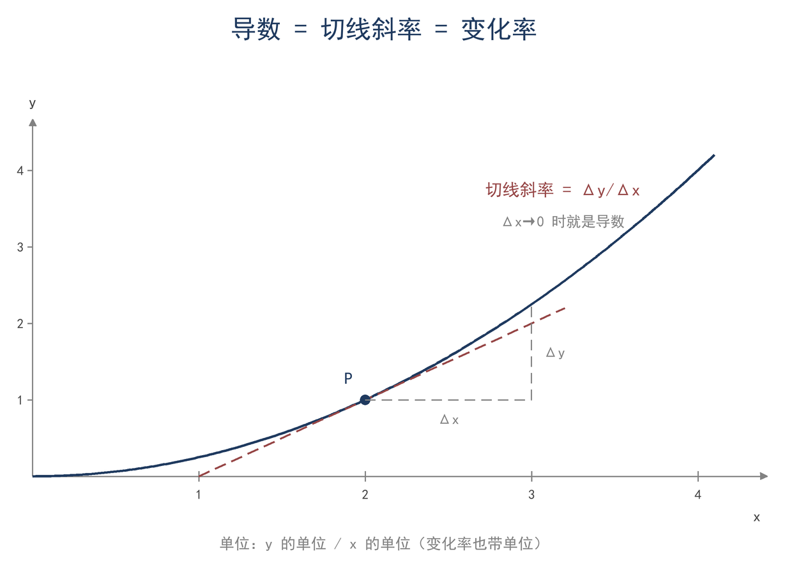
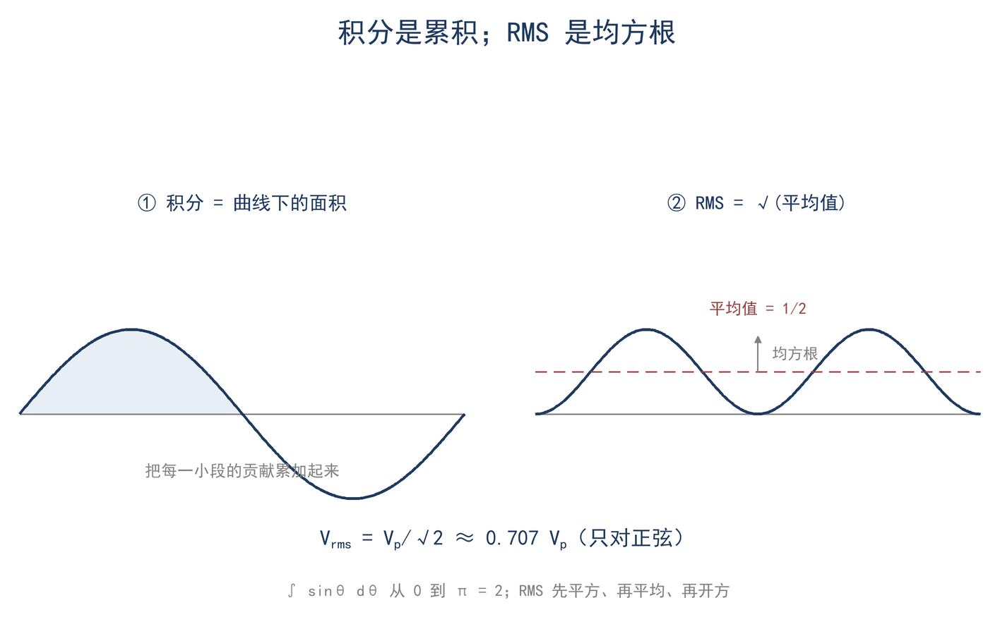
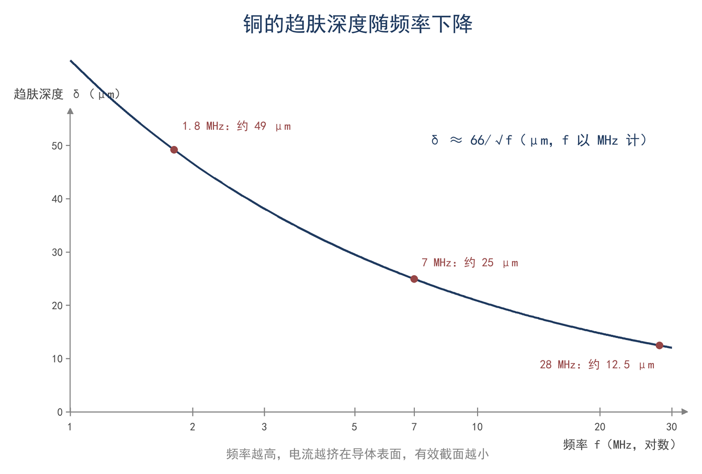

# 第 4 章 变化率与累积：微积分的四个用法

> **这一章会用到**：第 1 章的单位换算、第 3 章的相量与复阻抗。

## 一、加感线圈两端的 88 V

100 W、7.05 MHz 的发射机经天调送到一副缩短的 40 m 垂直天线。天调里那只加感线圈的电感是 1 μH，谐振时线圈里流过的峰值电流约 2 A。线圈用 1 mm 漆包线绕成，直流电阻不到 0.1 Ω。按欧姆定律，2 A 乘 0.1 Ω 只有 0.2 V；可它工作时两端的峰值电压接近 90 V，是欧姆定律结果的四百多倍。

多出来的电压不是从电阻上来的，是从电流的变化率上来的。7.05 MHz 的电流每 71 ns 换一次方向，在过零点附近变得最快；电感两端的电压正比于"电流变多快"，所以电流变化最快的瞬间，电压最大。用第 3 章的语言说：电感的感抗是 44 Ω，峰值电流 2 A，电压峰值为 44 × 2 = 88 V；用微积分的语言说：v = L·di/dt，di/dt 的最大值是 ω 乘峰值电流，算出来同样是 88 V。两种算法给出同一结果，其等价性来自导数的定义。

这个电压量级决定了天调元件与线圈绝缘的选取：只按电流和功率选型而忽略电压，接头打火与电容击穿便难以避免。若按直流思路估算，2 A 乘 0.1 Ω 仅为 0.2 V，会严重低估射频下的电压应力。

电阻上的电压与电流成正比，电感上的电压则取决于电流的变化率。这一差别决定了射频电路不能只用直流定律分析，而必须引入导数与积分；近似的适用范围也要由小量的大小判断。线圈电压、电容电流与导线中的电流分布，都可以由这两类工具解释。

## 二、导数：变化率与导数表

导数是变化率，几何上表示曲线上某一点切线的斜率。写法为 df/dt，定义为 Δf/Δt 在 Δt 趋于零时的极限。极限的严格定义不在本书范围，本书采用的表述是：Δt 足够小时，Δf/Δt 与极限值之差可以忽略。

导数带着单位，单位是"函数的单位除以自变量的单位"。电荷 q 对时间求导得电流，单位 C/s，即 A；磁通 Φ 对时间求导得电压，单位 Wb/s，即 V；电压对时间求导得 V/s。单位必须跟着走，否则算出来的数没法用。射频里最常见的错误是把 A/s 写成 A/μs 却不换算，差出 10⁶ 倍。

求导的规则在本书中只用两条：幂次降一阶，即 d(t^n)/dt = n·t^(n−1)；复合函数用链式法则，d/dt f(ωt) = ω·f′(ωt)。后者的 ω 把角度变化换算为每秒弧度，单位是 rad/s。由此直接得到射频计算中最常用的两条（表 4-1）：

d(sin ωt)/dt = ω·cos ωt，d(cos ωt)/dt = −ω·sin ωt

导数为零处函数取到极值；二阶导数 f″ 描述变化率本身的变化，第 5 章的微分方程要用到。

**表 4-1 常用导数**

| f(t) | f′(t) |
|---|---|
| t^n | n·t^(n−1) |
| sin ωt | ω·cos ωt |
| cos ωt | −ω·sin ωt |

导数在示波器上有直接的对应。7 MHz 正弦、峰值 100 V 时，过零点附近电压的最大变化率是 ωV_p = 4.43 × 10⁷ × 100 = 4.43 × 10⁹ V/s，即 4.4 V/ns；探头带宽不足时，首先损失的即为这种陡沿。测量上升时间，本质上即测量变化率。

同一函数在不同点的切线斜率不同，故导数是逐点的性质，而非整条曲线的性质，如图 4-1。

现实中的量常不止一个自变量。一段馈线上的电压既随时间变化，也随位置变化。∂v/∂t 表示固定位置、只对时间求变化率；∂v/∂z 表示固定时刻、只对位置求变化率。∂ 仅提示尚有其他自变量保持不变，运算规则与普通导数相同；第 6、7 章讨论场与行波时使用该记号。

## 三、积分与微积分基本定理

积分是累积。定积分 ∫_a^b f dt 的含义是：把从 a 到 b 的区间分成若干小段，每段以 f 乘 Δt，再将所有小份相加。几何上它等于曲线下的面积，但面积只是图形解释；其物理含义是把变化量逐段累加。单位是被积函数的单位乘以自变量的单位：电流对时间积分得电荷（A·s = C），功率对时间积分得能量（W·s = J）。

微积分基本定理把求导和积分扣在一起（F4-1）：

$$ ∫_a^b f′(t) dt = f(b) − f(a) $$

f′ 是被积函数（单位/秒），dt 是时间微元（s），积分结果为 f 从 a 到 b 的增量。适用条件：f′ 在区间上连续，物理上即不存在遗漏的突变。该定理表明：变化率的累积等于总量的差。电流的累积为流过的电荷，功率的累积为消耗的能量；车速表读数累积为路程，是同一关系在力学中的对应。

积分给出累积量，可用两个例子说明。1 mA 的电流给 100 pF 电容充电 1 μs，充入的电荷为 q = It = 10⁻³ × 10⁻⁶ = 10⁻⁹ C = 1 nC，电容电压升高 ΔV = q/C = 10 V；写成 q = ∫i dt，则对电流非恒定的情形同样成立。能量的情形与之相同：100 W 的功率持续 1 s 为 100 J，持续 1 ms 为 0.1 J。发射机标称的 100 W 是功率而非能量，工作时间越长，能量消耗与发热越大，这正是功率对时间积分的结果。

定积分还有两个常用性质：区间可加与线性，二者在分解复杂波形时有用。如图 4-2，将 sin² 在一个周期内分成小条累加，结果为 1/2，即正弦有效值中 0.707 的平方。

本书只用定积分：上下限明确，结果即总量之差；不定积分在求导时丢掉的常数对定积分没有影响，不再展开。

积分也用于求平均与有效值，公式见第六节。正弦整周期的平均值为零（正负半周相消），但其平方的平均值不为零，故功率不为零。两种"平均"含义不同，混淆会得出"正弦交流电不耗电"的错误结论。半个周期的积分非零：0 到 π/ω 的积分为 2V_p/ω，除以半周期 π/ω 得 2V_p/π = 0.637V_p，整流式平均值表的读数即为此值。

## 四、泰勒展开与小量近似

许多工程公式仅在小量附近成立。泰勒展开的原理是在小量附近以直线或抛物线代替曲线，即在 x = 0 附近（F4-2）：

$$ sin x ≈ x，e^x ≈ 1 + x，(1 + x)^n ≈ 1 + n·x $$

x 是无量纲小量，n 是任意实数；|x| 越小近似越好（误差见表 4-2）。第一个式子要求 x 用弧度。

**表 4-2 两个小量近似的误差**

| 近似 | x = 0.1 时的精确值 | 近似值 | 相对误差 | 可信范围 |
|---|---|---|---|---|
| sin x ≈ x | 0.09983 | 0.1 | 0.17% | \|x\| ≤ 0.3，误差 < 1.5% |
| e^x ≈ 1 + x | 1.1052 | 1.1 | 0.47% | \|x\| ≤ 0.1，误差 < 0.5% |

最常用的是小角近似：|x| ≤ 0.1 rad 时 sin x ≈ x 的误差不到 0.2%；到 30°（0.52 rad）误差已近 5%，再大就不再适用。二项式近似用于估计与长度、电阻平方有关的量：量变 10%，平方后的量约变 20%。

小失配的估算即为一例。Z = 50 + j10 Ω 接 50 Ω 线，反射系数的模约等于 X/(2Z₀) = 0.1，驻波比（SWR）≈ 1 + X/Z₀ = 1.2，精确值是 1.22。两个近似只在 |X| 远小于 50 Ω 时适用，X 达到 50 Ω 量级即失效。

使用近似前须明确两件事：小量有多大，允许的误差有多大。小量接近可信范围上限时，应直接代入精确公式；近似适合判断量级，不适合作为最终结果。这一判断在射频估算中反复使用，也是后续各章"先估后算"的依据。

## 五、L 与 C：两个储能元件

电感的电压由电流的变化率决定，电容的电流由电压的变化率决定（F4-3）：

$$ v_L = L·di/dt，i_C = C·dv/dt $$

v_L 是电感两端电压（V），L 是电感（H），di/dt 是电流变化率（A/s）；i_C 是电容电流（A），C 是电容（F），dv/dt 是电压变化率（V/s）。适用条件：线性元件、瞬时关系，与频率无关。这两个式子是时域的定义，对任何波形都成立，只要 L、C 不随电压电流变化。

这两个式子是一条因果链的两端。电流产生磁通，磁通的变化感应出电压（法拉第定律），而磁通与电流成正比，比例系数为 L：磁链（磁通与匝数的乘积）Ψ = L·i，对时间求导得 v_L = dΨ/dt = L·di/dt。电容那边更直接：电荷与电压成正比，q = C·v，电流是电荷的积累，i = dq/dt = C·dv/dt。反过来写即为积分：电感电流是电压的积分，i(t) = i(0) + (1/L)∫v dt；电容电压是电流的积分，v(t) = v(0) + (1/C)∫i dt。积分要占一段时间，所以电流和电压都不能瞬间改变。电抗也由此而来：电流频率越高，di/dt 越大，同样电流下电感电压越高，感抗 X_L = ωL 正是这个关系的另一种写法。

由这两个关系可以直接得到相位关系。正弦的导数为余弦，余弦相对正弦偏移四分之一周期，因此电感电压超前电流 90°；电容的 i_C = C·dv/dt 则使电流超前电压 90°。第 3 章表 3-2 中的这一结论并非规定，而是求导的结果：对电感而言，电压跟随电流的变化率，电流变化最快处位于过零点，故电压峰值出现在电流过零时。

上述关系也说明两个元件都具有记忆：电感的电压取决于电流的来路，电容的电流取决于电压的来路。电流突变需要无穷大的电压，电压突变需要无穷大的电流。实际电路中二者可以很大，大到击穿空气或烧蚀触点，即表现为打火与损坏。断开电感回路时 di/dt 极大，电感两端出现尖峰，继电器线圈并联续流二极管即为这条电流提供回路；电容上电瞬间电压不能突变，相当于短路，充电电流只受外电路限制。

回到 88 V。设电流 i = I_p·sin ωt，求导得

v_L = L·ωI_p·cos ωt = ωL·I_p·cos ωt

电压是余弦、电流是正弦，两者差 90°：电流过零时电压最大，电流到峰值时电压为零。峰值为 ωL·I_p = X_L·I_p，在 7.05 MHz、1 μH、2 A 的条件下是 88.6 V。这个电压只在射频交流状态下出现，用直流方法测不到；它不是直流电阻上的压降，因此不能用"电流乘电阻"估算。

电容的例子反过来。100 pF 两端加 100 V 峰值、7.05 MHz 的电压，峰值电流是 i_p = ωC·V_p = 4.43 × 10⁷ × 100 × 10⁻¹² × 100 = 0.44 A。一只 100 pF 的小电容，在 40 m 波段可以通过 0.44 A 的峰值电流，所以谐振回路里的电容要按电流和耐压两个指标选，不能只看耐压。用微积分看，i = C·dv/dt：电压变化最快的过零点，电容电流最大，这与电感的结论正好对偶。

能量关系附带给出：电感储能 E_L = ½L·i²，电容储能 E_C = ½C·v²。1 μH 通过峰值 2 A 时储能 2 μJ；100 pF 上 100 V 时储能 0.5 μJ。线圈两端电压有效值 62.6 V、电流有效值 1.41 A，乘积 88 VA；两者相差 90°，这 88 VA 不含有功分量，能量只在磁场中进出，平均功率为零。两个储能式子是第 5 章计算 Q 的依据，Q 的本质是储能与每周期损耗之比。

## 六、三个工程数：平均值、RMS 与趋肤深度

平均值和有效值都是用积分定义的（F4-4）：

$$ V_avg = (1/T)∫_0^T v dt，V_rms = √[(1/T)∫_0^T v² dt] $$

T 是一个周期（s），v 是瞬时电压（V）。V_avg 是直流分量；V_rms 是"产生同样热量的直流电压"，故称有效值。适用条件：周期信号，积分区间取整数个周期。三个概念的区别集中在平方这一步：平均对波形本身积分，有效值对波形的平方积分再开方；前者描述直流分量，后者描述发热能力。

有效值来自功率的平均。功率正比于电压的平方，真正决定发热的是电压平方的平均值；把这个平均值开方，就得到一个与直流等效的电压。正弦的平方在一个周期内的平均值是 1/2，开方得 1/√2，由此得到 0.707。对非正弦信号，平方的平均值不再是 1/2，所以 0.707 不能通用。名称"均方根"即来自先平方、再平均、后开方的计算顺序；这一等效关系是交流测量与功率计算的基础。

正弦整周期的平均值为零；整流后的平均值是 0.637V_p。有效值是 V_p/√2 = 0.707V_p，功率用有效值算：P = V_rms²/R = V_p²/(2R)。100 V 峰值进 50 Ω 是 100 W；如果误把峰值当有效值，会算出 200 W，整整差一倍。非正弦不能套 0.707：正负对称方波的 RMS 等于峰值，三角波的 RMS 是 V_p/√3 ≈ 0.577V_p。

峰值与有效值之比叫峰值因数（crest factor）。方波是 1，正弦约 1.4，三角波约 1.7；普通数字万用表默认按正弦换算，测方波和三角波会读错。测射频电压更麻烦，普通表带宽不够，读数基本不可信。要量射频有效值，用功率计反推最为可靠：由 P = V_rms²/R 量得功率后再算电压；仪表的换算方式正是由峰值因数决定的。

趋肤深度是高频电流往导体表面挤的深度，由下面这个式子给出（F4-5）：

$$ δ = √(ρ/(πfμ)) $$

δ 是趋肤深度（m），ρ 是电阻率（Ω·m），f 是频率（Hz），μ 是磁导率（H/m）。适用条件：良导体、平面边界，δ 远小于导体的尺寸。铜在 7 MHz 约 25 μm，28 MHz 时减半到约 12.5 μm；δ 与 √f 成反比。

25 μm 很薄：1 mm 粗的铜线，电流只走表面这一层，有效截面比直流时小一个数量级，交流电阻则大一个数量级，而电阻率的取值并未改变。这一差别完全来自电流在截面上的分布。

δ 还随两个材料参数变化。电阻率 ρ 随温度上升，δ 随之增大；磁导率 μ 对钢、铁等材料远大于铜，在相同电阻率与频率下 δ 更小。因此不同材料的趋肤深度不能直接比较。

由 F4-5 还可读出两种极限：频率越高、磁导率越大，δ 越小，电流越集中于表面；电阻率越大，δ 越大，电流分布越均匀。该式只适用于导体内部，绝缘介质中的场分布不遵循此规律，而由介电性质决定。

铜的趋肤深度随频率下降的曲线如图 4-3。

## 七、算例与误区

**算例 1（估算级）**：1 μH 线圈、7.0 MHz、峰值电流 2 A，线圈两端峰值电压是多少？

先交代条件：2 A 峰值对应 100 W 进 50 Ω 的情况。如果天线的谐振电阻不是 50 Ω，电流要按 P = I²R 重算，电压也跟着变；这里固定 2 A，是为了让两条算法好对照。

取 f = 7.0 MHz，先算感抗：X_L = 2πfL = 2π × 7.0 × 10⁶ × 1 × 10⁻⁶ = 44.0 Ω。
电压峰值：v_p = X_L × I_p = 44.0 × 2.0 = 88 V。

换微积分的路再算一遍：ω = 2π × 7.0 × 10⁶ = 4.40 × 10⁷ rad/s，di/dt 的最大值是 ω·I_p = 4.40 × 10⁷ × 2.0 = 8.80 × 10⁷ A/s；v_p = L·di/dt = 1 × 10⁻⁶ × 8.80 × 10⁷ = 88 V。两条路给出同一个数，说明感抗和导数关系是一回事。

单位检查：H × A/s = (V·s/A) × A/s = V，对得上。8.80 × 10⁷ A/s 换算成常用单位是 88 A/μs；数值上与 88 V 相同，因为 L = 1 μH 在这里相当于把"每微秒安培数"直接换成"伏特数"。

工程含义：线圈匝间绝缘、天调电容、接头要按百伏级设计；用直流电阻算出来的 0.2 V 差了四百多倍。频率取 7.05 MHz 时这个数是 88.6 V，四舍五入 89 V，与 88 V 属于同一档。

**算例 2（精确级）**：铜在 7.05 MHz、1.8 MHz、28 MHz 的趋肤深度各是多少？

铜的电阻率 ρ = 1.72 × 10⁻⁸ Ω·m，磁导率 μ = 4π × 10⁻⁷ H/m，把这两个常数和频率代入 F4-5。7.05 MHz 时 πfμ = 27.83，δ = √(1.72 × 10⁻⁸/27.83) = 24.9 μm。另外两个频率不必重算，按 δ ∝ 1/√f 换算：1.8 MHz 约 49 μm（×√(7.05/1.8)≈1.98），28 MHz 约 12.5 μm（×√(7.05/28)≈0.50）。三个数都落在 10–50 μm，比 1 mm 的导线直径小一个数量级以上，可见高频电流只走导线表面薄薄一层。所以 HF 线圈要选粗线或多股线，1 mm 铜线在 7 MHz 的交流电阻约为直流的 10 倍。

**误区 1：把积分只当求面积。** 错在把几何解释当成了定义。面积是"纵轴乘横轴"，不一定是物理量；积分要带着单位。1 mA 对 1 μs 积分得到 1 nC，而不是"一小块面积"。求平均、求有效值、算电荷和能量，都是积分在做累积，只记面积会在这些题上卡住。

**误区 2："平均功率 = 峰值功率 × 0.707"。** 错在把电压或电流的 RMS 系数用到了功率上。正弦电压乘 0.707 才是有效值，功率按电压的平方变，所以平均功率是峰值功率的一半，不是 0.707 倍；这个关系只对正弦成立，方波、SSB 包络、脉冲都不适用。把 100 V 峰值、50 Ω 的例子里误算成 141 W，正是这一步出错。

**误区 3：用 v = L·di/dt 时单位没统一。** 8.8 × 10⁷ A/s 写成 8.8 A/μs，电压就从 88 V 变成 8.8 V，差 10 倍；写成 8.8 × 10⁷ A/μs 则差 10⁶ 倍。L 取 H、i 取 A、t 取 s 是较为简便的组合；换算为 μs 时，分子与分母须同时换算，不可只改一侧。

## 八、小结

> **只记一个关系**
>
> 电感电压由电流的变化率决定，电容电流由电压的变化率决定：v_L = L·di/dt，i_C = C·dv/dt；反过来的累积即为积分，微分和积分是同一个关系的两面。
>
> **一组数**
>
> 1 μH 在 7 MHz 的感抗约 44 Ω，2 A 峰值电流产生 88 V 峰值电压；铜的趋肤深度 7 MHz 约 25 μm、1.8 MHz 约 49 μm、28 MHz 约 12.5 μm。
>
> **一个适用条件**
>
> 变化率关系对任何波形成立，只要 L、C 是线性的；平均值的 0.707 系数只对正弦成立；趋肤深度只适用于良导体，δ 要远小于导体尺寸。

自检三问：

1. 为什么加感线圈两端的电压不能用"电流乘直流电阻"算？电感电压什么时候最大？
2. 100 V 峰值的正弦电压加在 50 Ω 上，平均功率是多少？如果直接按峰值算 V²/R 会得到多少？
3. 同样是 1 mm 铜线，7 MHz 和 28 MHz 的交流电阻哪个大？大约差几倍？

习题（答案见附录 D）：

1. ★ 电荷 q(t) = 100 pC × sin(2π × 7.05 × 10⁶ t)，求电流 i(t) = dq/dt 的峰值。
2. ★ 求 t³ 和 cos(ωt) 的导数；再算 ∫_0^T sin(2πt/T) dt 的值。
3. ★★ 一个 10 μH 电感通过峰值 1 A、频率 7 MHz 的电流，两端峰值电压是多少？分别用 v = L·di/dt 和 X_L·I_p 算，核对结果。
4. ★★ 100 V 峰值、7.05 MHz 的正弦电压加在 50 Ω 上，平均功率是多少？保持峰值不变、把波形换成 50% 占空比的正负对称方波，平均功率又是多少？
5. ★★★ 用电子表格取 24 个点，算 sin² 一个周期的平均值，验证 V_rms = V_p/√2；再算三角波的 RMS，与 V_p/√3 比较。
