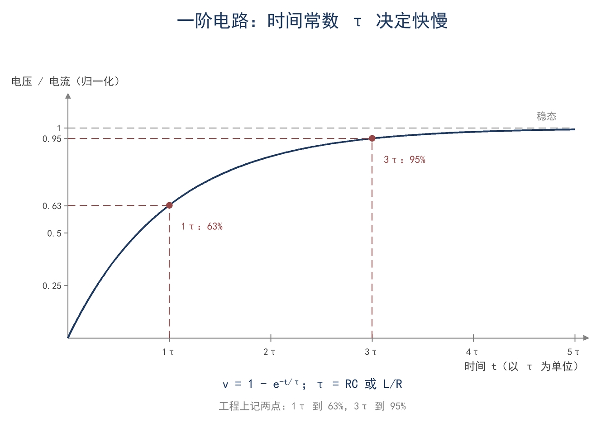
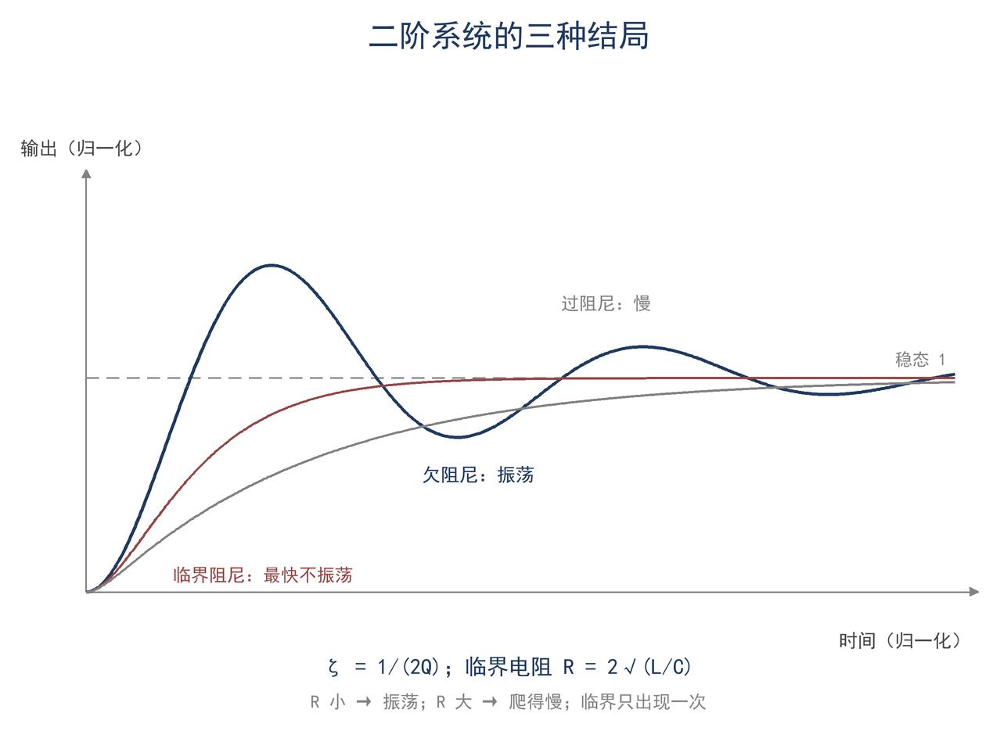
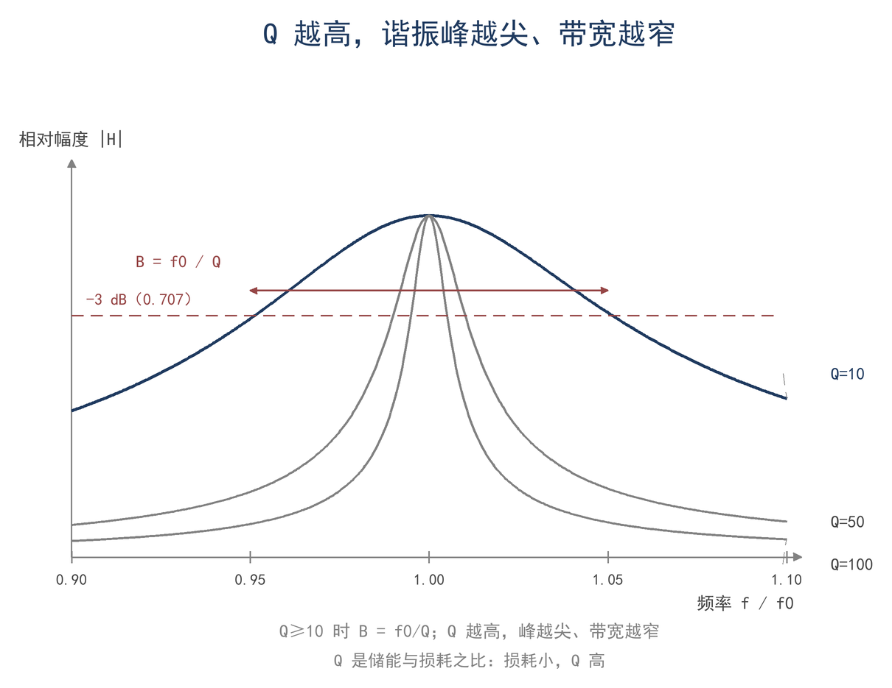

# ★ 第 5 章 振荡与衰减：微分方程第一课

不读本章也能继续读第 7 章；本章只讲振荡的三种结局，不推导通解。

> **这一章会用到**：第 3 章的复阻抗、第 4 章的导数与积分。

## 一、自由振荡：能量在两个元件间交换

一副缩短的 40 m 垂直天线，在 7.05 MHz 上谐振了，天线分析仪读到的电阻是 25 Ω，SWR 还是 2:1。谐振了，为什么 SWR 不是 1:1？

先分清两个词。谐振指电抗抵消：L 和 C 的电抗大小相等、符号相反，合起来为零，输入端只剩电阻。匹配指电阻对齐：该电阻等于 50 Ω。25 Ω 的电阻接 50 Ω 的线，SWR 为 50/25 = 2，即 2:1，与电抗是否抵消无关；将其变换为 50 Ω 的方法见第 8 章。本章讨论谐振这一侧：LC 回路为何自行振荡，电阻如何使其停止，以及 Q 所计量的内容。

把 L 和 C 单独拿出来看。一只 1 μH 的电感和一只 517 pF 的电容接成回路，先将电容充到 100 V，再合上开关。此后几十微秒内，电容放电，电流流过电感，磁场建立；电流最大时电容电压为零，电感继续推动该电流对电容反向充电，随后电流反向。能量在电场与磁场之间往复交换。电容储存的能量为 ½CV² = ½ × 517 × 10⁻¹² × 100² = 2.6 μJ；全部转入电感时，峰值电流由 ½LI² = 2.6 μJ 解出 I = 2.3 A。

所谓初始条件，即合上开关前储存在电容中的能量。回路随后按自身的 L、R、C 演化，称为自由振荡。天线在谐振点附近的行为与这个回路遵循同一套数学：天线具有分布电感与分布电容，以及辐射电阻 R_r 与损耗电阻 R_L，将其等效为 RLC 模型，即可用本章结论解释谐振点附近 SWR 变化剧烈的现象，以及加感天线可用带宽偏窄的原因。

振荡频率由 L 和 C 决定（F5-1）：

$$ f₀ = 1/(2π√(LC)) $$

f₀ 是谐振频率（Hz），L 是电感（H），C 是电容（F）。适用条件：无损耗或损耗很小的回路；有电阻时振荡频率会略低，Q ≥ 10 时差异可以忽略。代入 1 μH 和 517 pF：√(LC) = 2.27 × 10⁻⁸ s，f₀ = 7.00 MHz。

理想的 L 和 C 不消耗能量，能量在电场与磁场之间转移，平均功率为零。真实回路中的电阻把能量转化为热，每次交换都损耗一部分：电阻越大，振荡衰减越快；电阻越小，可持续的周期数越多。以下讨论阻尼的三种结局以及 Q 对它们的刻画。

## 二、一阶方程：RC、RL 与时间常数

先看只有一种储能元件的电路。电容 C 充到电压 V，经电阻 R 放电：基尔霍夫电压定律给出 v_R + v_C = 0，即 R·i + v = 0；而 i = C·dv/dt，代入得 R·C·dv/dt + v = 0。这是一个一阶微分方程，方程里只出现 v 的一阶导数。解是（F5-2）：

$$ v(t) = V·e^(−t/τ)，τ = RC；充电时 v(t) = V·(1 − e^(−t/τ)) $$

v 是电容电压（V），V 是初始电压或电源电压（V），t 是时间（s），τ 是时间常数（s），R 是电阻（Ω），C 是电容（F）。适用条件：恒定 R、恒定 C、电源是恒压源或没有电源。RL 电路对偶：电感电流按同样的指数规律变化，时间常数是 τ = L/R。

τ 是衰减到原来的 1/e 所需的时间，1/e ≈ 0.37。充电过程则相反：τ 时到 63%，3τ 时到 95%，再往后接近稳态。63% 与 95% 这两个数值最常用，用于判读指数曲线、估算电路建立时间和键控边沿。半衰期为 0.693τ，电压降到一半的时间按此计算，与 63% 是同一件事的两种表述。这两个比例只由 R 与 C 决定，与初始电压和电源电压无关。

以电台中的电路为例：1 μF 电容经 10 kΩ 充电，τ = 10 ms，无法形成 5 ms 的 CW 边沿；改用 0.01 μF 后 τ 降至 0.1 ms，即可满足要求。CW 键控边沿对应的频谱宽度在第 11 章计算，此处只用时间常数判断电路能否跟上边沿变化。

一阶电路只呈现衰减，不产生振荡。单个储能元件仅能储存一种形式的能量，放完即结束；振荡要求能量在两个储能元件之间往复交换，因此下一节引入同时包含 L 与 C 的回路。

一阶充电曲线上的 63% 与 95% 位置如图 5-1。

## 三、二阶方程：特征方程与三种阻尼

串联 RLC 回路，L、R、C 串起来，电容上有初始电荷。基尔霍夫电压定律：L·di/dt + R·i + q/C = 0，而 i = dq/dt。代入得

$$ L·q″ + R·q′ + q/C = 0 $$

q 是电容上的电荷（C），q′ 是电流（A），q″ 是电流的变化率（A/s）。适用条件：集中参数、线性元件、无外加电源，即自由振荡。这是二阶线性微分方程，最高出现二阶导数。

求解的办法是"猜"。指数函数求导后还是自己乘一个常数，形状不变，所以设 q = e^(st)，代入后每一项都带 e^(st)，约掉就得到特征方程（F5-3）：

$$ s² + (R/L)·s + 1/(LC) = 0，s = −α ± √(α² − ω₀²) $$

其中 α = R/(2L)，ω₀ = 1/√(LC)；根号内 α² − ω₀² 的符号决定三种阻尼。

s 是特征根（1/s），α 是衰减系数（1/s），ω₀ 是无阻尼谐振角频率（rad/s）。这个"猜"是标准做法，严格证明存在唯一解不在本书范围；用起来只需知道：根号内符号决定阻尼类型。

> **【推导】把 e^(st) 代进二阶方程**
>
> q = e^(st) 时，q′ = s·e^(st)，q″ = s²·e^(st)。代入 L·q″ + R·q′ + q/C = 0，每一项都含 e^(st)，约掉（e^(st) 永不为零）得 L·s² + R·s + 1/C = 0；两边除以 L，即得 s² + (R/L)·s + 1/(LC) = 0。根号里 α² − ω₀² 的符号决定 s 是两个实根、重根还是共轭复根，三种阻尼即由这一步分出。共轭复根时 e^(st) = e^(−αt)·e^(±jω_d t)：前一项是衰减包络，后一项是振荡。

阻尼比 ζ 把三种结局量化（F5-4）：ζ = α/ω₀ = 1/(2Q)；临界阻尼对应 R = 2√(L/C)。

- α > ω₀（ζ > 1）：过阻尼。两个负实根，不振荡，慢慢回到零；电阻太大，能量都消耗在电阻上。
- α = ω₀（ζ = 1）：临界阻尼。重根，不振荡，回到零最快；电阻再小一点就会过冲。
- α < ω₀（ζ < 1）：欠阻尼。一对共轭复根，振荡衰减，衰减包络是 e^(−αt)；振荡频率略低于 ω₀，Q ≥ 10 时可以当成 ω₀。

电台中三种阻尼都会出现。接收机前端回路 Q 高，受到脉冲后产生振铃，表现为邻频上的拖尾，属欠阻尼；电源去耦的 RC 属过阻尼，电压缓慢回到稳态而不过冲；指针式表头的阻尼调至临界附近，读数既快又无摆动。选择哪一种取决于对稳定速度与过冲的容忍程度。

判据见表 5-1。

**表 5-1 三种阻尼的判据**

| 条件 | 名称 | 波形结局 | 阻尼比 ζ | Q |
|---|---|---|---|---|
| R > 2√(L/C) | 过阻尼 | 不振荡，缓慢回到零 | ζ > 1 | Q < 0.5 |
| R = 2√(L/C) | 临界阻尼 | 不振荡，回零最快 | ζ = 1 | Q = 0.5 |
| R < 2√(L/C) | 欠阻尼 | 振荡衰减 | ζ < 1 | Q > 0.5 |

阻尼的分界可由 Q 直接判断：回路电阻与临界电阻之比等于 1/(2Q)，故 Q 大于 0.5 时为欠阻尼，等于 0.5 时为临界，小于 0.5 时为过阻尼。以 1 μH 配 517 pF 的回路为例，√(L/C) = 44 Ω，临界电阻 2√(L/C) = 88 Ω，Q = 0.5 恰对应此值；总电阻小于 88 Ω 即进入欠阻尼区。一副 40 m 加感天线的辐射电阻与损耗合计常在几欧至几十欧，正落在该区，受到激励后持续振荡，持续时间由 Q 决定。取 Q = 100，则 ζ = 0.005，振幅衰减到 37% 需 Q/π ≈ 32 个周期，7 MHz 上为 4.5 μs；每周期能量损失约 2π/Q = 6.3%，Q 的定义即由此而来。欠阻尼时振荡频率比 ω₀ 略低，ω_d = ω₀√(1 − ζ²)：ζ = 0.005 时低 1.25 × 10⁻⁵，可忽略；ζ = 0.5 时低 13%，已可察觉。因此"谐振频率等于 1/(2π√(LC))"默认 Q 不太低，严格说它是无阻尼频率，低 Q 回路的峰值频率略低。

三种阻尼的波形如图 5-2。

## 四、受迫振荡与谐振曲线

自由振荡会衰减掉。实际电路总有源在推：发射机推天线，信号源推接收机回路。加一个正弦源，方程右边多一项驱动，解就分成两部分：暂态（自由振荡，很快衰减）加稳态（与源同频的正弦）。稳定下来以后，只看稳态。

稳态可以直接用第 3 章的相量算：Z = R + j(ωL − 1/(ωC))，电流 I = V/Z。什么时候电流最大？分母的模最小时。ω = ω₀ 时虚部为零，分母只剩 R，电流达到最大，此即谐振。把电流或回路电压对频率画出来，得到一条钟形曲线：中间高、两边低。

曲线上有两个频率，使功率降到峰值的一半（电流或电压降到 1/√2），叫 −3 dB 点；两点之间的宽度是 −3 dB 带宽 B。−3 dB 的名称由此而来：功率降到一半，10lg(0.5) = −3.0 dB；幅度降到 1/√2，平方之后即为一半。用功率还是用幅度描述，指的是同一对频率点；−3 dB 点即半功率点。Q 越高，曲线越尖，带宽越窄。对高 Q 回路，带宽和 Q 的关系是（F5-5）：

$$ B = f₀/Q $$

B 是 −3 dB 带宽（Hz），f₀ 是谐振频率（Hz），Q 是回路品质因数。适用条件：Q ≥ 10；Q 低的回路曲线不对称，−3 dB 点两边不等距，该式仅能作定性估计，精确值应由扫频测得。

Q = 10、50、100 的三条曲线如图 5-3，横轴是频率除以谐振频率。同一个 7 MHz 回路，Q = 10 时带宽 700 kHz，Q = 50 时 140 kHz，Q = 100 时 70 kHz。

读这条曲线要看三个信息：峰的位置、峰的高度、峰的宽度。峰的位置是 X = 0 的谐振点，对应分析仪上电抗过零；峰的高度由回路总电阻决定，串联回路里 R 越小峰越高；峰的宽度即 −3 dB 带宽，由 Q 决定。曲线左右并不对称：谐振点左侧电抗为负（容性），右侧为正（感性）；Q 低时左坡缓、右坡陡，因为容抗和感抗随频率的变化率不同。这三个信息分别回答谐振点、回路电阻与带宽，也是 Q 作为选频指标与衰减指标的统一来源。

Q 高同时带来选择性与容差敏感性。前者使接收机中频回路能够抑制邻近频率的强信号；后者意味着 Q = 100 的回路在频率偏离 0.5% 时即到达 −3 dB 点，元件误差、温度变化与手靠近天线都会使谐振点移动。回到开头那副天线：谐振点找到后，SWR 曲线在 7.05 MHz 呈浅谷，谷底为 2:1，原因是 R = 25 Ω 不等于 50 Ω。谐振只消除电抗，谷底高度由电阻决定。

## 五、Q 的三种读法：储能比、元件比、带宽比

Q 有三个等价的读法，三者说的是同一个量。三种读法互为校验：测得带宽可求 Q，由 Q 与元件值可反推回路的等效损耗电阻，储能比则说明 Q 的物理含义。

**读法一：储能比。** Q 等于谐振角频率乘以回路储能，再除以每秒损耗的功率。储能越大、损耗越小，Q 越高。1 μH 电感通过 2 A 峰值电流时储能 2 μJ，回路电阻 0.44 Ω 时的损耗不到 1 W，代入得 Q ≈ 100。这一读法最接近物理：Q 所计量的是储能可维持的周期数。

**读法二：元件比。** 对串联 RLC，Q 可以由元件值直接算（F5-6）：

$$ Q = ω₀L/R = 1/(ω₀CR) = (1/R)·√(L/C) $$

ω₀ 是谐振角频率（rad/s），L 是电感（H），R 是回路总电阻（Ω），C 是电容（F）。适用条件：串联 RLC，R 是全部损耗折合到串联的等效值。单看一只线圈时，把 R 换成线圈自身的损耗电阻，所得为线圈的 Q：Q_coil = X_L/R_L，它只说明该线圈在某个频率上损耗的大小。

**读法三：带宽比。** Q = f₀/B，即 F5-5 的逆用：Q 等于谐振频率除以 −3 dB 带宽；测得带宽即得 Q，反之亦然。

三种读法算出来的是同一个 Q，前提是同一回路、同一总电阻。最容易混的是把元件的 Q 当成回路的 Q：线圈 Q 只说明线圈损耗小，回路的 Q 还要把所有电阻算进去，包括天线的辐射电阻。同一只 Q = 100 的线圈，若回路总电阻从 0.44 Ω 增到 3.44 Ω，回路 Q 就从 100 降到约 13，带宽展宽到几百 kHz。线圈的 Q 没变，带宽由总电阻决定。

因此"Q 越高越好"并无统一答案。线圈 Q 高意味着损耗小、效率高，是有利的；回路 Q 高则带来良好的选择性与抗干扰能力，代价是带宽变窄、调谐困难、对元件容差敏感。实际选择回路 Q 时，须同时权衡带宽、效率与调谐的稳定程度，并先明确所指的是哪一个 Q。

同一套公式换到并联回路要取对偶。L、C、R 并联时，谐振点阻抗最高，等效并联电阻 R_p = Q·ω₀L；反过来 Q = R_p/(ω₀L) = ω₀CR_p。同一只线圈改成并联等效，谐振时两端是几千欧的纯电阻。串联看 L 与 R 之比，并联看 R 与 L 之比，形式不同，数的是同一件事。

再以一副 2 m 鞭状天线为例。它在 7.05 MHz 的容抗在 1 kΩ 量级，需由几十 μH 的加感线圈补回；线圈损耗、辐射电阻与地网损耗同量级，回路 Q 只有几十，带宽约 100 kHz，效率仅百分之几。这一组数据说明：Q 为感抗除以总电阻，感抗越大、总电阻越小，Q 越高、带宽越窄；效率仅取决于辐射电阻占总电阻的比例。两项指标由同一组电阻决定，单独调整其一无法同时改善二者。

## 六、扫频读 Q

扫频时先找到电抗过零的谐振点 f₀，再取两侧 |X| = R 的两个频率 f₁、f₂，由 Q = f₀/(f₂ − f₁) 得到 Q。取 |X| = R 的依据是：串联回路的功率与 1/|Z|² 成正比，半功率要求 |Z|² = 2R²，即 |X| = R。该式同时给出频域与时域的对应：Q 越高，−3 dB 带宽越窄，振荡衰减越慢，二者由同一参数描述。测量中步进过粗、夹具的杂散电容与校准面位置都会使读数偏；回路接在有耗馈线之后时，线损使谐振谷变平，测到的 Q 偏低（第 7 章）。

## 七、算例与误区

**算例 1（估算级）**：L = 1 μH、C = 517 pF 的回路，谐振频率和 Q = 100 时的带宽是多少？

先算 √(LC) = √(1 × 10⁻⁶ × 517 × 10⁻¹²) = √(5.17 × 10⁻¹⁶) = 2.27 × 10⁻⁸ s。
f₀ = 1/(2π × 2.27 × 10⁻⁸) = 7.00 × 10⁶ Hz = 7.00 MHz。
带宽：B = f₀/Q = 7.00 × 10⁶/100 = 70 kHz。

量级检查：40 m 波段 7.0–7.2 MHz 共 200 kHz，70 kHz 约占三分之一；一个 Q = 100 的调谐回路要覆盖整个波段，得在波段内重新调谐。如果 Q 是 50，B = 140 kHz；Q 是 200，B = 35 kHz。带宽和 Q 成反比，这个比例关系比公式本身更有用。

**算例 2（精确级）**：同一回路的损耗核算。X_L = 44.3 Ω，线圈 Q = 100，辐射电阻 R_r 取 3 Ω 或 1 Ω，效率各是多少？

线圈损耗电阻 R_L = X_L/Q_coil = 44.3/100 = 0.44 Ω。R_r = 3 Ω 时，总电阻 3 + 0.44 = 3.44 Ω，效率 η = R_r/(R_r + R_L) = 3/3.44 ≈ 0.87；R_r = 1 Ω 时总电阻 1.44 Ω，η = 1/1.44 ≈ 0.69。两个结果都在 0 与 1 之间，且 R_r 越小效率越低：辐射电阻在总电阻里的占比变小，效率由这个比值决定，线圈 Q 只影响其中的损耗项。顺带得到回路 Q = 44.3/3.44 ≈ 12.9，带宽约 550 kHz，比算例 1 的 70 kHz 宽得多；总电阻既决定效率，也决定带宽。

**误区 1：把"Q 越高越好"当通例。** 错在没区分两种 Q。元件 Q 高是损耗小，确实越好；回路或天线 Q 高是窄带、难调、怕容差，不一定好。同一个线圈，装在损耗大的回路里和装在低损耗回路里，回路 Q 能差好几倍。

**误区 2：把谐振当匹配。** 谐振只保证 X = 0，即电抗抵消；R 是不是 50 Ω 是另一回事。本章开头那副天线谐振时 R = 25 Ω，SWR 还是 2:1；反过来，R 恰好 50 Ω 但不谐振的天线，SWR 也可能很高。两个条件分开判断。

**误区 3：特征方程漏 2，或用 B = f₀/Q 算低 Q。** α = R/(2L)，不是 R/L，漏掉 2 会让临界电阻算成一半。另外 B = f₀/Q 只在 Q ≥ 10 时够用；Q 低的回路，−3 dB 点不对称，带宽应由扫频测量确定，不宜直接套用公式。

## 八、小结

> **只记一个关系**
>
> 两个储能元件才有振荡。RLC 回路的结局由衰减系数 α = R/(2L) 和无阻尼频率 ω₀ = 1/√(LC) 的比值决定，ζ = 1/(2Q)；Q 同时是储能比、元件比和带宽比。
>
> **一组数**
>
> 1 μH 配 517 pF 谐振在 7.00 MHz；Q = 100 时带宽 70 kHz；临界电阻 2√(L/C) = 88 Ω；一阶过程 τ 处到 63%，3τ 到 95%。
>
> **一个适用条件**
>
> 集中参数、线性、时不变。B = f₀/Q 只在 Q ≥ 10 时用；传输线的谐振（第 7 章）不套这个结论。谐振的判据是 X = 0，匹配的判据是 Z = 50 Ω，二者分开判断。

自检三问：

1. 为什么一个 RC 电路不会振荡，而 LC 回路会？
2. 谐振时分析仪读 25 Ω、SWR 2:1，问题出在电抗还是电阻？
3. 线圈 Q = 100 和回路 Q = 12.9 矛盾吗？哪个决定带宽？

习题（答案见附录 D）：

1. ★ 10 kΩ 电阻与 1 μF 电容组成的 RC 电路，时间常数是多少？充电到 63% 和 95% 各要多久？
2. ★ L = 10 μH、C = 100 pF，求谐振频率；若 Q = 50，求 −3 dB 带宽。
3. ★★ 某串联回路 f₀ = 7.05 MHz、带宽 70 kHz，求 Q；若 R = 0.5 Ω，求 L 和 √(L/C)。
4. ★★ 一阶 RL 电路：L = 100 μH、R = 50 Ω，求 τ；电流从 0 升到 90% 要几个 τ？（e^(−2.3) ≈ 0.1）
5. ★★★ 上机：用电子表格算串联 RLC 的 |Z| 随频率的曲线（谐振点两侧各取若干点），找出 |Z| = √2·R 的两个频率，验证 B = f₀/Q；再改变 R，看曲线怎么变。
