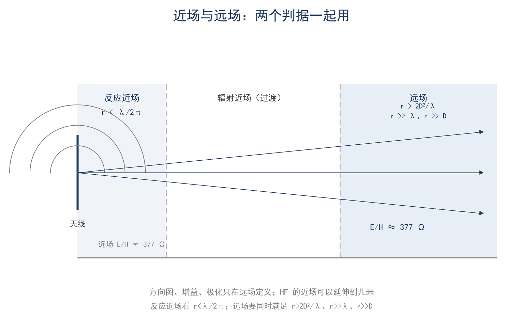

# ★ 第 6 章 电与磁：麦克斯韦的四个句子

> **这一章会用到**：第 3 章的相量与复阻抗、第 4 章的偏导记号（∂ 表示固定其他量、只看一个量的变化）。

## 一、天线上的电荷，怎么在几十米外留下场

7.05 MHz、100 W 送进一副 40 m 半波偶极，按半波偶极的 73 Ω 辐射电阻折算，馈电点电流的有效值约 1.17 A，峰值约 1.66 A。电流按正弦摆动，天线末端的电荷来不及流走，便堆积在那里。端头电荷记为 q，其峰值由电流积分得到：设 i = I_p·sin ωt，则 q = −(I_p/ω)·cos ωt（取一个周期内净电荷为零），峰值 q = I_p/ω = 1.66/(4.43 × 10⁷) ≈ 37 nC。

电流探头夹在馈线上能看到这个波形；把探头从导线上移开，读数立刻消失。探头耦合的是导线中的传导电流，读数消失不等于场消失。天线附近的电流有两条路径：传导电流沿天线分布，位移电流补足总电流的连续性；两者合起来才使电流处处连续。位移电流的来源在第三节。

几十米外的接收天线确实能从这片空间里取出功率。发射机只在天线内驱动电荷，场是怎么离开导线的？

描述场之前，先补三个工具。向量是有方向的量，电场 E 与磁场 B 均为向量场。点积取同一方向的成分，结果为数，用于计算通量；叉积取垂直方向的成分，结果仍为向量，本章只用于能流方向 E×H。偏导记号 ∂ 表示固定其他变量、只对一个变量求变化率：∂B/∂t 是固定位置看 B 随时间的变化，∂B/∂z 是固定时刻看 B 随位置的变化。

答案不是电子的迁移，而是两件事：电荷的运动在周围产生场；变化的电场产生磁场，变化的磁场又产生电场。两者相互激发，场便能脱离导线向前传播。描述这一过程只需两个几何量：通量（穿过一个面的场）与环流（沿闭合路径累加的切向分量）。麦克斯韦方程组由四个等式组成，每个等式说明某个通量或环流等于什么。

## 二、四个句子与四个器件

四条定律都用积分形式写：左边是通量或环流，右边是电荷、电流或它们的变化率。先看电的那条（F6-1）。

$$ ∫∫ E·dA = q/ε_0 $$

E 是电场（V/m），dA 是面元（m²），q 是面内净电荷（C），ε_0 = 8.85×10⁻¹² F/m 是真空介电常数。电场线从正电荷发出、到负电荷终止，穿出闭合面的电通量只由面内净电荷决定。天线端头的电荷、电容极板上的电荷、同轴内导体上的电荷，都在这条定律的管辖范围内。

磁的那条更短（F6-2）。

$$ ∫∫ B·dA = 0 $$

B 是磁感应强度（T）。穿过任意闭合面的磁通量恒为零：磁力线必然闭合成圈，不存在磁荷。磁环、扼流圈磁芯和变压器磁芯里的磁通都按这条规律闭合。

第三条是法拉第定律（F6-3）。

$$ ∫_C E·dl = −dΦ_B/dt $$

E 沿闭合路径的环流（V），等于穿过该路径所围面积的磁通量 Φ_B（Wb）的变化率的负值。负号是楞次定律：感应出的电场总是反抗磁通的变化。对一个面积 A、处在均匀磁场 H 中的小环，穿过环面的磁通是 Φ_B = μ_0HA；N 匝串联时电动势是单匝的 N 倍。

把正弦磁通代入，可以得到相量形式。设 Φ_B(t) = Φ_p·sin ωt，单匝电动势 v = −dΦ_B/dt = −ωΦ_p·cos ωt，N 匝串联时电动势为单匝的 N 倍。正弦对时间求导相当于乘 jω，余弦是正弦超前 90°，因此

$$ V = −jωNΦ_B，Φ_B = μ_0HA $$

V 是感应电动势的相量（V），Φ_B 是磁通的相量（Wb），ω = 2πf（rad/s），μ_0 = 4π×10⁻⁷ H/m，H 是磁场强度（A/m），A 是环面积（m²）；V 与 Φ_B 同时取峰值或同时取有效值。取模得 V_p = ωNμ_0HA。条件是：环的周长不超过约 0.2λ，H 在一个环面内近似均匀，环面与 H 垂直。这个式子是本章的场公式，第六节用它估算小环电动势。

第四条是安培—麦克斯韦定律（F6-4）。

$$ ∫_C B·dl = μ_0(I + ε_0·dΦ_E/dt) $$

B 沿闭合路径的环流（T·m）等于 μ_0 乘以所围面积内的传导电流与位移电流之和（A）；Φ_E 是电通量。第一项是电流生磁，第二项是变化的电场生磁，没有它电磁波无法自持。

表 6-1 把四条定律和电台里的东西对上。

**表 6-1 四条定律各对应一个器件或现象**

| 定律 | 含义 | 电台里的对应 |
|---|---|---|
| 高斯（电） | 电荷是电场的源 | 天线末端电荷、电容、同轴内导体 |
| 高斯（磁） | 没有磁荷，磁力线闭合 | 磁环、扼流圈磁芯、变压器 |
| 法拉第 | 变化的磁场产生电场 | 磁环天线、共模扼流、拾取磁通的环路 |
| 安培—麦克斯韦 | 电流和变化的电场产生磁场 | 电流探头、位移电流、波的自持 |

前两条定律说明场的源，后两条说明场的变化如何相互激发。图 6-1 把四条定律与对应的器件画在一起。

第四条里的第二项是新的。电容两极板之间没有电荷通过，磁场却仍然存在，这一项就是为解释这个现象准备的。

## 三、位移电流：电容里没有电荷通过，磁场却还在

拿一只 100 pF 的电容，两端加 7 MHz、100 V 的射频电压。电容的两块极板之间是绝缘介质，没有电荷穿过去；但导线里的电流是 I = ωCV = 4.43×10⁷ × 10⁻¹⁰ × 100 ≈ 0.44 A。这 0.44 A 的电流到哪里去了？

它没有消失，而是以位移电流的形式穿过介质：ε_0·dΦ_E/dt。介质里的电场随电压变化，变化的电通量按安培—麦克斯韦定律产生磁场，和真实电流产生的磁场一样。这样，导线里的电流在电容处“接上”了。

位移电流的大小可以定量写出。以平行板电容为例，电通量 Φ_E = E·A = (V/d)·A，而 C = ε_0·A/d，故 ε_0·dΦ_E/dt = C·dv/dt，恰好等于导线中的电流。这表明电容间隙中的位移电流与导线电流处处相等，基尔霍夫电流定律在电容处仍然成立。

位移电流是电磁波能够自持的一半，另一半是法拉第定律。安培定律原本只含传导电流：对充电中的电容，同一闭合路径可以围住一个穿过导线的面，也可以围住一个穿过介质间隙的面，两个面所围的传导电流不同，算出的磁场却不一致。补上位移电流项之后，两个面给出同一结果，安培定律在含电容的电路中才成立。这一项与传导电流一样产生磁场，并非只为修补公式而设。

天线末端也是同样的接力：传导电流把电荷送到端头，位移电流在端头周围的空气里接续，电荷才能在那里堆起来又流走。于是两个场相互激发：

变化的电场 → 产生磁场（位移电流项）→ 磁场变化 → 产生电场（法拉第定律）→ ……

这个过程不需要导线与介质，在真空中也能前后传播。真空中的光速由这两个常数决定：c = 1/√(μ_0ε_0) ≈ 3.0×10⁸ m/s；这一速度与光速一致，正是光的电磁理论的基础。

下一个问题是：平面波中电场与磁场的比例由什么决定。

## 四、E 与 H 的耦合：377 Ω 的来源

把上一节的两句话用在真空中的一列平面波上，会得到一个固定比例（F6-5）。

$$ E/H = η_0 = √(μ_0/ε_0) ≈ 377 Ω $$

E 是电场（V/m，有效值），H 是磁场（A/m，有效值），η_0 称为自由空间波阻抗，约 377 Ω（严格为 120π Ω）。该比值只由真空的两个常数决定，与频率和传播方向无关。电场与磁场并非独立变量：在远场中已知其一即可算出另一个。

> **【推导】平面波里为什么 E/H 是常数**
>
> 第一步，两条旋度方程在一维平面波里简化成 ∂E/∂z = −μ_0·∂H/∂t 和 ∂H/∂z = −ε_0·∂E/∂t。平面波只有一个传播方向，场只随 z 和 t 变，三维旋度退化成一维偏导。
>
> 第二步，把 E = E_0·e^(jωt−jβz)、H = H_0·e^(jωt−jβz) 代入：时间求导给出乘 jω，空间求导给出乘 −jβ。第一式给出 β·E_0 = μ_0·ω·H_0，第二式给出 β·H_0 = ε_0·ω·E_0。两式相乘，E_0·H_0 约掉，得 β² = μ_0·ε_0·ω²，即 β = ω√(μ_0ε_0)。
>
> 第三步，把 β 代回第一式：E_0/H_0 = μ_0·ω/β = √(μ_0/ε_0)，与频率无关，频率在 ω 和 β 的比值里约掉了。β 是相位常数（rad/m），ω/β = 1/√(μ_0ε_0) 即相速；把两个常数代进去，这个速度等于光速。

能流密度由二者共同决定：

$$ S = E²/377 = 377·H² $$

S 是功率密度（W/m²），方向是 E×H 的方向。这两个式子只在远场、平面波、真空或空气里成立；近场不成立，下一节专门讲。在远场测量中，测得 E 与 H 其一即可推得另一量与功率密度。

用 F6-5 做一个数值校验：如果某处远场 E = 10 mV/m，那么 H = E/377 = 26.5 μA/m，S = (0.01)²/377 ≈ 2.7×10⁻⁷ W/m²。

近场不满足 377 Ω，原因在于相位。远场里 E 和 H 同相，一个周期内坡印廷矢量（Poynting 矢量，能流密度）的平均值为正，能量单方向流走；近场里两者常相差接近 90°，乘积在正负之间摆动，一个周期的平均值为零，能量被存入又取出，没有净输出。E 和 H 的比例因此由天线结构决定，而不由传播决定。判断哪里算远场，需要距离判据。

## 五、近场与远场的判据

天线周围的场分三段。最靠近天线的一段叫反应近场（reactive near field），里面的电场和磁场相位差接近 90°，能量在近处来回交换：电场给电容充电，磁场给电感储能，充进去又放出来，不往外走。这一段不传输功率，方向图、增益、极化在这里都没有定义。它的边界是（F6-6）：

$$ r < λ/2π ≈ 0.16λ $$

r 是到天线的距离（m），λ 是波长（m）。这个判据来自 kr = 1（k = 2π/λ 为波数）：r = λ/2π 时，天线的“储能”和“辐射”开始变得可比；距离比这更近时，场以储能为主。

再往外是辐射近场；真正稳定的远场要同时满足三个条件：

$$ r > 2D²/λ，且 r ≫ λ，且 r ≫ D $$

D 是天线的最大尺寸（m）。2D²/λ 是口径相位判据：从天线边缘和中心到观察点的路程差约为 D²/(8r)，要求它小于约 λ/16，即 D²/(8r) < λ/16，解得 r > 2D²/λ。方向图要在这个距离之外才成形。r ≫ λ 保证辐射场按 1/r 衰减；r ≫ D 保证天线可以看成一个点。三个条件要同时成立，缺一个都不算远场。

两条判据的量级可以这样比较。若 D 与 λ 同量级，2D²/λ 是 λ 的量级，比 λ/2π ≈ 0.16λ 大一个数量级，口径判据起主导；若 D = λ/2，2D²/λ = λ/2，与 r ≫ λ 同量级，两条都要看。以 20 m 偶极或 2 m 波段的八木为例，具体距离放在算例 2。

这里要纠正两个常见读法。第一，λ/2π 不是“远场边界”，它是反应近场的边界；把 0.16λ 以外都叫远场，会在 0.5λ 处用远场公式算方向图，得到错误的结论。第二，对半波偶极这种小天线，D = λ/2 时 2D²/λ = λ/2，比 λ 还小，真正起作用的是 r ≫ λ；只套 2D²/λ 会得出“0.5λ 外即远场”的错论。两个判据要一起用，再取更严格的那个。

三区与两个判据画在一起，如图 6-2。

判据决定所测数据是否有意义：在近场中测方向图，得到的是近场分布而非辐射方向图；以近场场强乘 4πr² 反推功率，会得到随距离变化的“假功率”。远场中功率密度按 1/r² 下降，近场不满足这一关系。方向图、增益与极化只在远场定义，近场数据不能用于这些参数。

## 六、小环天线与同轴屏蔽：两条直接的“场应用”

上一节的判据划定了 377 Ω 的适用范围。在适用范围内，两条定律可以直接用来解释电台里的两种器件：小环天线把磁通变成电动势，同轴电缆用反向电流把外面的磁场抵消。

先看小环。单匝圆环放在远场里，环面与磁场垂直。由 F6-5 得 H，再由 Φ_B = μ_0HA 得磁通，最后用 F6-3 的相量形式 V = −jωNΦ_B 求感应电动势；取模得 V_p = ωNμ_0HA。直径 1 m 的环在 14.1 MHz、10 mV/m 的场里，电动势只有毫伏量级，具体数字见算例 1。这个量级说明，磁环天线必须靠高 Q 调谐回路把窄带内的电动势抬起来。

小环的灵敏度可以从公式直接读出：V 与频率、环面积、磁场强度成正比。所以磁环天线要做得大、要在低波段用高 Q 回路，还得对准来波的磁场方向；把环转 90°，收到的电动势就掉到零。短波（HF）上磁环的 Q 常做到 100–300：7.05 MHz 上 Q = 100 对应带宽约 70 kHz，低波段、更高 Q 时会窄到几 kHz。调谐电容稍微动一点就可能偏出信号，这是磁环天线要慢调、细调的原因。

“小环”这个近似有边界。环的周长是 πD，直径 1 m 时约 3.14 m，在 20 m 波段约为 0.15λ；周长接近 0.2λ 时，环上的电流不再均匀，小环公式失效，要按完整的天线理论处理，不能再用 V = ωNμ_0HA 估算。

再看同轴。内导体电流和屏蔽层内表面电流大小相等、方向相反，两者在屏蔽层外面产生的磁场相互抵消。用安培定律沿电缆外面一个圈积分，圈内的净电流为零，所以外面的 B 为零。同轴电缆不漏场，其原理在于这对反向电流，而非铜皮本身的厚度；这也是它既能贴着金属走、又能穿管的原因。

反过来，如果屏蔽层外表面出现了“不成对”的电流（两端接地不良、天线不平衡、馈线附近有强场），屏蔽层自己就变成了一根天线：接收噪声、干扰电视、机壳麻手。这类电流叫共模电流，定量处理在第 8 章；本章只需要指出它的来源：屏蔽层上的电流没有成对。

## 七、算例与误区

**算例 1（估算级）：小环能收到多少？** 条件同上：14.1 MHz、E = 10 mV/m、1 m 直径单匝环。先由 F6-5 得 H = E/377 = 26.5 μA/m；环面积 A = π × 0.5² = 0.785 m²，磁通 Φ_B = μ_0HA = 2.6×10⁻¹¹ Wb；角频率 ω = 2π × 14.1 × 10⁶ = 8.86×10⁷ rad/s，电动势峰值 V_p = ωΦ_B = 2.3 mV。这里的 8.86×10⁷ rad/s 就是 14.1 MHz 对应的角频率，与第四节的 4.43×10⁷ rad/s（7.05 MHz）不是同一个频率。

量级检查：mV 级电动势经过 Q = 100 的调谐回路，谐振时电容上的电压约 Q 倍，即 0.23 V，恰好是接收机前端能处理的量级。这个估算说明，磁环天线不是“放大了信号”，而是用谐振把窄带内的电动势抬起来。线性关系也用得上：频率翻倍，V 翻倍；环面积翻倍，V 翻倍；场强减半，V 减半。

**算例 2（精确级）：远场到底要多远？** 20 m 偶极：λ = 300/14.1 = 21.3 m，D = 10.1 m；λ/2π = 21.3/6.283 = 3.39 m；2D²/λ = 2×10.1²/21.3 = 9.58 m。所以 3.4 m 只是反应近场的边界，9.6 m 是口径相位允许的远场起点，要测方向图还得在几个波长（约 40–60 m）外。2 m 波段十单元八木：λ = 300/145 = 2.07 m，D = 3.5 m；2D²/λ = 2×3.5²/2.07 = 11.8 m。同样一台天线分析仪，在 HF 上可以在院子里测，在 VHF 上 11.8 m 以内都不算远场。

**误区一：电磁波需要介质。** 错在把机械波的经验套用过来。声波需要空气，电磁波不需要：变化的电场产生磁场，变化的磁场产生电场，两种变化相互感应，真空里即可传播，速度为 c = 1/√(μ_0ε_0)。光在真空中传播即为证据；太阳与地球之间没有介质，光仍能到达。

**误区二：天线“发射电子”。** 错在把电流当成电子的运输。天线里的电子只在原地来回摆动，100 W、7 MHz 下振幅只有 10⁻¹² m 量级（皮米级）；离开天线的是场和能量。电子如果真被发射出去，天线几天就没了，接收端也收不到“电子流”。

**误区三：近场只是“离得近一点”。** 错在把近场当成远场的缩小版。近场里 E/H 不是 377 Ω，能量主要来回交换、不往外走，方向图、增益、极化都没有定义；而且两个判据要同时用，λ/2π 和 2D²/λ 分别管两件事，不能互相代替。

## 八、小结

四个等式分别说明电通量、磁通量、电场环流和磁场环流由什么决定。电荷与电流是源，变化的电场与磁场相互激发，电磁波因此能在真空中传播，速度为 c = 1/√(μ_0ε_0)。远场平面波里 E/H 固定为 377 Ω，能流密度由 E×H 给出；近场不满足这个比例，能量只在近处交换。判断远场要同时看 λ/2π、2D²/λ 与 r ≫ λ、r ≫ D。

> **只记一个关系**
>
> 远场里 E/H = 377 Ω，功率密度 S = E²/377；近场不满足这个比例，也不传输功率。

> **一组数**
>
> λ/2π ≈ 0.16λ 是反应近场边界；远场要同时满足 r > 2D²/λ、r ≫ λ、r ≫ D；377 Ω、ε_0 = 8.85×10⁻¹² F/m、μ_0 = 4π×10⁻⁷ H/m。

> **一个适用条件**
>
> 377 Ω 与 S = E²/377 只用于远场、平面波、真空或空气；近场要用天线结构算，不能套。

自检三问：

1. 天线末端的 37 nC 电荷，与几十米外的场是什么关系？为什么把探头移开导线，读数就消失？
2. 为什么近场不能套用 377 Ω？E 与 H 的相位差在其中起什么作用？
3. 同轴电缆外面的磁场为什么是零？共模电流又是从哪里来的？

习题（答案见附录 D）：

1. ★ 某远场 E = 1 V/m，求 H 与 S。
2. ★ 一只 50 pF 电容两端加 7 MHz、200 V 电压，求位移电流的有效值。
3. ★★ 20 m 偶极 D = 10.1 m、λ = 21.3 m，求 λ/2π 与 2D²/λ，判断距离 20 m 处是否满足远场条件。
4. ★★ 小环直径 0.5 m，14.1 MHz，H = 1 mA/m，求感应电动势的峰值。
5. ★★★（测量）用场强探头或天线分析仪，在你自己的天线附近测一次场强随距离的变化，找出读数开始按 1/r 下降的距离，并和本章两个判据比较。
