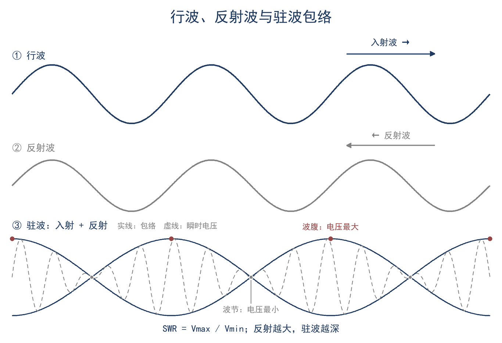
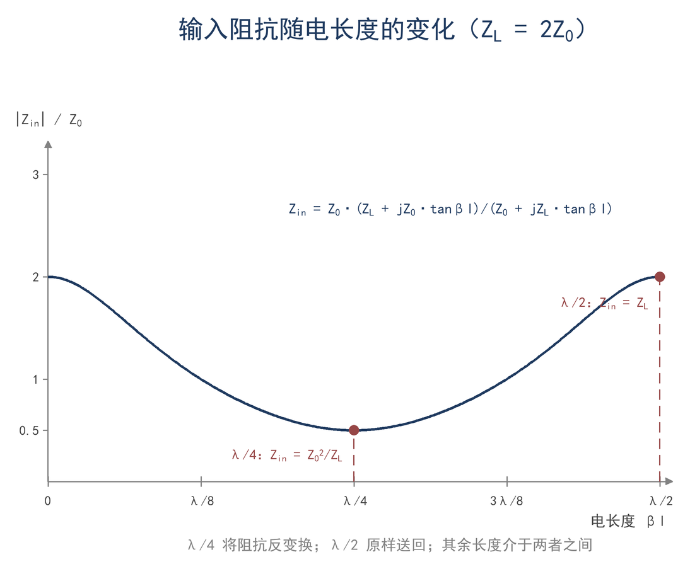
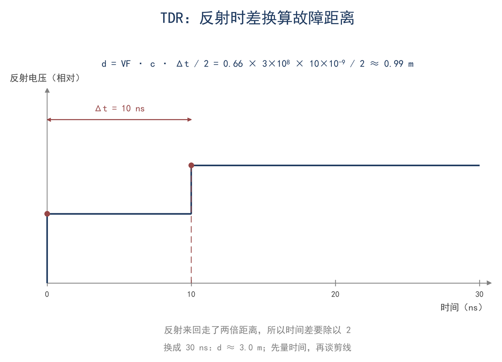

# 第 7 章 传输线：一根电缆里的波

> **这一章会用到**：第 3 章的复阻抗与相量、第 4 章的导数与偏导记号。第 6 章的微分方程解法不是必需的，本章会直接给出解并代回方程检验。

## 一、同一根馈线，长度不同，SWR 读数也不同

40 m 偶极架在楼顶，天线端在 7.05 MHz 上接近谐振，用天线分析仪测得约 100 Ω，电抗接近零；以 50 Ω 折算，驻波比为 2.0。接入 30 m 馈线后，发射机自带的 SWR 表读数为 1.8；换用 60 m 同型号馈线，读数降到 1.6；再换回 30 m，读数又回到 1.8。天线、频率和发射机都没有改变，改变的只有馈线长度。

这个现象要拆成两个问题。第一个问题是损耗：反射波从天线回到发射机的路上要被电缆衰减一次，去的时候也要衰减一次，往返共两次；线越长，回到发射机端的反射波越弱，表上看到的反射系数就越小，SWR 读数随之降低。第二个问题是相位：即使电缆完全没有损耗，电压和电流沿线传播时也有相位差，发射机端看到的输入阻抗会随线长改变，天调需要的元件值也随之改变；但无耗时反射系数的模不变，所以 SWR 读数不会因相位旋转而改变。

把这两点分开，第一节的读数就有了清楚的解释：1.8 和 1.6 的差别来自损耗，而不是天线发生了变化；天线端的 SWR 始终是 2.0。反过来，如果一根线完全没有损耗，那么无论接 30 m 还是 60 m，发射机端的 SWR 都应相同，改变的只是输入阻抗的相位和调谐位置。下面的推导会先说明电缆为什么不能用集总元件描述，再依次得到波速、特性阻抗、输入阻抗和损耗的表达式。

## 二、为什么电缆要按分布参数处理

一段导线在低频时可以看成一条等电位线：同一时刻各处电流相同，电压降只由电阻决定。这个近似成立的条件是导线的几何尺寸远小于波长。7.05 MHz 的自由空间波长是 42.6 m，在 VF = 0.66 的电缆内约为 28.1 m；30 m 馈线已经超过一个线上波长，线上各点的电压和电流不再同相，集总近似失效。工程上常以 λ/10 作为粗略界限：线长超过波长的十分之一，就应当按传输线处理；30 m 在 7 MHz 上远超这个界限，在 145 MHz 上更是如此。

传输线用两个分布参数描述：每米电感 L（H/m）和每米电容 C（F/m）。电流在导体中流动时，周围产生磁场，磁场能量对应串联电感；内外导体之间加有电压时，介质中建立电场，电场能量对应并联电容。电缆的导体电阻和介质漏电则分别用每米串联电阻 R 和每米并联电导 G 表示，这两项在有耗线一节再引入。先假设线是均匀、无耗的，即 L、C 沿长度不变，R = G = 0。

在线上取坐标 z，考察 z 到 z+dz 的一小段。设这段线两端的电压分别为 V(z) 和 V(z+dz)，流过它的电流为 I。串联电感上的电压降等于 L·dz·∂I/∂t，因此

$$ V(z+dz) − V(z) = −L·dz·∂I/∂t $$

两边除以 dz，令 dz 趋于零，得

$$ ∂V/∂z = −L·∂I/∂t $$

再看并联电容。流入 z+dz 处节点的电流是 I(z)，流出的是 I(z+dz)，二者之差给电容充电：

$$ I(z) − I(z+dz) = C·dz·∂V/∂t $$

除以 dz 并取极限，得

$$ ∂I/∂z = −C·∂V/∂t $$

这两式合称电报方程。把第一式对 z 再求一次偏导，得 ∂²V/∂z² = −L·∂²I/∂z∂t；把第二式代入，∂I/∂z 对 t 的偏导等于 −C·∂²V/∂t²，于是

$$ ∂²V/∂z² = LC·∂²V/∂t² $$

上式即一维波动方程（F7-1）。电流 I 满足同样的方程，只需对第二式作相同处理。式中的 LC 有明确的量纲：L 的单位是 H/m，C 的单位是 F/m，乘积是 s²/m²，因此 1/√(LC) 的单位是 m/s，正是一个速度。这个速度就是波在电缆中传播的速度，下一节会从解中把它定出来。

电报方程成立的前提是：线均匀、截面满足 TEM 或准 TEM、材料线性、无耗。接头、弯折和线径突变处不满足“均匀”，要把线切成几段分别处理，再在交界处用电压和电流连续的条件接起来。本章默认一条线是均匀的，因此只有负载端和输入端两个接口。同轴电缆的截面尺寸远小于波长，电场和磁场都被限制在内外导体之间，横向场占主导，纵向分量很小，这种模式称为横电磁模（TEM）；实际电缆因损耗存在很小的纵向分量，称为准 TEM。正因如此，一维的电压和电流就足以描述线上的波，不必写出完整的电磁场。

## 三、方程的解：两列行波

波动方程的通解可以写成两个任意波形的叠加：

$$ V(z,t) = f(z − vt) + g(z + vt) $$

其中 f 表示向 +z 方向传播的波，g 表示向 −z 方向传播的波。把它代回 F7-1：f 对 z 的二阶导数是 f″，对 t 的二阶导数是 v²f″；g 同理。于是

$$ f″ + g″ = LC·v²·(f″ + g″) $$

要对任意 f、g 都成立，必须有 v² = 1/(LC)，即

$$ v = 1/√(LC) $$

由此得到波速。通解中的 f 和 g 可以是任何形状，说明电缆不改变波形，只让它延迟和衰减；方波、脉冲和调制的包络都以同一个速度前进，这也是电缆可以传数字信号的原因。

单频情况下，取 f、g 为正弦波更方便。设角频率 ω = 2πf，相位常数 β = ω/v，则

$$ V(z,t) = V⁺·cos(ωt − βz) + V⁻·cos(ωt + βz) $$

V⁺ 和 V⁻ 分别是前行波和反向波的幅度。固定一个相位点，例如令 ωt − βz = 常数，则 z 随时间以速度 ω/β = v 增加，这正是行波的含义；相位常数 β 表示单位长度上相位落后的弧度数，与波长的关系是

$$ β = 2π/λ_g，λ_g = v/f $$

λ_g 是电缆内的波长，简称线上波长（F7-2）。代入 L ≈ 255 nH/m、C ≈ 100 pF/m，得 v ≈ 1.98×10⁸ m/s；7.05 MHz 时 λ_g ≈ 28.1 m，只有真空波长的 0.66 倍。这个比值称为速度因子 VF，由介质的相对介电常数决定，近似为 1/√ε_r。

仅有电压的解还不够，电流也要满足电报方程。把 V 的表达式对 z 求导：

$$ ∂V/∂z = β·V⁺·sin(ωt − βz) − β·V⁻·sin(ωt + βz) $$

由 ∂V/∂z = −L·∂I/∂t，得

$$ ∂I/∂t = −(β/L)·[V⁺·sin(ωt − βz) − V⁻·sin(ωt + βz)] $$

对 t 积分，并利用 β = ω√(LC)，得

$$ I(z,t) = (1/Z_0)·[V⁺·cos(ωt − βz) − V⁻·cos(ωt + βz)] $$

其中 Z_0 = √(L/C)，下一节专门讨论。这个结果说明：前行波的电压与电流同相，比值是 Z_0；反向波的电流带负号，比值是 −Z_0。把 I 的表达式代回电报方程可以逐项验证，符号和系数都一致。

单列前行波携带的功率为 P⁺ = V⁺²/(2Z_0)（V⁺ 为峰值）；若用有效值 V_rms，则 P⁺ = V_rms²/Z_0。能量并不在铜导体内部传输：导体只提供边界条件，功率在内外导体之间的介质中以电磁场的形式传播；趋肤效应增大导体损耗，但不改变这个图像。

当负载不等于 Z_0 时，部分入射波在负载处被反射，反向波与前行波叠加。电压沿线出现最大值和最小值，形成驻波。设某点的反射系数为 Γ = V⁻/V⁺，则电压最大值是 |V⁺| + |V⁻|，最小值是 ||V⁺| − |V⁻||，两者之比就是驻波比：

$$ SWR = (1 + |Γ|)/(1 − |Γ|) $$

波节之间的间距是 λ_g/2。图 7-1 把行波、反射波和驻波包络画在一起：行波的包络是一条水平线，驻波的包络有固定的波腹和波节。反射系数的完整计算放在第 8 章，本章只需要知道：负载失配会产生反向波，反向波的相位随位置变化，因而输入阻抗也随线长变化。

行波在线上走过一段长度，相位就滞后 βl。30 m 的线在 7.05 MHz 上约为 1.07 个线上波长，相位转过约 385°，因此电缆不能当成普通导线：它既是延迟线，也是相位变换器。延迟时间和相位滞后是同一个物理事实的两种说法，前者用于时域，后者用于频域。

## 四、特性阻抗：前行波的电压电流比

上一节已经得到，前行波的电压与电流之比是

$$ Z_0 = √(L/C) $$

这个比值称为特性阻抗（F7-3）。它之所以在沿线各点都一样，是因为前行波的电压和电流都按 e^(−jβz) 变化，相位因子相同，相除后抵消，只剩由 L、C 决定的实数。这一点可以直接从电报方程看出来：把 V = V⁺e^(−jβz)、I = I⁺e^(−jβz) 代入 ∂V/∂z = −L·∂I/∂t 和 ∂I/∂z = −C·∂V/∂t，两式分别给出 V⁺/I⁺ = √(L/C)，符号也一致。

Z_0 不是电阻。电阻消耗能量，Z_0 描述的是行波中电压与电流的比值，无耗时它不消耗能量。Z_0 也与线长无关：式中没有长度，一段 1 m 的线和一段 1000 m 的线，只要结构和介质相同，Z_0 都是 50 Ω；长度改变的是延时和损耗，不是这个比值。用直流欧姆表量一段开路电缆，读数是无穷大，但它的 Z_0 仍然是 50 Ω，原因就在这里。

“与线长无关”也可以从连接两段相同的线来理解：接点两侧的每米 L、C 相同，前行波看不到参数突变，因而不产生反射，接点处的电压与电流之比仍为 Z_0。若两段线的 Z_0 不同，接点处出现参数突变，一部分波被反射，这正是接头和转接器要保证阻抗连续的原因。

有耗时，电报方程中多出 R 和 G，特性阻抗变成复数：

$$ Z_0 = √((R + jωL)/(G + jωC)) $$

在低耗近似下，虚部很小，Z_0 仍可近似为 √(L/C)。短波段这个近似足够好；频率升高后趋肤效应和介质损耗都增强，虚部不可忽略，选线时要按厂家给出的数据计算。

Z_0 的数值由同轴内外导体的几何比例和介质决定。增大外导体内径与内导体外径之比，每米电感增大、电容减小，Z_0 升高；介质介电常数越大，每米电容越大，Z_0 越低。同轴线的估算公式是

$$ Z_0 ≈ (138/√ε_r)·lg(D/d) $$

其中 D 是外导体内径，d 是内导体外径，lg 是常用对数。50 Ω 是一个折中值：功率容量最大的阻抗约 30 Ω，损耗最小的阻抗约 77 Ω，二者之间取 50 Ω，兼顾功率和损耗，因而成为电台和测试仪器的标准接口。平行馈线和明线的 Z_0 较高，通常为 300–600 Ω，原因是线间距大、每米电容小。

## 五、输入阻抗：负载与线长的共同作用

一段长度 l、终端接 Z_L 的线，从输入端看进去是什么阻抗？做法和任何电路一样：写出线上电压和电流的通解，在负载处用边界条件定出反向波的幅度，再回到输入端计算电压与电流之比。

取负载所在位置为 z = 0，输入端在 z = −l。用复振幅表示，线上电压和电流为

$$ V(z) = V⁺·e^(−jβz) + V⁻·e^(jβz) $$

$$ I(z) = (1/Z_0)·[V⁺·e^(−jβz) − V⁻·e^(jβz)] $$

在负载处 z = 0，电压与电流之比必须等于 Z_L：

$$ Z_L = Z_0·(V⁺ + V⁻)/(V⁺ − V⁻) $$

解出反向波与前行波之比，即负载处的反射系数：

$$ Γ_L = V⁻/V⁺ = (Z_L − Z_0)/(Z_L + Z_0) $$

这个式子是第 8 章反射系数公式的来源，本章先用它。把 Γ_L 代回输入端 z = −l 的电压和电流：

$$ V(−l) = V⁺·e^(jβl)·[1 + Γ_L·e^(−2jβl)] $$

$$ I(−l) = (V⁺·e^(jβl)/Z_0)·[1 − Γ_L·e^(−2jβl)] $$

两式相除，得到输入阻抗

$$ Z_in = Z_0·(1 + Γ_in)/(1 − Γ_in)，Γ_in = Γ_L·e^(−2jβl) $$

这一步说明：从负载到输入端，反射系数的模不变，相位转过 2βl；无耗线上 |Γ| 沿线处处相同，改变的只是相位。因此 SWR 沿线不变，而输入阻抗随长度周期变化。

把 Γ_L 的表达式代入，并令 x = βl，得

$$ Z_in = Z_0·[(Z_L + Z_0) + (Z_L − Z_0)·e^(−2jx)]/[(Z_L + Z_0) − (Z_L − Z_0)·e^(−2jx)] $$

分子分母同乘以 e^(jx)，把含 e^(jx) 与 e^(−jx) 的项分别合并，利用 e^(jx) + e^(−jx) = 2cos x、e^(jx) − e^(−jx) = 2j·sin x，得

$$ Z_in = Z_0·(Z_L·cosβl + jZ_0·sinβl)/(Z_0·cosβl + jZ_L·sinβl) $$

分子分母同除以 cosβl，整理得

$$ Z_in = Z_0·(Z_L + jZ_0·tanβl)/(Z_0 + jZ_L·tanβl) $$

上式即输入阻抗公式（F7-4）。它的条件是：均匀 TEM 或准 TEM 线、无耗或低耗、单频，l 从负载算起。式中 tanβl 以 π 为周期，所以输入阻抗以 λ_g/2 为周期重复；长度改变和频率改变都通过 βl 起作用，二者可以互相换算。图 7-2 画出了 Z_in 随电长度的变化，标出了 λ/4 和 λ/2 两个位置。

由 F7-4 可以直接读出几个特例。当 βl = π/2，即线长为 λ_g/4 时，tanβl 趋于无穷，分子分母同除以 tanβl，得

$$ λ/4：Z_in = Z_0²/Z_L $$

当 βl = π，即线长为 λ_g/2 时，tanβl = 0，得

$$ λ/2：Z_in = Z_L $$

这两式合记作 F7-5。λ/4 线能把纯电阻 R_load 变换成 Z_0²/R_load：一副 100 Ω 的纯阻天线，若要接到 50 Ω 馈线上，可用一段特性阻抗 Z_0′ = √(50×100) = 70.7 Ω 的 λ/4 线，输入端就是 50 Ω；14.1 MHz、VF = 0.66 时，这段线长 3.51 m。它只在设计频率附近有效，而且负载必须是纯电阻；负载带虚部时，要先串或并一个元件把虚部抵消，再谈变换。反过来，100 Ω 天线接一段 50 Ω 的 λ/4 线，输入端变成 50²/100 = 25 Ω，说明 λ/4 线只完成 Z_0²/Z_L 这一种变换，并不能匹配任意阻抗。

λ/2 线在无耗近似下把 Z_L 原样送到输入端。这条性质常被误解为“剪一段 λ/2 的线就能改善 SWR”。实际上，λ/2 线不改变负载阻抗，也不改变线上的驻波和损耗，它只是把负载阻抗送回到输入端；频率一变，βl 偏离 π，这个“原样”就失效了。剪线改变的只是表的位置，不是天线的状态。

终端开路和短路是另外两个有用的极限。令 Z_L → ∞，F7-4 分子分母同除以 Z_L，得 Z_in = −jZ_0·cotβl；令 Z_L = 0，得 Z_in = jZ_0·tanβl。所以一小段开路线在输入端呈容性，一小段短路线呈感性。7.05 MHz 时，一段 5 m 的短路线约为 0.18 个线上波长，βl ≈ 1.118 rad，tanβl ≈ 2.05，Z_in ≈ +j103 Ω，相当于 2.3 μH 的电感；同样长度的开路线则呈容性。缩短电容、加感线圈和天调里的短截线，用的就是这两个极限。

把 βl 从 0 变到 π，可以看到一个完整周期：短路时 Z_in 从 0 升到 +∞，开路时从 −∞ 升到 0；到 βl = π/2 时两者互换，短路变开路、开路变短路。λ/4 线的阻抗反变换就是这一步的代数写法；到 βl = π 时两者回到各自的原值，周期完成一次。输入阻抗由负载和电长度共同决定，这一点是理解匹配、调谐和短截线的基础。

## 六、有耗线：损耗如何改变读数

真实电缆有导体电阻和介质损耗，电报方程中要加上 R·dz 和 G·dz 两项：

$$ ∂V/∂z = −(R + jωL)·I，∂I/∂z = −(G + jωC)·V $$

消去 I 或 V，得到有耗的波动方程。它的解仍是行波，但幅度沿线按指数衰减：

$$ V(z) = V⁺·e^(−αz)·e^(−jβz) + V⁻·e^(αz)·e^(jβz) $$

α 是衰减常数（Np/m），表示每米幅度衰减的自然对数；功率按 e^(−2αz) 衰减。低耗条件下，α 近似为

$$ α ≈ R/(2Z_0) + G·Z_0/2 $$

第一项来自导体损耗，第二项来自介质损耗。工程上更常用 dB/m，换算关系是 1 Np/m = 8.686 dB/m，因此每米损耗为 8.686α dB。趋肤效应使 R 随 √f 增大，介质损耗随 f 增大，所以频率越高、电缆越长，损耗越明显。

反射波在线上要多走一趟：从负载到输入端，再从输入端回到负载。因此输入端看到的反射系数是

$$ Γ_in = Γ_L·e^(−2αl)·e^(−2jβl) $$

取模得 |Γ_in| = |Γ_L|·e^(−2αl)。衰减只改变反射波的幅度，不改变负载处的失配；天线端的 |Γ| 仍是原来的值，只是发射机端观测到的反射变弱了。线越长、损耗越大，两端的 SWR 读数差越大。

用第一节的读数校验。天线端 |Γ_L| = 1/3（SWR 2.0），30 m 线单程损耗按 0.8 dB 估算，往返 1.6 dB。幅度衰减因子是 10^(−1.6/20) = 0.832，于是 |Γ_in| = 0.333×0.832 = 0.277，SWR = (1 + 0.277)/(1 − 0.277) ≈ 1.77，与表上的 1.8 相符。线长加倍到 60 m，往返 3.2 dB，因子 10^(−3.2/20) = 0.692，|Γ_in| = 0.231，SWR ≈ 1.60，与 1.6 相符。可见读数从 1.8 降到 1.6，完全可以用线损解释，不需要假设天线发生了变化。

反过来，也可以用两端 SWR 的差估算线损。若已知天线端 |Γ_L|，测出输入端 |Γ_in|，则往返衰减为 20·lg(|Γ_L|/|Γ_in|) dB，单程损耗是其一半。实际测量要注意 SWR 表的分辨率和接头重复性，线损较小时两端读数差可能只有 0.1–0.2，误差不小；用两段长度不同的同型号线对比，可以减小系统误差。

有耗线的 Z_0 是复数，按 F7-3 的一般式计算，短波段变化不大，VHF 以上需要留意。判断天线端匹配时，应把分析仪接到馈线末端，或用已知线损反算；不宜用发射机端读数直接比较两副天线，因为长而损耗大的线会把失配隐藏起来。

## 七、算例与误区

**算例 1（估算级）：从 C 和 VF 反推 L、Z_0 与每米延时。** 已知 50 Ω 聚乙烯同轴电缆的每米电容 C = 100 pF/m，速度因子 VF = 0.66。波速 v = VF×c = 0.66×3.0×10⁸ = 1.98×10⁸ m/s。由 v = 1/√(LC) 和 Z_0 = √(L/C)，可以先求 Z_0：Z_0 = 1/(vC) = 1/(1.98×10⁸×1.0×10⁻¹⁰) = 50.5 Ω；再求 L = Z_0/v = 50.5/1.98×10⁸ = 255 nH/m。每米延时 t = 1/v = 5.05 ns/m，一根 20 m 的线延时约 101 ns，对 7 MHz（周期 143 ns）约为 0.7 个周期，足以明显改变输入阻抗。

校验：√(L/C) = √(255×10⁻⁹/100×10⁻¹²) = √2550 ≈ 50.5 Ω，与上面一致。换一种电缆，C = 80 pF/m、VF = 0.80，则 v = 2.4×10⁸ m/s，Z_0 = 1/(2.4×10⁸×8.0×10⁻¹¹) = 52 Ω，L = Z_0/v = 217 nH/m。常用对应关系是：VF 0.66 对应 5.05 ns/m，VF 0.80 对应 4.17 ns/m，VF 0.90 对应 3.70 ns/m；VF 越高，同样的物理长度对应的电长度越短。

**算例 2（精确级）：用 TDR 反推故障点。** TDR（时域反射计）向电缆发一个阶跃，观察反射波返回的时间。往返路程等于 v·t，故障点距离 d = v·t/2。设 VF = 0.66，v = 1.98×10⁸ m/s。屏幕上 10 ns 出现反射，则 d = 1.98×10⁸×10×10⁻⁹÷2 = 0.99 m；30 ns 出现反射，则 d = 1.98×10⁸×30×10⁻⁹÷2 = 2.97 m ≈ 3.0 m。

两个要点：读数要除以 2，因为波走了往返；VF 必须用实际值，若把 VF 当成 1，同样 10 ns 会算成 1.5 m，与 0.99 m 相差约 50%。TDR 的空间分辨率由阶跃上升时间决定，约为 v·t_r/2；上升时间 1 ns 时约 0.1 m，要分辨更近的两个故障点，就需要更快的脉冲。反射波与发射波同相，说明反射系数为正，负载阻抗高于 Z_0，开路是极端情况；反相则说明阻抗低于 Z_0，短路是极端情况。这是第 8 章反射系数符号的应用，本章不展开。

如图 7-3，TDR 波形与长度换算。

**误区一：特性阻抗是电阻。** Z_0 = √(L/C) 里既没有长度，也没有 R；它是行波电压与电流的比值。直流欧姆表量到的是导体的通断和几欧姆的直流电阻，与 Z_0 是两回事。一段开路电缆的直流电阻是无穷大，它的 Z_0 仍然是 50 Ω。

**误区二：速度因子会随线长改变。** VF 由介质的相对介电常数决定，近似为 1/√ε_r，同一种线不管多长都一样；长度增加的是延时 t = l/v，不是速度变慢。买同型号的线接长一倍，每米延时不变，总延时翻倍。

**误区三：把馈线剪成 λ/2 的整数倍，就能让天调轻松。** 由 F7-5，λ/2 线在无耗近似下把 Z_L 原样送到输入端，它不改变失配，也不改变线损；频率一变，tanβl 就偏离零，这个“原样”随即失效。剪线改变的只是表上的位置，失配和损耗都照旧。

## 八、小结

电缆的尺寸与波长可比时，电压和电流沿线变化，必须用分布参数描述。每米 L、C 决定波速 v = 1/√(LC) 和特性阻抗 Z_0 = √(L/C)。负载失配产生反向波，反射系数为 Γ_L = (Z_L − Z_0)/(Z_L + Z_0)；反向波回到输入端，相位转过 2βl，输入阻抗按 F7-4 随电长度周期变化，周期为 λ_g/2。λ/4 线完成 Z_0²/Z_L 的变换，λ/2 线把负载阻抗原样送回输入端。有耗时，反射波往返被衰减，输入端 |Γ| 按 e^(−2αl) 减小，SWR 读数因而低于天线端。

> **只记一个关系**
>
> 每米 L、C 决定 Z_0 = √(L/C) 与 v = 1/√(LC)；负载失配时，输入阻抗按 tanβl 随电长度旋转，周期为 λ_g/2。

> **一组数**
>
> 50 Ω 聚乙烯同轴：C ≈ 100 pF/m、L ≈ 255 nH/m、VF ≈ 0.66、v ≈ 2.0×10⁸ m/s、延时约 5 ns/m；λ_g = VF×300/f(MHz)。

> **一个适用条件**
>
> F7-1 至 F7-5 用于均匀 TEM（准 TEM）线、无耗或低耗、单频；有耗线的 Z_0 是复数，输入端 SWR 低于天线端，不能拿发射机端读数反推天线匹配。

自检三问：
1. 一根 50 Ω 电缆，为什么开路时用直流表量不出 50 Ω？
2. 7 MHz 时 λ/4 在 VF = 0.66 的电缆里是多长？
3. 天线端 SWR 是 2.0，发射机端为什么可能只有 1.8 甚至 1.6？

习题（答案见附录 D）：
1. ★ 已知 C = 80 pF/m、VF = 0.80，求 v、Z_0 与 L。
2. ★ 14.1 MHz、VF = 0.66，求 λ_g 和 λ/4 长度。
3. ★★ 终端接 100 Ω 纯电阻，线长 λ/4，Z_0 = 50 Ω，求 Z_in；若线长改成 λ/2 呢？
4. ★★ 天线端 |Γ| = 0.5，30 m 线单程损耗 1.0 dB，求发射机端 |Γ| 和 SWR。
5. ★★★（测量）用一段已知长度的同轴和 TDR 或天线分析仪，测出 VF 和故障点位置，与本章公式对照。
