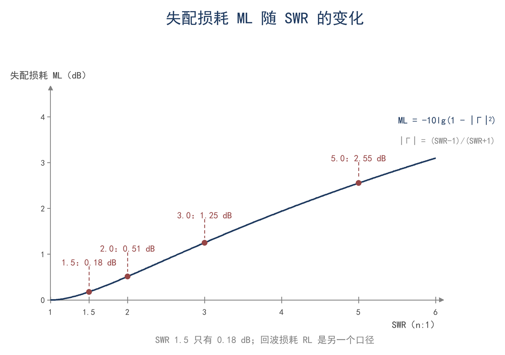
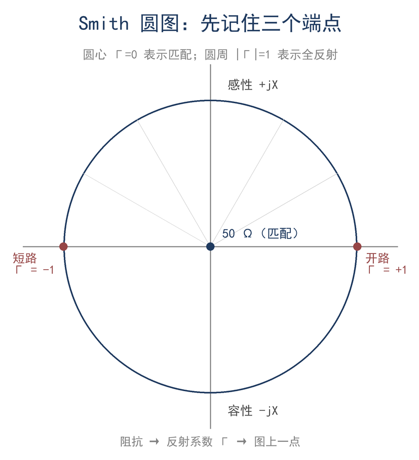
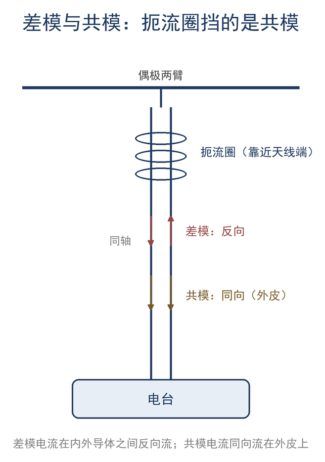

# 第 8 章 反射、驻波与匹配：把功率送进天线

> **这一章会用到**：第 3 章的复阻抗与相量；第 7 章的 Z_in 公式、特性阻抗与线上波长。

## 一、天线不是 50 Ω 时，功率去了哪里

14.1 MHz 的垂直天线在天线分析仪上显示 36 − j120 Ω，发射机却要求 50 Ω 的纯阻负载。接上天调，把发射机端的 SWR 调到 1.0，通信对方的信号强度没有变化。被调到 1.0 的只是发射机端的读数，天线端的阻抗与馈线里的驻波都没有改变。

读数与现象之间隔着几层接口：发射机输出端、馈线、天线端。功率离开发射机之后有几个去处：在天线端被反射、沿馈线返回的功率，在馈线导体与介质中变成热的功率，由天线辐射出去的功率，以及回到发射机后被源吸收的功率。天调改变的是发射机看到的阻抗，它既不能让已经被反射的功率免于再次经过馈线，也不能提高天线自身的辐射能力。

要判断这副天线能不能用，需要把几笔账分开。反射多少由负载与馈线的阻抗关系决定，线损多少由电缆的衰减决定，辐射多少由天线的辐射电阻与损耗电阻决定。前两笔在这里算清，第三笔留到第 9 章。计算之前先回答一个更基本的问题：阻抗不相等，为什么会产生反射波。

## 二、边界条件给出反射系数

一列向负载传播的行波，沿线各点的电压与电流之比等于特性阻抗 Z_0（第 7 章 F7-3）。负载处却要求 V_L/I_L = Z_L。若 Z_L ≠ Z_0，单独一列前行波无论幅度取多少，都无法同时满足"线上是 Z_0"与"负载处是 Z_L"这两个条件。电压与电流在负载处仍然连续，基尔霍夫定律没有被违反；不匹配的是两者的比值。矛盾靠第二列波解决：反射波与前行波叠加之后，总电压与总电流之比可以取 Z_0 以外的值，边界条件则唯一地定出反射波的大小与相位。

设入射波的复振幅为 V⁺，反射波为 V⁻，特性阻抗为 Z_0，负载阻抗为 Z_L = R_L + jX_L。负载处的总电压与总电流是两列波的叠加：

$$ V_L = V⁺ + V⁻ ， I_L = (V⁺ − V⁻)/Z_0 $$

负载是线性无源元件，电压与电流还必须满足欧姆定律：

$$ V_L = I_L · Z_L $$

把前两式代入第三式，得

$$ V⁺ + V⁻ = (V⁺ − V⁻)·Z_L/Z_0 $$

两边乘以 Z_0，把含 V⁺ 与 V⁻ 的项分别归拢：

$$ V⁺(Z_0 − Z_L) = −V⁻(Z_0 + Z_L) $$

于是负载处的反射系数为

$$ Γ_L = V⁻/V⁺ = (Z_L − Z_0)/(Z_L + Z_0) $$

记作 F8-1。它是复数：模 |Γ| 给出反射波与入射波的幅度比，相角给出两者在负载处的相位差。

反射带走的功率比例为 |Γ|²，进入负载的功率比例为 1 − |Γ|²，两者相加为 1。这个分配与反射波的相位无关，只由模决定；相位决定的是反射波与入射波在负载处同相还是反相，因而决定沿线驻波的波腹落在什么位置。由 F8-1 可以直接读出三种极端：Z_L = Z_0 时 Γ = 0，没有反射；Z_L = 0 时 Γ = −1，全反射且反射波反相；Z_L → ∞ 时 Γ = +1，全反射且反射波同相。

取一副 100 Ω 的纯电阻天线接到 50 Ω 线上校验：Γ = (100 − 50)/(100 + 50) = 1/3。反射功率占 |Γ|² = 1/9 ≈ 11.1%，进入天线的占 88.9%。这个数与第 7 章用 SWR 2.0 描述同一副天线是同一件事，下一节会把两种写法接起来。

反射系数还随观察位置变化。取负载处为 z = 0，向发射机方向为正。入射波从发射机走向负载，沿 −z 传播，写作 V⁺e^(+jβz)；反射波沿 +z 传播，写作 V⁻e^(−jβz)。两者相除，得

$$ Γ(z) = Γ_L·e^(−2jβz) ， β = 2π/λ_g $$

系数 2 来自往返：从负载走到位置 z 再反射回来，反射波比入射波多走 2z。无耗线上 |Γ| 沿线不变，变化的只有相角；每走 λ_g/4，相角转 −π，反射系数变号；每走 λ_g/2，相角转 −2π，回到原值。同一副天线换一段长度的馈线，模与 SWR 不变，输入阻抗的相角却会改变，这一点在第四节会用到。

## 三、驻波、Z(z) 与四个 dB 口径

沿馈线移动测量点，电压表读数会周期性起伏；起伏的大小与负载失配的程度有关。两列反向传播的波叠加时，相位相同的点电压相加，相位相反的点电压相减，位置固定，形成驻波。

设入射波幅度为 |V⁺|，把负载处的反射系数写成 Γ_L，任意位置的电压为

$$ V(z) = V⁺·e^(+jβz)·[1 + Γ_L·e^(−2jβz)] $$

取模，e^(+jβz) 的模为 1，于是

$$ |V(z)| = |V⁺|·|1 + Γ_L·e^(−2jβz)| $$

记作 F8-2。括号内是一个单位圆上的向量加上 1：当它与 1 同相时，模取最大值 1 + |Γ|；反相时取最小值 1 − |Γ|。因此

$$ |V|_max = |V⁺|·(1 + |Γ|) ， |V|_min = |V⁺|·(1 − |Γ|) $$

最大值与最小值之比称为驻波比（SWR）：

$$ SWR = (1 + |Γ|)/(1 − |Γ|) $$

沿线移动时，移动的是测量点；波腹与波节的位置固定，只是测量点扫过它们。|Γ| 不变，所以 SWR 不变。相邻两个电压波腹相距 λ_g/2，波腹到相邻波节相距 λ_g/4。电流的驻波与电压互补：电压波腹处电流最小，电压波节处电流最大。用电压表或电流表测量，找到的是同一组波节位置。实际测量时不一定碰得到波腹，可以量两个相邻波节的间距，它等于 λ_g/2；再除以速度因子，才得到自由空间波长：

$$ λ_air = λ_g / VF $$

VF < 1，所以自由空间波长比线上波长更长。以第 7 章的 50 Ω 聚乙烯电缆为例，VF = 0.66、7.05 MHz 时 λ_g = 28.1 m，λ_air = 28.1/0.66 ≈ 42.6 m；若把除法写成乘法，会得到 18.5 m，与真实值相差一倍多。

功率分配也可以用 dB 表示。反射功率与入射功率之比是 |Γ|²，进入负载的功率与入射功率之比是 1 − |Γ|²。回波损耗与失配损耗分别定义为

$$ RL = −20lg|Γ| ， ML = −10lg(1 − |Γ|²) $$

即 F8-3。RL 用幅度比，系数是 20；ML 用功率比，系数是 10。仪器上的 S11 是反射系数的 dB 值，S11 = −RL，带负号；两个量不要混用。

**表 8-1 SWR、|Γ|、回波损耗与失配损耗**

| 量 | 定义 | 2:1 时 | 符号约定 |
|---|---|---|---|
| Γ | 反射系数（复数） | 模 1/3 | 模决定 SWR，相角决定驻波位置 |
| SWR | (1+\|Γ\|)/(1−\|Γ\|) | 2.0 | 写作 n:1 |
| RL | −20lg\|Γ\| | 9.5 dB | 取正；S11 = −RL |
| ML | −10lg(1−\|Γ\|²) | 0.51 dB | 入射与进入负载之比 |

取 |Γ| = 1/3 代入：RL = −20lg(1/3) ≈ 9.54 dB，ML = −10lg(1 − 1/9) ≈ 0.51 dB。|Γ| = 0.5 时 ML = −10lg(0.75) ≈ 1.25 dB。失配损耗随 |Γ|² 增长，SWR 从 2:1 升到 3:1，读数变化明显，损耗增量却不到 1 dB。SWR 1.5 时多出来的损耗约 0.18 dB，比一个普通接头还小；决定实际到达天线功率的是线损、天线效率与匹配网络损耗，SWR 读数只是其中一项。ML 只统计"入射与进入负载"之间的差，不包含反射波回到源之后再次产生的损耗。

驻波还会抬高线上的电压。电压波腹处的电压是入射波的 1 + |Γ| 倍。SWR 3:1 时 |Γ| = 0.5，倍数为 1.5。若天线端实得 100 W，入射功率为 100/(1 − 0.25) ≈ 133 W，入射波电压有效值为 √(133×50) ≈ 82 V；波腹处电压为 82×1.5 ≈ 122 V 有效值，峰值约 173 V。天调电容与馈线绝缘要按这个电压选择，不能按匹配时的 70.7 V 计算。

简易驻波表的分辨率通常是 0.1，读数 1.5 表示真值落在 1.4 到 1.6 这个区间，这是读数间隔决定的，不是表的准确度；用它比较两副天线时，这个间隔常常大于两者的真实差别，第 16 章会把误差来源展开。如图 8-1，失配损耗随 SWR 上升得很慢，纵轴是对数刻度。

## 四、从 Γ 到 Z：圆图方程与三个端点

分析仪给出的量是反射系数，匹配网络需要的却是阻抗。两者之间只差一次代数变换：把同一位置的电压除以电流。由第二节与第三节，

$$ V(z) = V⁺·e^(+jβz)·[1 + Γ(z)] $$

$$ I(z) = (V⁺/Z_0)·e^(+jβz)·[1 − Γ(z)] $$

两式相除，e^(+jβz) 与 V⁺ 都消去，得沿线任意一点的输入阻抗：

$$ Z(z) = Z_0·(1 + Γ(z))/(1 − Γ(z)) $$

把 Γ(z) = Γ_L·e^(−2jβz) 代入，分子分母同乘 e^(+jβz)：

$$ Z(z) = Z_0·(e^(jβz) + Γ_L·e^(−jβz))/(e^(jβz) − Γ_L·e^(−jβz)) $$

再代入 Γ_L = (Z_L − Z_0)/(Z_L + Z_0)，分子分母同乘 (Z_L + Z_0)，并利用 e^(jβz) + e^(−jβz) = 2cosβz、e^(jβz) − e^(−jβz) = 2j·sinβz。先看分子：

$$ (Z_L + Z_0)e^(jβz) + (Z_L − Z_0)e^(−jβz) = 2Z_L·cosβz + 2jZ_0·sinβz $$

分母：

$$ (Z_L + Z_0)e^(jβz) − (Z_L − Z_0)e^(−jβz) = 2Z_0·cosβz + 2jZ_L·sinβz $$

两式相除，公共因子 2 约去，得到

$$ Z(z) = Z_0·(Z_L·cosβz + jZ_0·sinβz)/(Z_0·cosβz + jZ_L·sinβz) $$

这正是第 7 章的 F7-4，只是把线长 l 写成了位置 z。第 7 章从负载边界条件和波的传播推出它，这里从反射系数推出它，两条路得到同一个结果。圆图不是第三个公式，而是这个式子的几何画法：把 Z 平面映射到 Γ 平面，沿线移动就是绕原点转圈。

令归一化阻抗 z = Z/Z_0，则 z = (1 + Γ)/(1 − Γ)，反解得 Γ = (z − 1)/(z + 1)。右半阻抗平面被映射到单位圆内：纯电阻落在实轴上，感性在上半圆，容性在下半圆；圆心 Γ = 0 对应 z = 1，即 50 Ω；右端 Γ = +1 对应开路，左端 Γ = −1 对应短路。沿等驻波圆移动，|Γ| 不变，SWR 不变，变的只是相角，匹配网络的作用就是把负载点移到圆心。

取 z = 2 + j1（即 100 + j50 Ω）校验：

$$ Γ = (z − 1)/(z + 1) = (1 + j1)/(3 + j1) = 0.4 + j0.2 $$

其模 |Γ| ≈ 0.447，与 SWR ≈ (1 + 0.447)/(1 − 0.447) ≈ 2.6 对应。如图 8-2，三个端点与等驻波圆给出了沿线阻抗变化的全部信息；无耗线只旋转相角，所以改变馈线长度只旋转输入阻抗，SWR 读数不变。

## 五、匹配网络：L 网络、λ/4 与变压器

匹配网络的任务是把一个复数阻抗变成 50 Ω 的纯阻。实现这件事的元件只有电抗：串联电抗改变电阻分量并抵消虚部，并联电抗把电阻分量升高或降低。以最常见的 L 网络为例，负载为纯电阻 R_low，要变到较高的 R_high。

先看串联支路 R_low + jX_s 的并联等效。串联阻抗的 Q 定义为电抗与电阻之比，Q = |X_s|/R_low。把串联支路改写成并联形式，并联电阻与并联电抗分别为

$$ R_p = R_low·(1 + Q²) ， X_p = X_s·(1 + 1/Q²) $$

要让并联后的电阻等于 R_high，需 R_high = R_low(1 + Q²)，解出

$$ Q = √(R_high/R_low − 1) $$

串联电抗取 X_s = Q·R_low。并联支路再并上 −X_p，把电抗抵消，留下的就是纯电阻 R_high。把 X_s 代入 X_p 的表达式，并用 R_high = R_low(1 + Q²) 化简，得 X_p = R_high/Q。三式合记作 F8-4：

$$ Q = √(R_high/R_low − 1) ， X_串 = Q·R_low ， X_并 = R_high/Q $$

用本章开头那副 36 − j120 Ω 的天线校验。先串联 +j120 Ω 的电感抵消天线电抗，14.1 MHz 时 L = 120/(2π×14.1×10⁶) ≈ 1.35 μH，补偿后负载变为 36 + j0 Ω。再把 36 Ω 变到 50 Ω：Q = √(50/36 − 1) ≈ 0.62；串联电抗 X_串 = 0.62×36 ≈ 22.4 Ω，对应电感 253 nH；并联电抗 X_并 = 50/0.62 ≈ 80.2 Ω，对应电容 141 pF。复核：2π×14.1×10⁶×253×10⁻⁹ ≈ 22.4 Ω，1/(2π×14.1×10⁶×141×10⁻¹²) ≈ 80.1 Ω，与设计值一致。

两笔计算要分开看。1.35 μH 只抵消天线自身的电抗，不改变电阻；L 网络才把 36 Ω 变换到 50 Ω。若只做后者，纯阻负载的失配损耗仅从 0.12 dB 降到 0，收益很小；使发射机端得到 50 Ω 纯阻的，是消电抗与阻抗变换的共同结果。串联臂的两段电抗可以直接相加：120 + 22.4 ≈ 142 Ω，用一个约 1.6 μH 的电感就能一次实现；分成两笔写只是为了看清各自的作用。L 网络也有代价：Q 越高，匹配越尖锐，带宽越窄；阻抗比越大，Q 越高。若负载电阻高于 50 Ω，把串联与并联的位置对调，Q 的定义不变，只是把 R_high 与 R_low 互换。

λ/4 变换器走另一条路。由第 7 章 F7-4，令 βl = π/2，线长为 λ_g/4，tanβl 趋于无穷，分子分母同除以 tanβl 后取极限，得

$$ Z_in = Z_0'²/Z_L $$

取 Z_0' = √(Z_in·R_L)，就能把纯电阻 R_load 变换到指定的输入电阻。36 Ω 变到 50 Ω 时，Z_0' = √(36×50) ≈ 42.4 Ω。它的限制有三条：负载必须是纯电阻（带虚部时要先消电抗）、只在设计频率成立、只在窄带内有效。

变压器与巴伦靠匝数比工作。设初级 N₁ 匝、次级 N₂ 匝，n = N₂/N₁。理想变压器功率不变，电压按 n 升高，电流按 n 降低，阻抗按 n² 升高：

$$ Z₂/Z₁ = n² ， V₂/V₁ = n $$

记作 F8-5。4:1 的阻抗变换对应 2:1 的匝数比，49:1 对应 7:1。端馈半波天线的馈电点阻抗很高，常用 49:1 的变压器把它降到 50 Ω 附近；这里起作用的是匝数比的平方，而不是两个电阻的比值。

## 六、同轴外皮的第三种模式：共模与扼流

天调把发射机端的 SWR 调到 1.0 之后，手碰机壳，SWR 会跳动，话筒偶尔发麻。差模传输已经匹配，问题出在同轴外皮的另一种电流上。

同轴线正常工作时只有一种模式：内导体电流与外皮内表面电流大小相等、方向相反，磁场被限制在内外导体之间，这是差模。当天线是平衡结构、馈线是不平衡结构时，外皮外表面还会出现第三种电流：共模电流。把两根导体上的电流分解成差模与共模：

$$ I_dm = (I₁ − I₂)/2 ， I_cm = (I₁ + I₂)/2 $$

反过来，I₁ = I_dm + I_cm，I₂ = −I_dm + I_cm。共模电流的路径是"天线→馈线外皮→机壳→地"，它不参与有用辐射，却让机壳带电、让 SWR 随手的位置变化、让方向图畸变。它的危害不在功率大小，而在把馈线变成了天线的一部分：馈线参与辐射之后，天线端看到的方向图与阻抗都变了。共模电流的大小取决于天线与馈线系统的平衡程度，平衡越好，外皮电流越小。平衡天线接到不平衡馈线时，两臂电流不再对称，差值只能经外皮返回；天线的架设高度、馈线走向与接地方式都会改变这个差值。

治理办法是在共模路径上串一个高阻抗，即扼流圈。匝数为 N、电感为 L 的扼流圈对共模呈现的阻抗约为 |Z_cm| ≈ ωL；差模电流在磁芯里产生的磁通相互抵消，几乎不受影响。设共模路径本身的阻抗约 50 Ω，扼流圈在 7 MHz 上提供 1 kΩ，共模电流下降

$$ 20lg[(Z_cm + 50)/50] ≈ 20lg(1050/50) ≈ 26 dB $$

这个估算解释了绕几圈同轴为什么有用，也解释了扼流圈为什么要装在天线端：装得越靠近天线，被挡住的共模路径越短。共模阻抗与差模阻抗相互独立，因此扼流圈可以在不影响差模传输的前提下抑制外皮电流；抑制量取决于 |Z_cm| 与共模路径阻抗之比，两者相差越大，抑制越强。

扼流圈的电感并非越大越好。电感过大时分布电容把它旁路，高频段反而失效；磁环饱和也会使电感下降。按经验，应让 |Z_cm| 至少达到共模路径阻抗的 10 倍，相当于 20 dB 抑制，并在最低工作频率上仍然成立。

还要分清 1:1 电流巴伦与扼流圈。电流巴伦内部有两个绕组，强制两臂电流大小相等、方向相反，同时提供共模阻抗；扼流圈只提供共模阻抗，不改变阻抗比。端馈天线用的 49:1 变压器是阻抗变换，不等于扼流；两个功能可以分开做，也可以做在一个器件里。如图 8-3，扼流圈串在共模路径上，差模几乎不受影响。

## 七、算例与误区

**算例 1（估算级）**：36 Ω 天线直连 50 Ω。Γ = (36 − 50)/(36 + 50) = −0.163，|Γ| = 0.163；SWR = 1.39，RL = 15.8 dB，ML = −10lg(1 − 0.0266) ≈ 0.12 dB。反射功率约占 2.7%。直连完全可用，失配损耗比一个普通接头还小。

**算例 2（精确级）**：用 λ/4 线把 36 Ω 变到 50 Ω，频率 28 MHz、VF = 0.66。线上波长 λ_g = 0.66 × 300/28 ≈ 7.07 m，λ/4 ≈ 1.77 m；特性阻抗 Z_0' = √(36×50) ≈ 42.4 Ω。复核：Z_in = Z_0'²/R_load = 42.4²/36 ≈ 50.0 Ω。限制：只在这个频率、这个纯阻负载上成立；负载带电抗时先消电抗。

**校验**：表 8-1 的 2:1 一行由 F8-3 复核。|Γ| = 1/3，RL = 9.54 dB，ML = 0.51 dB，两数与表中一致；S11 显示 −9.54 dB，与 RL 只差一个符号。

**误区一：SWR 低就是效率高。** 有耗线的 |Γ| 沿线下降，发射机端测到的 SWR 会比天线端低；低 SWR 可能来自线损，而不是来自匹配。判断效率要看辐射电阻与损耗电阻，不能只看 SWR。

**误区二：回波损耗、失配损耗、S11 是一回事。** RL 取正、S11 取负、ML 是“入射与进入负载之比”；三个量在 2:1 时分别是 9.5 dB、−9.5 dB、0.51 dB。RL 与 ML 相差约 19 倍，把 ML 当成 RL 会高估失配的后果。

**误区三：匹配就是谐振。** 谐振是电抗为零，匹配是输入阻抗等于 50 Ω。36 Ω 的天线在谐振时仍然是 36 Ω，SWR 仍是 1.39；要变成 50 Ω，还得加变换。

**误区四：天调能把效率调上去。** 天调只改变发射机看到的阻抗，不改变天线的辐射电阻与损耗电阻。一副辐射电阻 3 Ω、损耗电阻 27 Ω 的短天线，效率只有 10%；天调把它匹配到 50 Ω 后，效率仍然是 10%，只是发射机不再被失配保护。要提效率，只能改天线。

**误区五：驻波高会烧馈线。** 驻波本身不消耗功率，它只是让线上电压与电流的分布出现峰谷。真正发热的是导体损耗与介质损耗；发射功率固定时，线损约为匹配时的 (1 + |Γ|²)/(1 − |Γ|²) 倍，SWR 3:1 时约 1.67 倍。驻波高是警告信号，不是直接原因。

## 八、小结

> **只记一个关系**
>
> 反射系数是复数：模决定 SWR 与失配损耗，相角决定驻波位置与输入阻抗。

> **一组数**
>
> 36 Ω 直连 50 Ω：SWR 1.39、ML 0.12 dB；λ/4 变换器 Z_0' = √(R_load×50)，28 MHz、VF 0.66 时约 1.77 m；4:1 阻抗比 = 2:1 匝数比。

> **一个适用条件**
>
> 以上都成立在单频、线性、无源负载；有耗线上发射机端 SWR 低于天线端，不能反推天线端 SWR。

自检三问：

1. 一副 36 Ω 的天线直连 50 Ω，失配损耗是多少？需要匹配吗？
2. 同一副天线换一段无耗馈线，发射机端 SWR 会变吗？什么情况下读数才会变？
3. 4:1 巴伦的匝数比是多少？49:1 呢？

习题（答案见附录 D）：

1. ★ 已知 Z_L = 100 + j0 Ω、Z_0 = 50 Ω，求 Γ、SWR、RL、ML。
2. ★ 50 Ω 系统里，SWR = 3:1 时反射功率占多少？失配损耗多少 dB？
3. ★★ 用 L 网络把 25 Ω 纯阻匹配到 50 Ω，求 Q、串联电抗与并联电抗（频率 14 MHz，给出 L、C 值）。
4. ★★ 一段 42.4 Ω、VF = 0.66 的 λ/4 线，在 28 MHz 上把 36 Ω 变到多少？线长多少米？
5. ★★★ 用天线分析仪测一副天线的 |Γ| 随频率曲线，找出谐振点（X = 0）与最小 SWR 点，解释两者为什么不一定是同一个频率（提示：有耗线与馈线变换）。
