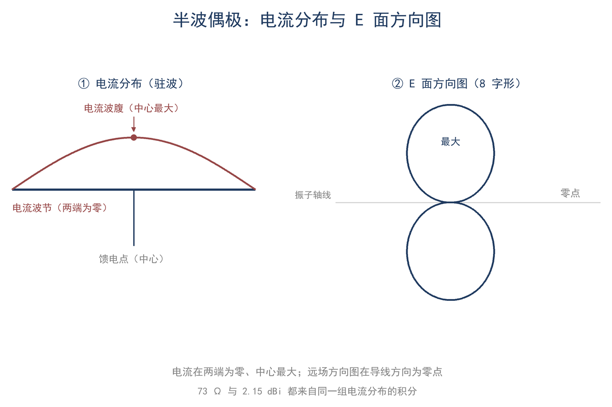
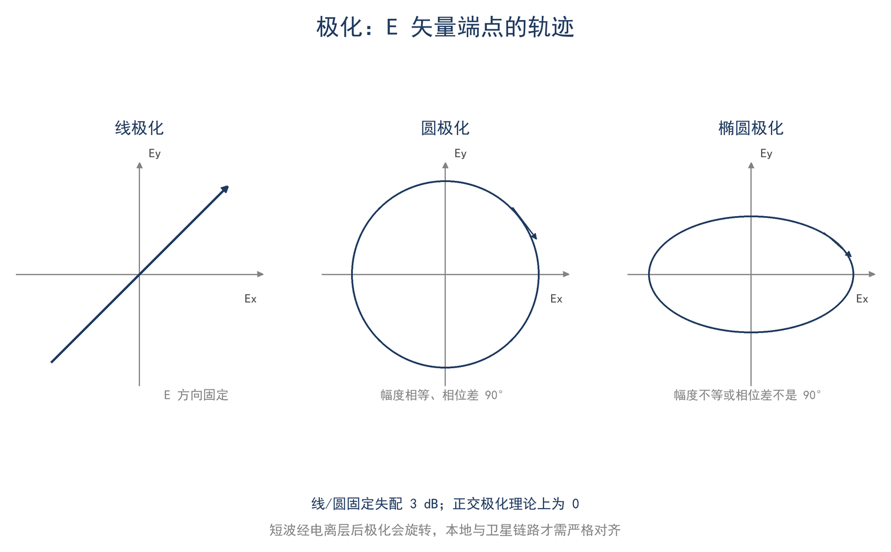
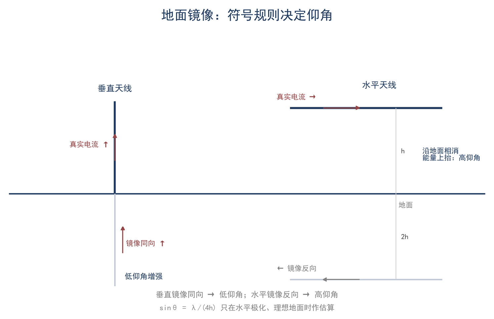

# 第 9 章 天线的物理：电流怎么变成波，功率去了哪里

> **这一章会用到**：第 3 章的相量与复阻抗、第 6 章的远场 E/H = 377 Ω 与近场判据（★6 可跳过，用到时会给出结论）。

本章回答一个问题：导线上的电流，怎么变成远处按方向分布的场，又怎么变成 73 Ω、2.15 dBi、−61 dBm 这些能算的数。

## 一、从电流到远场：一个积分决定方向图

14.1 MHz、100 W 送进一副 20 m 半波偶极。馈电点的电流沿天线按正弦分布：中心最大，两端为零。它的数学形式是：

I(z) = I_0·sin[k(l/2 − |z|)]

I_0 是波腹电流（A），l 是天线的全长（m），z 从中心量起（m），k = 2π/λ（rad/m）。条件：细导线、孤立、谐振附近、自由空间。100 W、R_r ≈ 73 Ω 时，波腹电流的有效值是 √(100/73) ≈ 1.17 A，峰值约 1.66 A；后面的数字都从这里来。

每个电流元都在辐射，远处某点的场是各电流元贡献的叠加。不同位置的电流元到该点的路程不同，路程差转化为相位差，叠加结果随方向变化，方向图由此产生。严格地说，远处 t 时刻收到的场由各点在 t−r/c 时刻的电流产生，这一推迟效应在本章只用到"路程差变相位差"这一结论。

远场幅度正比于电流分布的积分 ∫ I(z)·e^(jkz·cosθ) dz：e^(jkz·cosθ) 为相位因子，kz·cosθ 为路程差对应的相位。沿振子方向（θ=0）时相位因子随 z 快速旋转，正负贡献相消，因而无辐射。电流分布的形状决定方向图，本章不再展开积分运算。

把半波偶极的电流分布代进去，得到远场方向图函数（F9-1）：

$$ f(θ) = cos((π/2)·cosθ) / sinθ $$

θ 是从振子轴量起的角度（rad），f(θ) 是无量纲的方向图幅度。它描述包含振子的那个平面（E 面）：θ = 90°（垂直于振子）时 f = 1，是最大方向；θ = 0°（沿振子方向）时 f = 0，没有辐射。H 面（垂直于振子的平面）是圆的。方向图的 −3 dB 宽度约 78°。

如图 9-1，左边是电流分布，右边是 E 面方向图。

知道了 f(θ)，两个数就能算出来：辐射电阻和方向性。它们来自同一个积分。

## 二、偶极的两个数：73 Ω 与 2.15 dBi 来自同一个积分

远场功率密度为 S = E²/377。将 E 写成 f(θ)/r 的常数倍并对整个球面积分，得总辐射功率 P_rad；以波腹电流定义辐射电阻 P_rad = ½I_0²R_r，方向性系数取最大与平均功率密度之比。两者归结为同一积分（F9-2）：

$$ R_r = 60·J，D = 2/J，J = ∫f²dΩ/(2π) $$

R_r 是辐射电阻（Ω），D 是方向性系数（无量纲），J 是无量纲积分，dΩ = sinθ·dθ·dφ 是立体角元（sr）。对半波偶极，J = Cin(2π)/2 = 1.219（Cin 是余弦积分，没有初等原函数），代入得：

R_r = 60×1.219 ≈ 73 Ω，D = 2/1.219 ≈ 1.64。

1.64 换成分贝是 10×lg(1.64) = 2.15 dBi。73 Ω 和 2.15 dBi 是同一个积分的两种读法：前者说"这个结构在给定电流下辐射多少功率"，后者说"这些功率集中在多窄的范围里"。辐射电阻以波腹电流为参考；若改用馈电点电流作参考，数值会随电流分布改变，因此引用 73 Ω 时必须同时说明参考电流与长度条件。

这两个数的物理含义比结论本身更重要。辐射电阻 73 Ω 表示电流与辐射功率的兑换关系：P_rad = ½I_0²R_r，波腹电流为 1 A 峰值时辐射功率约 36.5 W；该关系只对正弦电流、细线与半波长度成立。方向性 1.64 表示最大方向功率密度相对平均值的倍数，由 f(θ) 的形状决定，与总功率无关。同一副天线输入功率加倍时 R_r 与 D 均不变；振子缩短时 R_r 按 (l/λ)² 下降，D 仍接近 1.5。两者描述不同性质，却来自同一球面积分：积分在球面上的总值决定辐射功率，积分在最大方向的值决定功率集中程度。短天线的主要问题是效率，而非方向性。

> **【推导】60J 的来历**
>
> 远场电场幅度正比于 I_0·f(θ)/r，时间平均功率密度为 S=|E|²/(2×377)；对球面积分后与 R_r 的定义相除，常数合并为 60，即 R_r=60J、D=2/J。

适用条件要写清楚：自由空间、孤立细线（线径远小于波长）、中心馈电、正弦电流、全长等于 λ/2。λ/2 时输入阻抗不是纯电阻（约 73+j42.5 Ω；谐振时约 70 Ω，缩短系数约 4%–5%）。粗线、近地、加感、附近有金属或寄生单元时，电流偏离正弦，73 Ω 和 2.15 dBi 都要修正。

J 的数值由方向图决定，半波偶极是 1.219。长度一变，电流分布和方向图一起变，J 跟着变，两个数都要重算：短偶极的方向图更宽，但它的远场幅度系数也小，R_r 按 (l/λ)² 迅速下降（短偶极的 R_r ≈ 197(l/λ)²，就是这条趋势）；全波偶极的方向图出现旁瓣，R_r 和 D 又都不同。因此"73 Ω"只能用在半波偶极上，不能拿来算任意一根线。

方向性再乘效率才是实际增益：G = D×η。2.15 dBi 是方向性（η = 100%）；实际天线有损耗，增益低于它。把这两个数当作"半波偶极的固定属性"普遍套用，是后续多处误用的来源：加感天线的电流分布不是正弦，短天线的 R_r 小得多，这两个数都不适用。

## 三、有效面积：接收功率怎么算

接收天线不是"接收功率"的器件，它接收的是空间里的功率密度 S，能截获多少由有效面积 A_e 决定（F9-3）：

$$ A_e = G·λ²/(4π) $$

A_e 是有效面积（m²），G 是增益（倍数，不是 dBi），λ 是波长（m）。对半波偶极，G = 1.64，20 m 波段 λ = 21.3 m：A_e = 1.64×21.3²/(4π) ≈ 59 m²。一根细导线的"有效面积"远大于它的几何投影面积；波长越长，同样增益对应的 A_e 越大。这解释了一个常被忽略的事实：低波段天线尺寸小、效率低，但有效面积大，所以几十瓦也能通很远。

F9-3 的用途是把发射端的方向图与增益换算为接收端的等效截获面积；它不含接收机噪声与损耗，因此给出的是到达天线端的可用功率。

接收功率就是功率密度乘有效面积：P_rx = S·A_e。可以这样理解：发射功率铺在半径 r 的球面上，收端只截获自己那一片"口径"；功率密度按 r² 掉，而 A_e 与 λ² 成正比，波长越长口径越大。

这个式子不是定义，它可以从互易推出来：

> **【推导】A_e = Gλ²/(4π) 的来历**
>
> 由互易定理，两副天线交换收发角色时传输功率相同。将发射端功率密度 S=PG/(4πr²) 与接收端 P_rx=S·A_e 分别列出并相除，几何因子与距离消去，得 A_e/G=λ²/(4π)。

互易关系说明：发射方向的功率集中程度，在接收时表现为同一方向上的截获能力；收发共用同一几何因子，故 A_e/G = λ²/(4π) 与天线形状无关。该关系把上一节的方向图与本节的有效面积联系起来，是自由空间链路公式的依据。

把两式相乘，得到自由空间链路公式：P_rx = P_t·G_t·G_r·(λ/(4πr))²。本章只用它做量级检查，完整链路（电离层、地面、噪声）在第 15 章。

功率密度由发射端决定（F9-4）：

$$ S = P·G/(4πr²)，E = √(377·S) $$

P 是发射功率（W），G 是发射天线增益（倍数），r 是距离（m），S 是功率密度（W/m²），E 是场强（V/m，有效值）。条件：远场、自由空间、最大增益方向。这两个式子和第 6 章的 F6-5 是同一件事的两种写法：发射端算出 S 和 E，接收端用 A_e 把 S 变成功率。

以 14.1 MHz、100 W、相距 1000 km 的两副半波偶极为例，可由 F9-4 与 F9-3 依次求得接收功率，完整计算见本章算例 1。结果表明，自由空间下 20 m 波段千公里量级的接收功率在 pW–nW 量级（约 −61 dBm），计入电离层、地面与极化损耗后还要再低 10–25 dB。

上述公式均以远场为前提：观察点须满足 r > 2D²/λ、r ≫ λ 与 r ≫ D，其中 D 为天线最大尺寸。在近场中，功率密度与场强不满足 377 Ω 的比例关系，F9-3 与 F9-4 不能直接使用。远场判据的物理含义是：距离足够远时，球面波在局部可近似为平面波，E/H=377 Ω 与功率密度公式才成立。

## 四、极化：三个数

极化是远场电场矢量在一个周期内的轨迹。工程上最常用的三个结论是：两个线极化正交时理论全损、线极化对圆极化固定损失 3 dB、同旋圆极化全收。本节把它们写成一个公式：极化失配因子 PLF 是接收天线极化向量与来波极化向量的归一化点积的模平方（F9-5）：

$$ PLF = |ρ_w·ρ_a*|² $$

ρ_w 是来波的极化单位向量（复数），ρ_a 是接收天线的极化单位向量，* 表示共轭，PLF 是功率比（无量纲，0 到 1）。换成 dB 是 10×lg(PLF)。PLF 取模的平方，是因为功率正比于场强的平方：两极化向量的点积给出场强在接收方向上的投影，投影后再平方才是功率比。这里的"向量"是复二维的，本质上是第 3 章相量的两个分量；不用展开也能用：表 9-1 的四行已经把工程上绝大多数情况覆盖了。

**表 9-1 极化组合与 PLF**

| 来波与接收天线 | PLF | dB |
|---|---|---|
| 两个线极化，夹角 α | cos²α | α = 0 时 0 dB；90° 时理论 −∞ |
| 线极化对圆极化（任意夹角） | 1/2 | −3.0 dB |
| 同旋圆极化对圆极化 | 1 | 0 dB |
| 反旋圆极化对圆极化 | 0（理论） | 实际约 −20…−30 dB |

如表 9-1，线极化之间的失配随夹角变化，在 45° 附近损失约 3 dB；线极化接收圆极化时固定损失 3 dB；圆极化同旋与反旋的差别可达 20–30 dB。

短波天波穿过电离层时极化面会旋转（法拉第旋转），所以 HF 远距离通信中极化不是主要矛盾；甚高频/特高频（VHF/UHF）直射、卫星和本地中继则必须对齐。极化还解释了为什么"交叉极化天线"能降低干扰：把接收天线转 90°，同频的本地垂直极化噪声会被压低 20 dB 以上，而远地天波信号因为极化旋转，损失远小于 20 dB。

椭圆极化用轴向比 AR 描述：AR 是极化椭圆长轴与短轴之比，1 是圆极化，趋于无穷是线极化。实际天线多是椭圆极化，PLF 要代两个复向量；工程上先按"接近线"或"接近圆"处理，够判断要不要转天线。极化分集降噪也靠这个思路：本地人为噪声多是垂直极化，把水平天线的极化方向用对，通常还能改善几个 dB 的信噪比。

如图 9-2，线、圆、椭圆极化的电场矢量轨迹。

## 五、地面与镜像：两个阵因子

理想导体地面上，垂直地面的电流镜像同向，平行地面的电流镜像反向。地面的作用可以写成两个阵因子，下面给出形式与适用条件。

地面是理想导体时，真实天线和它的镜像构成一个二元阵，远场是两者的叠加。阵因子只取决于高度 h、波长和仰角 θ（从地面量起）：

水平电流（水平偶极）的阵因子是 2|sin(k·h·sinθ)|；垂直电流（垂直天线、单极子）的阵因子是 2|cos(k·h·sinθ)|。k = 2π/λ，h 是架设高度（m），θ 是仰角（rad）。两个式子的符号差来自镜像方向：水平电流镜像反向，两个源相减，所以是 sin；垂直电流镜像同向，两个源相加，所以是 cos。两个因子只描述地面的作用；地面效果可看作间距为 2h 的二元阵，故高度改变时主瓣仰角与零点位置随之改变。

从这两个式子可以直接读出方向图随高度的变化。水平偶极在 h=λ/4 时最大辐射指向天顶，h=λ/2 时最大辐射仰角为 30°；继续升高，主瓣压低，但会在较高仰角出现附加波瓣。垂直天线在 h 较小时低仰角辐射较强，这是其适合远距离通信的原因；单极子在天顶方向为零。零点源于镜像与直射波在某一仰角正好反相，因此远距离通信与近垂直入射天波对架设高度的要求相反。

地面因子的物理来源是直射波与反射波的路程差：二者到达远场同一点时所走路径不同，高度或仰角改变时，两列波的相位关系随之改变，方向图便出现最大值与零点的交替。

适用条件：理想导体平面、远场、正弦稳态，而且 h 不能太低（一般 h > 0.1λ）。真实地面不是理想导体，反射系数 |Γ| < 1，相位也不是理想值：零点被填平，低仰角增益下降，垂直极化对电导率最敏感（海面 > 湿地 > 干地）。h < 0.1λ 时阵因子失效，改用地面损耗电阻 R_g 的模型，线圈的损耗电阻记为 R_loss，接地与地面的损耗记为 R_g，效率写成 η = R_r/(R_r + R_loss + R_g)。R_r 小到 1 Ω 量级，而线圈、接地和地面的损耗有十几欧，η 被 R_loss + R_g 主导；这不是"匹配没调好"，是辐射电阻本来就小。

垂直单极子在地面上的辐射电阻约 36 Ω，只有偶极的一半；方向性却加倍到 3.28（5.15 dBi），因为它只向上半空间辐射：总功率减半、集中到半个球面，两个效果相乘得到 2 倍方向性。镜像不增加总功率，只改变功率分布；单极子即其例。

镜像是计算方法，不是"多了一副天线"。镜像不会给天线增加功率，它改变的是场的分布，不是功率的天花板。看到"镜像让增益 +3 dB"这种说法，要分清是方向性加倍还是真的多辐射了功率。

如图 9-3，水平与垂直电流的镜像符号和仰角画在一起。

## 六、功率去了哪里：自由空间、地面与曝露边界

天线输入 100 W 时，功率的去向可分为三部分：天线效率使一部分转化为热（η）；辐射部分按 4πr² 扩散，功率密度随距离平方下降；接收端仅截获其中 A_e 那一部分。前两部分由本章公式给出，第三部分的完整数值见算例 1。

场强也可用 dBμV/m 表示（以 1 μV/m 为 0 dB）：70 μV/m 对应 20lg(70)≈37 dBμV/m。将功率密度与场强的关系取对数，得 S 约等于 E(dBμV/m) 减 115.8（S 的单位为 dBm/m²，条件为空气与 377 Ω）。场强表常用 dBμV/m，链路预算常用 dBm，两者是同一量的两种刻度。

上述公式均以远场为前提，不能用于估算近场中的安全距离。以功率密度参考值 S=10 W/m² 为例，由 F9-4 反解距离约 1.14 m，而 20 m 波段的近场边界为 λ/2π≈3.4 m、口径相位判据 2D²/λ≈9.6 m，故 1.14 m 仍处于近场，远场公式不成立；HF 不能用它计算安全距离，VHF/UHF 高增益天线在 1–2 m 外才勉强可用。HF 的近场曝露以场强或功率密度衡量，E 与 H 不成 377 比例；发射时不得接触天线、馈线及加感线圈的裸露部分，观察应使用场强探头或电流探头，不应以接触时的麻感作为判据。曝露限值以现行标准为准。

功率分配还有一条互易结论：同一副天线在发射与接收时的方向图、增益与阻抗相同，故 S=PG/(4πr²) 与 A_e=Gλ²/(4π) 是同一条链路的两个端。由互易可得两条推论：其一，在噪声环境不变时，接收效果可用于验证发射方向图；其二，接收效果良好并不代表发射效率高，后者取决于两端噪声环境，详见第 13 章。两条推论都来自同一事实：天线的收发特性由同一组电流分布决定。

## 七、算例与误区

**算例 1（估算级）：1000 km 自由空间能收到多少？** 14.1 MHz、100 W、两副半波偶极（G = 1.64）、1000 km、自由空间。发射端等效全向辐射功率（EIRP）= P·G，本例 EIRP = 100×1.64 = 164 W；S = 164/(4π×(10⁶)²) = 1.31×10⁻¹¹ W/m²；E = 70 μV/m；A_e = 1.64×21.3²/(4π) = 59 m²；P_rx = 7.7×10⁻¹⁰ W ≈ −61 dBm。量级检查：0.77 nW，落在 pW–nW 量级；实际加 10–25 dB 传播损耗后到 −71…−86 dBm，和 1000 km 单跳的经验值对得上（第 15 章按更完整损耗算得 −71.2 dBm）。换一条路复核：P_rx = P_t·G_t·G_r·(λ/(4πr))² = 100×1.64×1.64×(21.3/(4π×10⁶))² ≈ 100×2.69×2.87×10⁻¹² = 7.7×10⁻¹⁰ W ✓。两条路给出同一个数，说明量级、单位、口径都没错。

**算例 2（精确级）：远场公式算安全距离，错在哪？** 100 W、G = 1.64，取 S = 10 W/m² 示例。r = √(164/(4π×10)) = 1.14 m。判据：λ/2π = 21.3/6.283 = 3.4 m，2D²/λ = 2×10.1²/21.3 = 9.6 m。1.14 m 既小于近场边界，也小于口径相位判据，远场公式不成立。结论：HF 的"安全距离"不能用这个公式给；VHF/UHF 高增益天线要按各自波长和 D 重新判，远场判据见第 6 章。VHF 的例子更直观：2 m 波段十单元八木 D = 3.5 m，λ = 2.07 m，2D²/λ = 11.8 m，λ/2π = 0.33 m，远场从约 12 m 起；在楼顶测 VHF 天线的方向图，多数人站的距离都不够。

**误区一：增益是"放大"。** 错在把无源天线当有源器件。G = D×η，无源天线总辐射功率不会超过输入功率；增益只是把能量集中到某些方向。73 Ω 和 2.15 dBi 都是"电流分布决定"的量，不是放大量。

**误区二：方向图就是天线外形。** 错在把几何投影当辐射分布。方向图由电流分布（和地面、周围金属）决定；同样形状的天线，电流分布不同，方向图就不同。八木的引向器不接馈线，照样强烈影响方向图。

**误区三：极化失配"没什么损失"。** 错在只看近距离经验。正交线极化理论上 PLF = 0；线极化对圆极化固定 3 dB；反旋圆极化理论上收不到。HF 天波因法拉第旋转而弱化极化要求，但 VHF/UHF 直射、卫星和本地中继必须对齐。

## 八、小结

> **只记一个关系**
>
> 半波偶极的 73 Ω 和 2.15 dBi 来自同一个积分（J = 1.219）；A_e = Gλ²/(4π) 把功率密度变成接收功率。

> **一组数**
>
> 自由空间：S = PG/(4πr²)、E = √(377S)、E/H = 377 Ω；半波偶极 A_e ≈ 0.13λ²（20 m 波段约 59 m²）；理想地面上单极子 36 Ω、5.15 dBi；线对线极化失配 cos²α，线对圆 3 dB。

> **一个适用条件**
>
> 所有远场公式要求 r 同时满足 r > 2D²/λ、r ≫ λ、r ≫ D；近场（HF 的 1–10 m）不能用来算安全距离。

自检三问：
1. 73 Ω 和 2.15 dBi 为什么会从同一个积分里出来？
2. 一根细导线的有效面积为什么能有几十平方米？
3. 100 W、20 m 波段，为什么不能用 S = PG/(4πr²) 算 1 m 处的场强？

习题（答案见附录 D）：
1. ★ 半波偶极 G = 1.64，14.1 MHz，求 A_e。
2. ★ 远场 E = 0.5 V/m，求 S 和 H。
3. ★★ 两副偶极相距 500 km、100 W、14.1 MHz、自由空间，求接收功率（dBm）。
4. ★★ 水平偶极架高 0.35λ，求最大辐射仰角（用 |sin(kh·sinθ)|）。
5. ★★★（测量）用已知增益的参考天线和场强探头，在远场测一次功率密度，换算成 E，并与 S = PG/(4πr²) 对照；说明误差来源。
