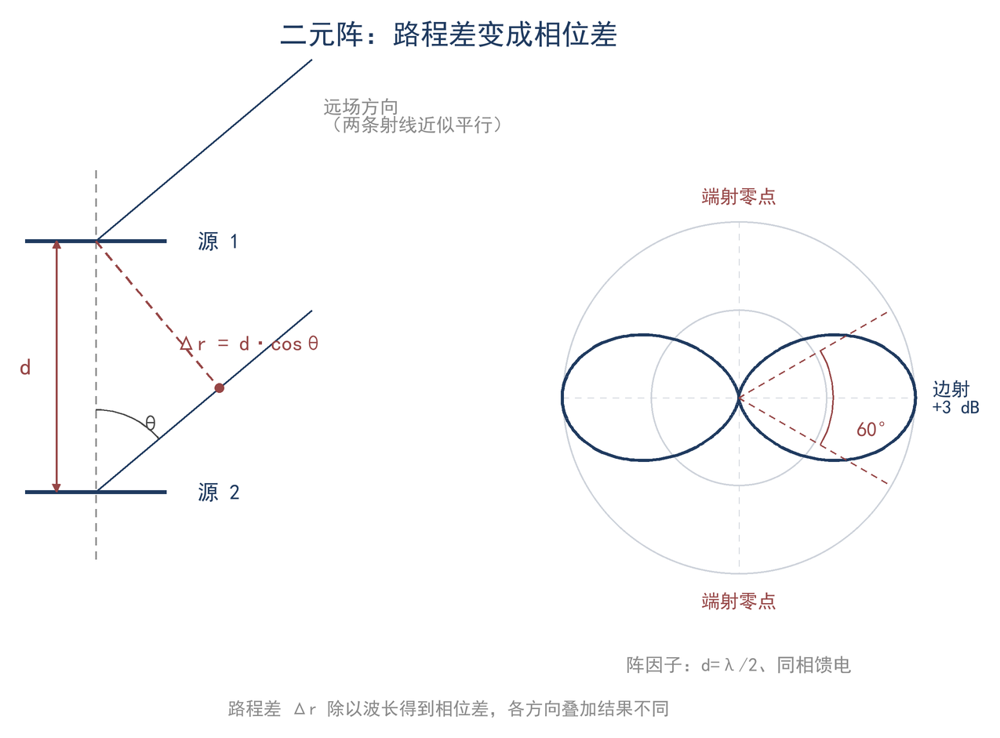
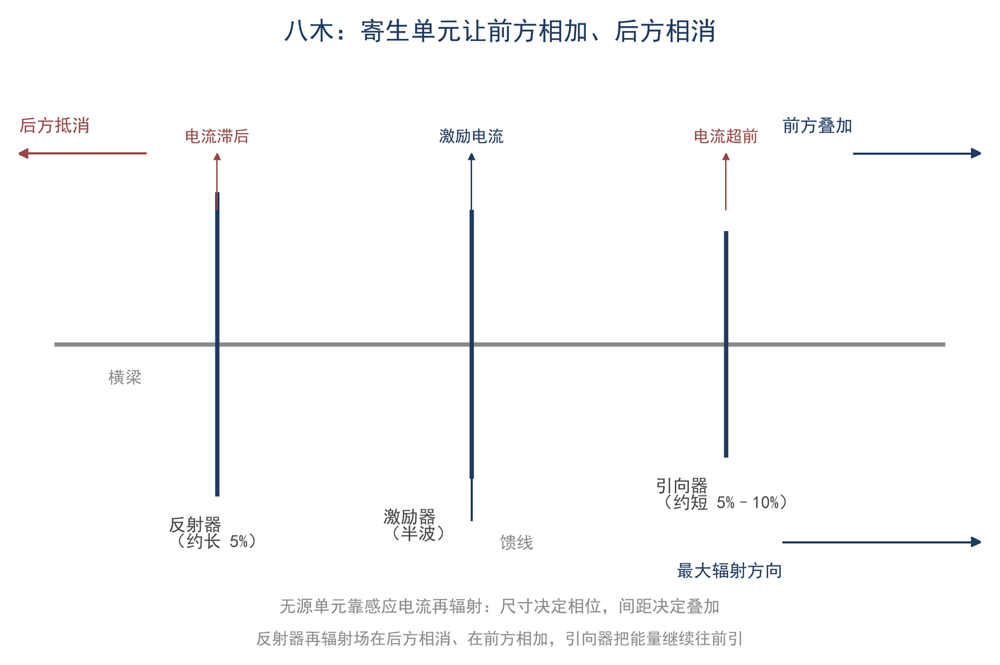

# ★ 第 10 章 阵列与方向图：多根天线怎么叠加

不读本章也能继续读第 11 章；本章只做相位叠加与二元阵，不做口径场积分。

> **这一章会用到**：第 3 章的相量（把正弦量写成复指数再相加）、第 9 章的方向图与增益（半波偶极 2.15 dBi）。

在 20 米波段，爱好者常需在两副偶极上下叠放与一副三单元八木之间取舍：前者的材料成本可能远低于后者，而后者标称增益为 7–8 dBi。两种方案的增益相差多少、来源为何、在什么条件下无法达到标称值，是本章讨论的问题。

本章反复使用三个术语：两个源的连线称为阵轴；与阵轴垂直的方向称为边射（broadside）；沿阵轴的方向称为端射（endfire）。同一副阵在边射与端射的场强可相差到零，八木即利用端射工作。

## 一、两个源的叠加：从路程差到相位差

先把问题缩到最小：两个完全相同的辐射源，相距 d，都朝远处发同一个频率的波。远处的观察点离得足够远，两条射线近似平行。

到观察点的路程不一样长。设观察方向与两天线连线（阵轴）的夹角为 θ，两段路程差是 Δr=d·cosθ。路程差换成相位差，还要加上馈电本身的相位差 δ。于是相邻两个源在远场某点的总相位差为 ψ=k·d·cosθ+δ，其中 k=2π/λ。

ψ 是本章的核心变量：它等于 0 时两列波同相、相加；等于 180° 时反相、相消；其它角度落在两者之间。两列同频波在远场叠加，合振幅只由相位差决定：能量没有消失，只是从相消的方向移到了相加的方向。无源阵不产生功率，只重新分配方向，增益指的就是这件事。

还有一层容易被忽略：ψ 里的 k=2π/λ 随频率变。d=λ/2 的阵在设计频率上边射最强、阵轴为零点；频率偏 10%，电间距变成 0.55λ，零点与波束宽度都会动。二元阵本身带宽较宽，但堆叠多副窄带八木时，阵因子的频率敏感性会叠在八木的窄带上。

把每个源的贡献写成复指数再相加，求和结果由 N、d 和 δ 决定：相邻项同相时相加，反相时抵消；单元数越多，相消的方向越窄，主瓣越窄。N 个等幅、等间距单元的阵因子（F10-1）是

$$ AF = Σ e^(jnψ)，|AF| = |sin(Nψ/2) / sin(ψ/2)| $$

| 符号 | 含义 | 单位 |
|---|---|---|
| N | 单元数 | 个 |
| d | 相邻单元间距 | m |
| k | 2π/λ，波数 | rad/m |
| θ | 观察方向与阵轴的夹角 | rad 或 ° |
| δ | 相邻单元的馈电相位差 | rad |
| AF | 场的相对幅度，最大值为 N | 无量纲 |

适用条件：所有单元相同且取向一致、等幅馈电、互耦可忽略；AF 只描述"阵"的贡献，不含单个单元自己的方向图（下一节补上）。还有一条容易忘：阵因子是远场的概念，观察点要满足第 6 章的远场条件（r > 2D²/λ 且 r ≫ λ、r ≫ D）；在近场里把天线挪几米，方向图就变，谈不上"阵因子"。

> **【推导】阵因子公式从哪来**
>
> 每个单元在远场同一点贡献一个复指数 e^(jnψ)，n=0…N−1；等幅意味着每项系数相同。求和就是等比级数：1+e^(jψ)+…+e^(j(N−1)ψ) = (1−e^(jNψ))/(1−e^(jψ))。分子分母各提出一半相位，取模就得到 |AF|=|sin(Nψ/2)/sin(ψ/2)|。N=2 时代入化简为 2|cos(ψ/2)|，就是下一节的二元阵公式。

在实际架设中，图纸上两副偶极的间距决定 d，馈电点处两段电缆的长度决定 δ。两个量彼此独立，但只有相加才构成 ψ；其中任何一个出错，后续结论都会偏离。

## 二、二元阵：边射、端射、零点与 +3 dB

N=2 时，F10-1 化简成二元阵的阵因子（F10-2）：

$$ |AF| = 2|cos(ψ/2)|，ψ = k·d·cosθ + δ $$

取最常用的布置：两副偶极上下叠放，间距 d = λ/2，同相馈电（δ=0）。20 m 波段 λ=21.3 m，d=10.6 m。此时 ψ=(2π/λ)·(λ/2)·cosθ=π·cosθ。

几个特殊方向立刻能读出来。正侧方（θ=90°，与阵轴垂直，也就是水平方向）ψ=0，|AF|=2：两列波同相，场是单副天线的 2 倍。阵轴方向（θ=0°，垂直向上或向下）ψ=π，|AF|=0：两列波反相，完全抵消，这个方向是零点。

更实用的是半功率波束宽度。|AF| 最大为 2，功率正比于 |AF|²，半功率对应 |AF|=√2。代入 2|cos(π·cosθ/2)|=√2，得 cosθ=0.5，即 θ=60° 与 θ=120°。两个半功率点之间是 60°，即这副二元阵在垂直于振子轴、又包含阵轴的那个竖直面里的波束宽度。

把 |AF| 随 θ 画成曲线，读法与天线分析仪的扫频曲线类似：最高点是边射，落到 √2 的两侧是 −3 dB 点，再往外是旁瓣和零点。方向图是远场量，不能在近场里移动卷尺去"验证"。

现在回答"增益从哪来"。边射方向上两列波同相，场是单副天线的 2 倍，功率密度是 4 倍；但两副天线各分一半输入功率，总输入功率也变成 2 倍。用功率密度除以总输入功率，增益只增加 2 倍，即 10lg2≈3.0 dB。这个 +3 dB 有三个前提：两源等幅同相、单元相同且互耦可忽略、比较时总输入功率相同。如果两副天线分到的功率不相等，或其中一副不馈电，比较口径就要重新定义。

场强增加 6 dB，而增益只增加 3 dB；若把"叠放可增加 6 dB"当作增益结论，则混淆了场强与功率两个口径。加上单元本身的增益（半波偶极 2.15 dBi，见第 9 章），理想情况下总增益为 2.15+3.0=5.2 dBi。该 3 dB 为上限，实际无法达到的原因见第五、六节。

如图 10-1，把两个源的几何、路程差和 |AF| 随 θ 的变化画在一起，边射、端射与 60° 波束宽度一眼可见。

间距换成 λ/4、仍同相：边射仍有 |AF|=2，但阵轴方向 |AF|=2|cos(π/4)|≈1.41，不再是零点，方向图变宽、方向性变弱。间距继续拉大，会出现多个旁瓣：间距越大，主瓣越窄，但"栅瓣"越多，可见间距并非越大越好。

## 三、方向图乘积定理：条件与误用

真实的单元不是各向同性点源，单元自己有方向图。方向图乘积定理（F10-3）说：在满足条件时，总方向图等于单元方向图乘阵因子：

$$ F(θ,φ) = f_e(θ,φ)·AF(θ,φ) $$

它成立要同时满足三条：

1. 所有单元完全相同（长度、形状、取向一致）；
2. 单元放进阵里以后，方向图与单独放置时相同，也就是互耦可以忽略；
3. 各单元的馈电幅度和相位已知，并且能写成 AF 的形式。

两副偶极叠放的例子刚好满足：单元方向图是水平偶极的"面包圈"；在垂直于振子轴、又包含阵轴的那个竖直面里，它是均匀的，所以这个面的方向图完全由 AF 决定：水平方向最强、垂直方向为零点、上下各 30° 是半功率边界，而水平面依然是全向的。堆叠只压垂直面、不压水平面，原因就在这里：增益来自把原本射向高仰角的功率移到低仰角，不是凭空放大。

换个单元，结论就变。两副垂直偶极上下叠放时，单元方向图在阵轴方向本来就有零点，乘上 AF 以后零点更深；同样叫"两元阵"，单元取向不同，总方向图不是一回事；所以必须先看单元方向图，再谈阵因子。

误用最常见的是套八木。八木各单元长度不同、互耦很强，既没有"全同单元"，也没有"单元方向图不变"，乘积定理的两条前提同时不成立。八木的总场只能逐单元相加，这正是第 17 章建模软件在做的事；本章后面只做定性叠加，不套乘积定理。

还有一条容易混淆的加法：总增益（dB）约等于单元增益（dBi）与阵因子增益（dB）之和。两副 2.15 dBi 的偶极同相叠放，理想总增益为 5.2 dBi；换成两副 7 dBi 的八木同相堆叠，理想上限为 10 dBi，实际因互耦与带宽而更低。

## 四、八木：寄生单元的相位机理

八木由接馈线的激励器与若干寄生单元组成。反射器比激励器略长（约 4%–5%）而呈感性，引向器略短（5%–10%）而呈容性；寄生单元被近场感应出电流，其相位由长度与间距共同决定，使前向叠加、后向相消（图 10-2）。各单元电流由互阻抗耦合决定，精确计算需解联立方程组，属于第 17 章的内容。方向图除前向主瓣外还有后瓣与旁瓣，前后比为前向最大值与后向最大值之比；抑制后向干扰依靠前后比与零点位置，而非单纯提高增益。

单元数增加的收益递减：每加一个单元都通过互耦改变已有电流，并非在固定方向图上简单叠加；带宽、前后比、损耗和机械代价同时变差。所以"3 单元到 4 单元约 +1 dB、再往上每加一个不到 1 dB"；理想均匀阵长度翻倍能 +3 dB，八木远达不到。

## 五、相位扫描与堆叠

如果给相邻单元一个可控的馈电相位差，主瓣可偏转到指定方向。令 F10-2 中的 ψ 在目标方向 θ₀ 处为零，得到波束指向条件（F10-4）：

$$ δ = −k·d·cosθ₀ $$

其含义是用馈电相位差补偿路程差，使目标方向上的两列波同相。相控阵即据此在水平面内偏转波束；业余条件下更常见的是固定相位差的两元阵。例如 d=λ/2 时，把主瓣从边射转到 60° 需 δ=−π/2（90°），转到端射需 180°。

堆叠是同相特例：两副同型号八木上下叠放并同相馈电，理想增益增加 3 dB，垂直面主瓣变窄。实际增益通常只有 2–3 dB，原因包括：间距小于约 0.5λ 时互耦使乘积定理失效；两副天线离地高度不同，地面反射条件不同；两路馈线不等长引入附加相位，例如 20 m 波段、VF=0.66 时 3.5 m 的差对应约 90°；以及各自的损耗与失配。堆叠时两根馈线应等长，两副天线的型号、安装高度与净空也应尽量一致。

## 六、从波束宽度估增益；互耦：什么时候叠加失效

方向性系数 D 的定义是"最大方向功率密度 ÷ 全空间平均功率密度"。用归一化方向图 F 写出来是（F10-5）

$$ D = 4π·|F_max|² / ∫|F|²·dΩ $$

这个积分一般没有解析解，主线不要求算；它只说明一件事：主瓣越窄、旁瓣越小，方向性越高。对 λ/2 间距的两元阵可以手算：|AF|²=4cos²(πcosθ/2)，对球面积分得 ∫=8π，于是 D_AF=4π×4/(8π)=2，正是 +3 dB。第 17 章会把这类积分做成数值练习；这里只需知道，41253 和经验 +3 dB 是同一个方向性概念的两种算法。工程上更常用的是一个估法（F10-6）：

$$ G ≈ 41253 / (θ_E·θ_H) $$

θ_E、θ_H 是两个主平面里的 −3 dB 波束宽度，单位是度。常数 41253 不是随意取的数：把"矩形主瓣"的近似 D≈4π/(θ_E·θ_H)（角度用弧度）换成度，乘上 (180/π)² 就得到 4π×(180/π)²≈41253。适用条件很窄：单个主瓣、波束足够窄、旁瓣不大、波束宽度按 −3 dB 定义。全向方向图没有两个"波束宽度"，不能套。该估法的精度取决于主瓣形状：波束越接近矩形、旁瓣越小，估计越接近实际；若方向图有深零点或多个宽旁瓣，等效矩形主瓣的假设不再成立，误差可达数 dB。该式只用两个主平面的宽度，未计入后瓣与旁瓣，因此对高前后比天线偏乐观。

这个公式可用于先从两个主平面的 −3 dB 宽度估计增益：其误差通常小于测量误差，可用于判断是否值得检修，但不能代替实测，也不宜作为验收依据。

互耦是叠加失效的总根源。间距小于约 0.5λ 时，每个单元看到的负载被邻居改变，电流不再"各干各的"：增益低于 AF 预测值、零点被填浅、阻抗与 SWR 曲线变形。AF 的 +3 dB 是"互耦为零"的上限，实际堆叠拿 2–3 dB；差额来自互耦、地面、馈线相位与损耗。判断靠第 17 章模型或第 16 章实测。

## 七、地面上的阵列：把镜像加回来

前面的阵因子以自由空间为前提。真实天线架设在地面上，第 9 章的地面因子与阵因子共同作用；将真实阵与其镜像阵一并考虑，总方向图可由单元方向图、阵因子与地面因子相乘得到。本节说明该乘积的来源与适用条件，其中仰角 θ 从地平线量起，与前几节从阵轴量起的 θ 互余；镜像方向仍遵循第 9 章的规则：平行地面的电流镜像反向，垂直地面的电流镜像同向。

> **【推导】地面因子从哪来**
>
> 把一个阵等效成位于高度 h 的源，地面以下有它的镜像：真实源在 +h，镜像源在 −h。远场观察点在仰角 θ，两条路径的路程差是 2h·sinθ，对应相位差 k·2h·sinθ。
>
> 水平电流的镜像反向，两列波相减：e^(j·kh·sinθ) − e^(−j·kh·sinθ) = 2j·sin(kh·sinθ)，取模得 2|sin(kh·sinθ)|。
>
> 垂直电流的镜像同向，两列波相加：e^(j·kh·sinθ) + e^(−j·kh·sinθ) = 2·cos(kh·sinθ)，即 2|cos(kh·sinθ)|。
>
> 这两式就是地面因子，它只描述地面的作用，不含单元和阵的贡献。

把三个因子乘起来，得到地面上的阵列总方向图（F10-7）：

$$ F(θ,φ) = f_e(θ,φ) · AF(θ,φ) · G_g(θ) $$

$$ G_g = 2|sin(kh·sinθ)|（水平电流）或 2|cos(kh·sinθ)|（垂直） $$

三个因子可以相乘的依据是叠加原理：在远场，各单元贡献按相位叠加得到阵因子；地面镜像再以同样方式与整个阵叠加，得到地面因子。只要单元方向图、阵因子与地面因子彼此独立，总场即为三者之积。

三个因子各有前提：f_e 要求单元全同、同取向、互耦可忽略；AF 要求馈电幅度与相位已知，能写成阵因子形式；G_g 要求理想导体地面、远场，且 h 不太低（h > 0.1λ）。乘积还默认整个阵能用一个位于 h 的等效源表示。对阵关于相位中心对称、等幅同相的情况，这与逐单元加镜像的结果完全相同（本节例子属于这一类）；阵很高、单元高差大或各单元相位不同时，要逐单元加镜像，乘积只是近似。

算一个例子：两副水平偶极上下叠放，间距 d=λ/2，阵的参考点高度 h=λ/2。这个竖直面内单元方向图均匀，AF=2|cos((π/2)·sinθ)|，G_g=2|sin(π·sinθ)|；总幅度正比于 |cos((π/2)·sinθ)·sin(π·sinθ)|。零点出现在 θ=0°（地面因子为零）与 θ=90°（阵因子与地面因子同时为零），与第 9 章"水平偶极沿地面为零、天顶也可能为零"的结论一致。对 sinθ 求导：令 sin(π·sinθ/2)=1/√3，得 sinθ≈0.392，主瓣仰角约 23°。作为对照：单副偶极在 h=λ/2 时地面因子的主瓣在 30°；叠成二元阵后，阵因子在低仰角更强，把主瓣拉到约 23°。30° 处的总幅度比最大值低约 0.7 dB。该结果表明，地面使自由空间中的边射主瓣抬高，并使水平方向成为零点；主瓣仰角由架高与间距共同决定。

适用条件：理想导体地、远场。真实地面 |Γ|<1，反射波幅度变小、相位也偏离理想值，结果是零点变浅而不是真正为零、低仰角增益下降；垂直极化对地面电导率最敏感，海面接近理想导体，干燥地面要打折扣。精确设计要用数值模型逐单元加镜像，第 17 章会给出做法。因此，架高与间距是调整仰角的两个独立手段，实际设计需在增益、仰角与旁瓣之间折中。

## 八、算例与误区

**算例 1（估算级，30 秒）**：20 m 波段，两副半波偶极上下叠放，间距取 λ/2≈10.6 m，同相馈电。ψ=π·cosθ；边射（水平方向）|AF|=2，场 +6 dB、功率 +3 dB；阵轴方向为零点；半功率点在 cosθ=0.5，即 θ=60° 与 120°，波束宽度 60°。总增益约 2.15+3.0=5.2 dBi。实际因互耦、地面与馈线相位，常见落在 4.5–5.2 dBi；差值要靠模型或实测判断。复核：λ/2=21.3/2=10.6 m；20lg2=6.0 dB，10lg2=3.0 dB；由 |AF|=√2 解出 cosθ=0.5，三个数在纸上都能对上。

**算例 2（精确级）**：一副三单元八木实测 E 面 −3 dB 宽 65°、H 面 85°。用 41253 估：G≈41253/(65×85)=41253/5525≈7.5，即 8.7 dBi。三单元八木的典型值是 7–8 dBi，差约 1 dB。差在哪：波束不是矩形、有旁瓣、两个主平面的波束宽度定义不完全一致、增益最大值不一定落在两个主平面的交线上。所以这个公式可用于估到 ±1–2 dB、判断是否值得检修，不宜作验收依据；增益报到 0.1 dB 无实际意义。复核：65×85=5525，41253/5525≈7.47，10lg7.47≈8.7 dB；三个数可在计算器上一次算完。

**误区一：单元越多，增益越高，没有上限。** 错在把"理想均匀阵长度翻倍 +3 dB"当成了所有阵列的规律。八木每加一个单元都要通过互耦改变已有电流，还要挤占带宽和前后比，实际增量迅速降到一个 dB 以下。

**误区二：阵因子就是总方向图。** 错在漏了单元方向图，也漏了乘积定理的三个条件。垂直叠放的水平偶极，垂直面由 AF 决定、水平面由单元决定；换一种单元，同一副阵的方向图就变了。

**误区三：把 41253 公式用到全向或强旁瓣方向图。** 半波偶极的 78°×360° 算出来 1.7 dBi 与真值只差 0.5 dB，是巧合；换成有深零点、多个旁瓣的方向图，误差可以到几个 dB。用之前先看它是不是"窄波束、单主瓣"。

## 九、小结

> **只记一个关系**
>
> 阵因子把"路程差 + 馈电相位差"变成方向：同相边射时场是两倍、功率是四倍，但输入功率也翻倍，所以增益只 +3 dB。
>
> **一组数**
>
> λ/2 间距、同相：AF=2、波束宽度约 60°、20 m 波段间距约 10.6 m；G≈41253/(θ_E·θ_H)（度）。
>
> **一个适用条件**
>
> 乘积定理只对全同单元、同取向、互耦可忽略的阵成立；八木和相距小于约 0.5λ 的阵都要打折扣，实际增益靠模型或实测确认。

自检三问：

1. 两副偶极同相叠放，为什么"场 +6 dB"不等于"增益 +6 dB"？
2. 乘积定理要满足哪三条？八木缺了哪一条？
3. 两副三单元八木堆叠，实测只多了 2.2 dB，可能的原因有哪三类？

习题（答案见附录 D）：

1. ★ 两个相同点源间距 d=λ/4、同相馈电。写出 ψ(θ)，求边射与阵轴方向的 |AF|，说明阵轴方向还是不是零点。
2. ★ 上题的二元阵，最大方向在哪里？如果改成反相馈电（δ=π），最大方向又在哪里？
3. ★★ 两副相同偶极堆叠，间距 λ/2、同相。求 −3 dB 波束宽度；若馈线相位差 90°，合成损失多少 dB？
4. ★★ 一副八木 E 面 −3 dB 宽 50°、H 面 70°，用 41253 估增益；与"典型 3 单元 7–8 dBi"比较，说明误差来源。
5. ★★★（拓展，测量）选一个传播稳定的时段，交替切换"单副偶极"与"两副偶极（间距 λ/2、同相）"，用接收信号中值比较，估实际堆叠增益；写出你如何避免把传播变化误当成天线差异，并解释结果与 3 dB 的差距。
