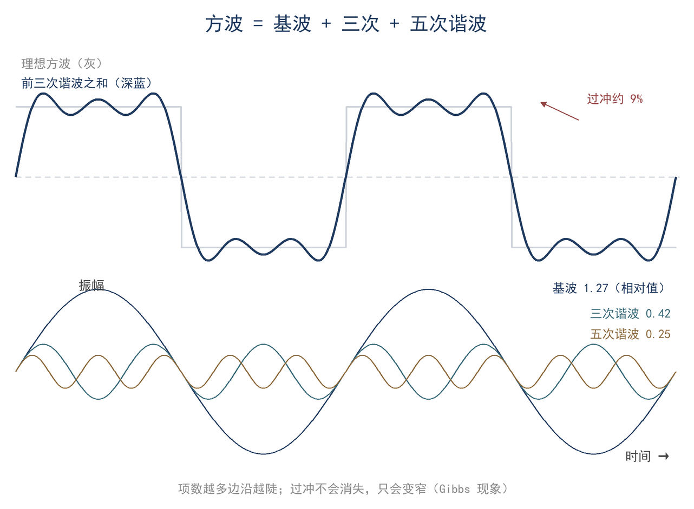
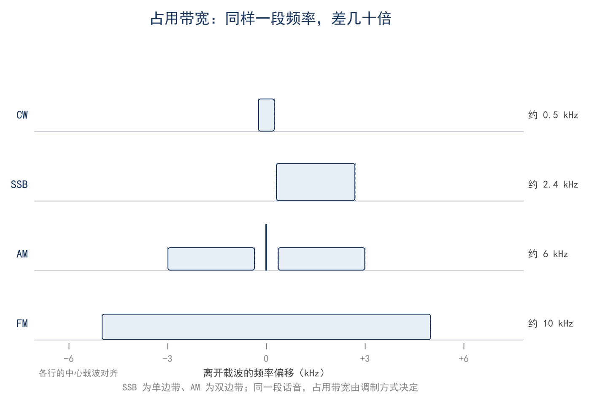
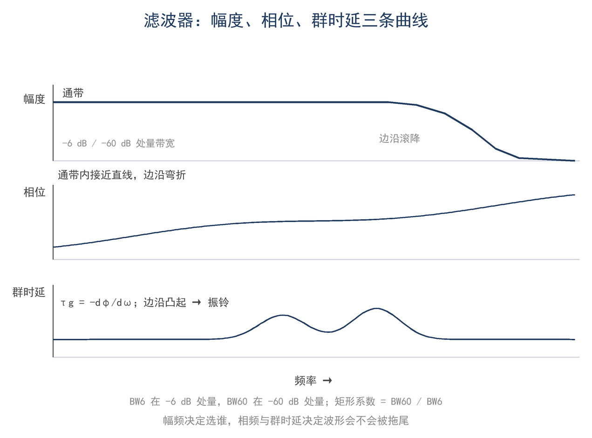

# 第 11 章 傅里叶与滤波：波形里有哪些频率

> **这一章会用到**：第 3 章的正弦与相量，以及 ★ 第 5 章的 Q 与带宽（只用到结论）。

## 一、SSB 的 2.4 kHz 与 CW 的键击声

40 m 波段的可用范围约为 200 kHz，同一时段通常有大量信号。若 SSB 信号占用的频带过宽，邻频可以听到其边带；CW 键控边沿过陡时，则会产生可闻的键击声（key clicks），隔开数 kHz 仍能听见。两种现象看似无关，实际都源自波形与其频谱之间的对应关系：时域中变化越剧烈的部分，对应频域中越高的频率成分。

先给出本章使用最多的定义。带宽指信号或设备所占用的频率范围，工程上按带外衰减到某一电平（常见 −40 dB 或 −60 dB）划定边界；不同口径得到的数值不同，比较时应说明。SSB（single sideband，单边带）仅发送一个边带，其带宽与话音本身的频率范围相当。人声能量主要分布在数百赫兹至两三千赫兹，所以 SSB 的占用带宽约为 2.4 kHz。CW（continuous wave，等幅电报）在理想情况下只发送单一谱线，但键控使载波在开与关之间切换，切换过程不再是单一谱线，听感上表现为键击声。

由此得到本章的基本判断：波形的形状决定其频谱宽度，滤波器只能选择保留哪一段，不能将已经展宽的信号重新变窄。需要区分的是，发射端带宽由调制方式与键控波形决定，接收端带宽由滤波器决定；两者口径不同，不能把接收滤波器的数值当作发射信号的实际带宽。带宽还决定频段能容纳多少电台：同样 200 kHz，按 SSB 带宽可容纳数十个信号，按 CW 带宽可容纳数百个。

要估算任意波形占多宽，需要先回答一个问题：一个波形里究竟包含哪些频率成分。

## 二、一个方波里有几个频率

周期信号可以分解为基频及其整数倍谐波之和（F11-1）。设周期为 T，基频 f₀ = 1/T，角频率 ω₀ = 2πf₀；a₀/2 是直流分量，aₙ 与 bₙ 分别是第 n 次谐波中余弦与正弦分量的幅度。该分解适用于周期、分段光滑的信号，电台中遇到的波形基本满足这一条件。

$$ f(t) = a₀/2 + Σ[ aₙ·cos(nω₀t) + bₙ·sin(nω₀t) ] $$

系数由正弦族的正交性给出。正弦、余弦函数在一个周期上的积分为零；把 F11-1 两边分别乘以 cos(nω₀t) 与 sin(nω₀t)，再在一个周期上积分，除第 n 项外各项都消去，得到

$$ aₙ = (2/T)∫₀^T f(t)·cos(nω₀t) dt，\quad bₙ = (2/T)∫₀^T f(t)·sin(nω₀t) dt；\quad a₀ = (2/T)∫₀^T f(t) dt $$

正交性写成积分就是

$$ ∫₀^T cos(nω₀t)·cos(mω₀t) dt = 0\ (n ≠ m)，\quad = T/2\ (n = m) $$

正弦项与余弦项的乘积同理。这一步说明，系数就是把 f(t) 投影到各次谐波上的结果；"任意周期波形都能这样分解"不是假设，而是这组正交函数的性质。

以幅度在 ±A 之间跳变的对称方波为例。它的波形关于原点对称，只含奇次正弦项。代入系数式，n 为奇数时

$$ bₙ = (2/T)[∫₀^{T/2} A·sin(nω₀t) dt − ∫_{T/2}^{T} A·sin(nω₀t) dt] = 4A/(nπ) $$

偶数 n 的两个半周期贡献相消，系数为零。于是方波的级数为 F11-2：

$$ x(t) = (4A/π)[ sinω₀t + (1/3)sin3ω₀t + (1/5)sin5ω₀t + … ] $$

表 11-1 列出 ±1 V 方波前几次谐波的幅度与相对电平。峰值按 1/n 递减：第 1 次为 4/π ≈ 1.27 V，第 3 次为 1.27/3 ≈ 0.42 V，第 5 次为 1.27/5 ≈ 0.25 V。相对基波的分贝数为 20lg(1/n)，前几项依次是 0、−9.5、−14.0、−16.9、−19.1 dB。相邻两次谐波之比为 20lg(n/(n+2))，从 3 次到 5 次约 4.4 dB，更高次逐渐变小；从基波到 3 次谐波降得最多，为 9.5 dB。奇次谐波的幅度按 1/n 衰减，并非每次固定降低 9.5 dB。

**表 11-1 ±1 V 方波的前几次谐波**

| 谐波次数 n | 频率（1 kHz 基频） | 峰值幅度 | 相对基波 |
|---|---|---|---|
| 1 | 1 kHz | 1.27 V | 0 dB |
| 3 | 3 kHz | 0.42 V | −9.5 dB |
| 5 | 5 kHz | 0.25 V | −14.0 dB |
| 7 | 7 kHz | 0.18 V | −16.9 dB |
| 9 | 9 kHz | 0.14 V | −19.1 dB |

高次谐波的幅度虽然较小，却对应波形中较陡的边沿；忽略高次谐波，边沿便会被平滑。平顶部分由低次谐波决定，跳变细节由高次谐波决定；判断一个波形占多宽，关键是看它的边沿有多陡。

有限项叠加在跳变附近出现过冲与振铃，称为吉布斯现象（Gibbs phenomenon）。图 11-1 给出前三次谐波叠加的结果：峰值约为方波幅度的 119%，即过冲约为 19%（相对方波幅度 A）；项数继续增加时峰值趋于 118%，按跳变量 2A 计算就是经典的 8.95% 过冲。过冲不随项数消失，只是变窄。

从频谱看，周期信号的频谱是间隔为 f₀ 的离散谱线：谱线间隔由重复频率决定，包络形状由单个波形的形状决定。非周期信号的频谱才是连续的。这一变化可以在周期 T 趋于无穷时看到：谱线间隔 f₀ = 1/T 趋于零，离散谱线连成连续谱，叠加变成积分。非周期波形用傅里叶变换表示，正变换与反变换分别为

$$ F(ω) = ∫ f(t)·e^(−jωt) dt，\quad f(t) = (1/2π)∫ F(ω)·e^(jωt) dω $$

其中 j 为虚数单位。本章不要求计算这两个积分，只需知道时域与频域是一对一的对应：波形的每个细节都对应频谱中的一组成分。实际发射机无法产生无限陡的方波，末级与输出滤波器会削弱高次谐波，使边沿变圆。方波只是分析示例；键控、脉冲等非周期波形没有离散谐波，但其边沿变化仍可用频谱展宽描述，分析方法与方波一致。

## 三、时间×带宽：边沿、脉冲与键控

方波是周期信号，谱线离散；脉冲和键控是一次性的非周期过程，频谱连续。非周期波形的时域尺度与频谱宽度满足时宽带宽积关系（F11-3）：

$$ Δf · Δt ≈ 1 $$

其中 Δt 为波形持续时间或边沿的特征时间，Δf 为频谱的特征宽度，单位分别为秒与赫兹。推导来自尺度变换：设 f(t) 的频谱为 F(ω)，把时间轴压缩 a 倍得到 f(at)，其频谱变为 (1/|a|)·F(ω/a)，即频率轴按相同比例展宽、幅度相应降低。因此时间上的集中与频率上的展宽互为代价，二者乘积近似为常数。该关系是量级估计，并非精确等式：具体系数取决于带宽的定义方式，主瓣零点、半高宽与等效噪声带宽给出的数值并不相同。比较不同来源的数据时，应先确认采用同一定义。

以 1 ms 矩形脉冲为例，频谱第一零点位于 ±1 kHz；取主瓣半宽作为带宽，则 Δf·Δt ≈ 1。脉宽缩短为十分之一时，带宽相应扩大十倍。对脉冲信号而言，时间上的集中与频谱上的展宽互为代价；雷达与数字通信选择脉冲宽度时依据的正是这一关系。

对一阶低通或近似高斯响应，−3 dB 带宽与 10%–90% 上升时间满足

$$ BW ≈ 0.35 / t_r $$

该式来自一阶系统的阶跃响应：系统带宽越宽，响应越快；带宽越窄，边沿越慢。对于近似高斯的响应，系数略有不同，但量级关系不变。键控边沿 t_r = 5 ms 时，−3 dB 包络带宽仅约 70 Hz；但为使频谱在邻频处衰减到数十 dB，CW 的占用带宽通常按 (1–2)/t_r 估计，约为 200–400 Hz。边沿缩短为十分之一，发射频谱相应展宽到邻道；500 Hz 滤波器只能选择所需信号，不能消除已经辐射出去的邻频。因此，CW 发射机的键控整形直接影响其频谱占用：边沿过陡会干扰邻频，边沿过缓则使点划边界模糊，需要在两者之间取舍。

接收端同样受该关系约束。500 Hz CW 滤波器的建立时间约为 0.7 ms；若键控边沿显著快于该时间，包络会被平滑并产生拖尾。滤波器越窄，噪声越低，但可通过的边沿越慢，因此带宽存在下限。实际设备在噪声抑制与波形保真之间取折中，带宽由工作模式与信息速率决定，并非越窄越好。

这一关系也解释了测量中的现象：示波器或滤波器的带宽不足时，观察到的边沿由仪器响应决定，而非信号本身。要判断真实边沿，仪器带宽必须显著高于信号中的最高有效频率成分。

## 四、SSB、AM、FM、CW 的频谱占用

四种常用模式的占用带宽可由 F11-4 估算：

$$ AM：B = 2f_m；\quad SSB：B ≈ f_{m,max}；\quad FM：B ≈ 2(Δf + f_m) $$

其中 f_m 为调制话音的最高频率，Δf 为 FM 的频偏。AM 发送载波与两个边带，B = 2f_m；话音为 3 kHz 时约为 6 kHz。载波不占额外带宽，但占用大部分发射功率：100% 调制时载波约占总功率的三分之二，两个边带合计约占三分之一。边带才携带信息，因此同样发射功率下 AM 的有效信息功率低于 SSB。AM 的接收可用包络检波实现，电路简单，但选择性衰落与噪声会直接叠加在幅度上。

SSB 仅发送一个边带、不发载波，功率几乎全在携带信息的边带里，所以同样发射功率下有效信息功率高于 AM；带宽窄（B ≈ f_m）是由另一个原因决定的。SSB 的实现方式不影响上述结论：滤波法与相位法都只输出一个边带，载波本身不携带信息。

FM 的带宽由卡森公式给出。2.5 kHz 频偏与 3 kHz 话音对应约 11 kHz，这是业余窄带 FM 的量级。FM 的优点是幅度噪声可被限幅器抑制，代价是占用较宽频带，且存在门限效应。频偏与话音共同决定带宽，因此调整频偏时不能只看灵敏度，还要考虑相邻信道的间隔；在相同信道间隔下，频偏越大，解调后的信噪比改善越明显，但占用带宽也越宽。

CW 的占用带宽不是固定值，主要由键控边沿时间决定。边沿越陡，频谱展开越宽；边沿放慢，占用带宽收窄，但键控波形的上升与下降时间变长，高速发报会受影响。接收端使用 500 Hz 滤波器，指的是接收机的选择性，并不意味着发射信号的带宽只有 500 Hz。

**表 11-2 四种模式的典型占用带宽**

| 模式 | 典型占用带宽 | 由什么决定 | 说明 |
|---|---|---|---|
| SSB | 约 2.4 kHz | 话音最高频率 | 话音 300–2700 Hz，只发一个边带 |
| AM | 约 6 kHz | 两倍话音最高频率 | 载波加两个边带，功率利用率低 |
| FM（窄带） | 约 11 kHz | 频偏 + 话音 | 卡森近似，Δf 与 f_m 同量级 |
| CW | 约 200–400 Hz（键控 5 ms） | 键控边沿时间 | 边沿 0.5 ms 时扩到 2–4 kHz |

图 11-2 对比四种模式的频谱。表 11-2 中的数值为典型值，实际带宽还受发射滤波、话音处理与键控整形影响。数字模式同样遵循上述关系：符号速率越高，所需带宽越宽；具体实现见 ★ 第 14 章。

## 五、滤波器与混频：留下想要的、移到中频

滤波器对信号做了什么？在频域，它把信号的频谱乘以一条传输曲线，通带内的成分留下，阻带内的成分被衰减；在时域，这等价于把波形与滤波器的冲激响应做卷积。窄带滤波器的冲激响应持续时间长，卷积的结果是边沿被拉长、强跳变之后出现振铃。冲激响应是滤波器对极短脉冲的输出，它与传输曲线是一对傅里叶变换。这一机制可以同时解释后面几件事：CW 滤波器可以做得很窄，数据与脉冲信号却需要保留边沿；采样之后频谱会以采样频率为间隔周期复制。

滤波器由中心频率 f₀、−3 dB 带宽 BW 与带外衰减描述。窄带滤波器常用 Q、矩形系数 SF 与群时延 τ_g 表示（F11-5）：

$$ Q = f₀ / BW；\quad SF = BW₋₆₀ / BW₋₆；\quad τ_g = −dφ/dω $$

Q 是中心频率与带宽之比，Q 越高，通带越窄。SF 是 −60 dB 带宽与 −6 dB 带宽之比，越接近 1 表示滤波器的过渡带越窄、对邻频的抑制越强。τ_g 表示不同频率成分通过滤波器后的延迟；Q 高、SF 小的滤波器在通带边缘的群时延变化较大，脉冲与数字信号的波形可能因此失真。

以 455 kHz 中频、2.4 kHz 带宽的 SSB 滤波器为例，Q = 455/2.4 ≈ 190；矩形系数为 2:1 时，−60 dB 带宽约为 4.8 kHz。邻频强信号在滤波器阻带内被削弱，从而降低对中频放大器的要求。滤波器的阶数决定边沿的陡峭程度：阶数越高，通带与阻带之间的过渡越窄，但群时延与插入损耗的代价越大。插入损耗会直接降低接收灵敏度，因此接收机前端通常优先选用损耗较低的滤波器。

接收机先将信号移到固定中频，再进行滤波，原因是滤波器在固定频率上性能最佳，做成可调滤波器的代价过高。混频将射频信号与本振送入非线性器件，取差频作为中频：7.1 MHz 信号与 7.555 MHz 本振混频得到 455 kHz，带宽仍为 2.4 kHz。镜像频率位于本振另一侧，可能在混频后落入同一中频，因此必须在混频前由前端滤波器抑制；中频滤波器则负责抑制邻频。两类滤波器各在其位：前端在混频前，中频在混频后，次序不能颠倒。中频频率的选择也影响镜像抑制：中频越低，镜像频率离信号越近，前端滤波器越难分离；中频越高，镜像越远，但中频滤波器的实现难度增加。

滤波器带宽的选择受信号带宽与调制方式约束：窄带模式可用较窄滤波器，宽带模式必须保留足够带宽。群时延在通带边缘变化较大时，脉冲与数字信号会出现失真；因此选择滤波器不能只看带宽与矩形系数，还要考虑信号类型。CW 可以接受较窄的滤波器，数据与脉冲信号则需要保留足够的边沿。

图 11-3 展示滤波器的幅频、相频与群时延。

## 六、方向图也是频谱（进阶，可跳过）

滤波器按频率选择，天线按方向选择；两者在数学上是同一类操作。将天线上的电流分布视为空间波形，远场方向图即其空间傅里叶变换：电流分布越宽，方向图主瓣越窄；分布边缘越陡，旁瓣越高。

这一对应与本章的时域—频域关系同源，只是自变量由时间换为空间角度。口径场分布与方向图的这种对应也称空间傅里叶关系，可解释主瓣宽度与天线电尺寸成反比；定量计算要用第 17 章的数值积分。方向图与频谱在分析方法上一致，区别只在自变量是空间角度还是时间。

## 七、算例与误区

**算例 1（估算级）：1 kHz 方波的谐波与示波器边沿**

取 ±1 V 的 1 kHz 方波。前三次谐波峰值为 4/π ≈ 1.27 V、1.27/3 ≈ 0.42 V、1.27/5 ≈ 0.25 V，三项叠加在跳变附近峰值约 119%，即过冲约 19%。用 20 kHz 带宽的示波器观察，按 BW ≈ 0.35/t_r 反推，显示上升时间约 0.35/20 kHz ≈ 17.5 µs；最高能通过约第 19 次谐波（比基波低约 26 dB），换成 100 MHz 带宽，边沿约 3.5 ns。结果：17.5 µs 占 1 kHz 周期（1 ms）的 1.75%，看到的边沿主要由仪器决定；前三次谐波只能拼出大致方波，跳变细节要靠更高次谐波。要判断真实边沿，示波器带宽需比信号的高频成分宽得多。

**算例 2（精确级）：40 m SSB、CW 与中频滤波器**

话音取 300–2700 Hz，SSB 带宽 B = 2.4 kHz。中频 455 kHz、带宽 2.4 kHz 的滤波器，Q = 455/2.4 ≈ 190；矩形系数 2:1 时 −60 dB 带宽约 4.8 kHz，5 kHz 以外邻频被压约 60 dB。CW 键控边沿 5 ms，占用带宽约 (1–2)/5 ms = 200–400 Hz，500 Hz 滤波器够用；滤波器建立时间约 0.7 ms，远小于 5 ms 边沿。结果：两种模式的滤波器带宽都与信号匹配；SSB 用 2.4 kHz、CW 用 500 Hz，是两种模式各自的带宽口径。边沿越快，对滤波器和示波器的带宽要求越高；矩形系数越好，邻频抑制越强，但群时延和插入损耗的代价也越大。

**误区**

1. **"频谱中只有正弦"**。任何波形均可分解为正弦之和；非正弦并不意味着没有频率成分，只意味着成分更多、频带更宽。
2. **"滤波器只影响幅度"**。滤波器的相位响应同样会改变波形；群时延不平会使脉冲展宽、振铃，对数字模式影响更明显。
3. **"带宽越窄越好"**。窄带可降低噪声，但 SSB 低于约 1.8 kHz 时可懂度明显下降，CW 过窄会拖尾、振铃。带宽应由信息速率与工作模式决定。

## 八、小结

波形与频谱一一对应：周期信号分解为离散谐波，奇次谐波按 1/n 衰减；非周期信号的时宽与带宽互为倒数。滤波在频域是乘一条传输曲线，在时域是与冲激响应卷积，窄带滤波器因此带来拖尾与振铃。四种模式的占用带宽由调制方式决定，接收滤波器的带宽则按信号选择。

> **只记一个关系**
>
> 波形的边沿和时间尺度决定频谱宽度：Δf·Δt ≈ 1，一阶系统 BW ≈ 0.35/t_r，键控占用带宽约 (1–2)/t_r。

> **一组数**
>
> SSB 约 2.4 kHz，AM 约 6 kHz，窄带 FM 约 11 kHz，CW 500 Hz 滤波器；455 kHz 中频、2.4 kHz 带宽对应 Q ≈ 190；键控边沿 5 ms 对应 200–400 Hz。

> **一个适用条件**
>
> 以上都是连续时间、线性时不变、平稳信号的估算；边沿与带宽的关系是量级关系，不是精确等式；数字实现的误差另算（★ 第 14 章）。

自检三问：

1. 1 kHz 方波只保留前三次谐波，跳变附近的峰值大约是多大？为什么不是三项幅度相加？
2. 键控边沿从 5 ms 缩短到 0.5 ms，占用带宽变成多少？500 Hz 滤波器还够吗？
3. 455 kHz 中频、2.4 kHz 带宽的滤波器，Q 和矩形系数各说明什么？

习题（答案见附录 D）：

1. ★ ±2 V 的 1 kHz 方波，前三次谐波的峰值各是多少？在 T/4 处三项之和是多少？
2. ★ 判断：某台 SSB 发射机用 2.4 kHz 滤波，接收端用 500 Hz 滤波器，能否正常收 SSB？为什么？
3. ★★ 某 CW 发射机键控边沿为 2 ms，估算占用带宽；若邻频在 1 kHz 外，500 Hz 滤波器能否压住？给出改进办法。
4. ★★ 一个 1 µs 的脉冲，频谱主瓣宽度约多少？用 100 kHz 带宽的示波器观察，显示的上升时间约多少？
5. ★★★ 上机：用电子表格以 1 kHz 为基频，叠加 1、3、5 次谐波（幅度 4A/(nπ)），画出一个周期，量出跳变附近的峰值；再叠加到 19 次，比较过冲。校核：三项时峰值约 1.19A，多次谐波后稳定在约 1.18A。
