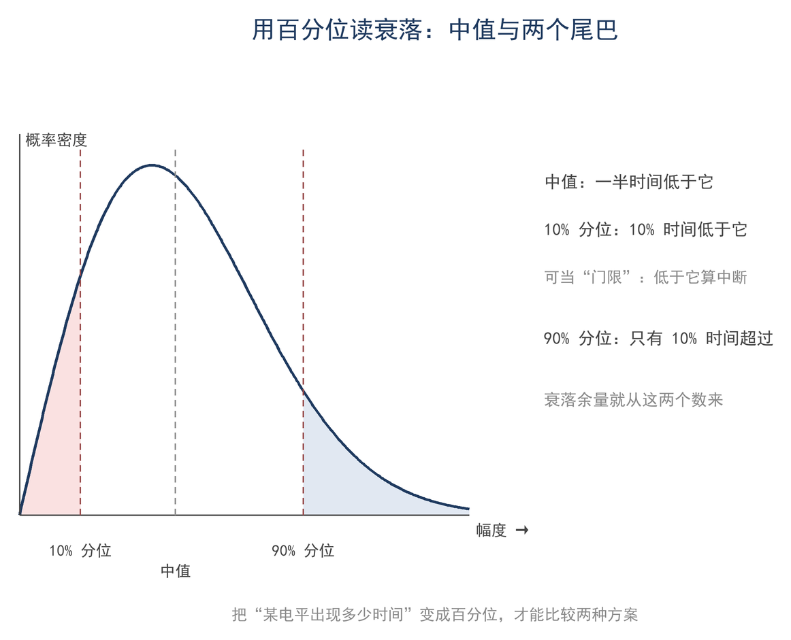
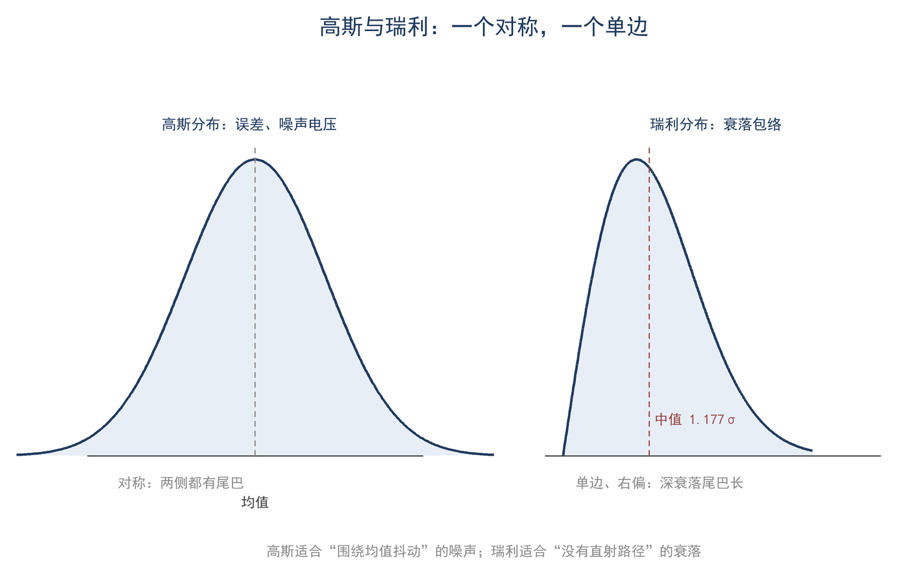

# 第 12 章 概率与统计：噪声、衰落为什么忽强忽弱

> **这一章会用到**：第 2 章的 dB（把功率比变成加法）、第 11 章的带宽（后面算噪声时会用到）。

## 一、一次测量为什么会抖

在 40 m 波段守听远地电台时，S 表（S-meter）读数常在 S6 与 S7 之间摆动，周期为数秒；同一副天线、同一台接收机，间隔十分钟再读，又可能相差半个 S 单位。用场强仪测量近场时，两次读数也可能相差 2 dB，而天线与设备并未改变。

这种波动有三个来源。第一是噪声：接收机内部的热噪声与天电噪声本身随机，瞬时值没有确定规律。第二是衰落：信号经电离层反射时存在多条路径，各路径相位略有变化，合成幅度随之起伏；快衰落周期为数秒，慢衰落可达数分钟。第三是测量本身：仪表分辨力、读数误差与接头位置都会带来数 dB 的散布。

三类波动的性质不同，处理方式也不同。噪声与衰落属于信号固有，只能通过带宽、滤波、天线与余量改善；测量误差可通过校准、多次平均与更换仪器压缩。快衰落与慢衰落的区分依赖时间尺度：判断天线是否变差，应在同一时段内多看几次；判断传播条件，则需按小时或天比较。若不加区分，容易把仪表漂移误判为天线变差，或把一次深衰落误判为设备故障。单次读数不能作为结论，需要把多次读数放在一起，考察其中心位置、散布宽度与低于某门限的时间比例。概率描述下一次读数可能落在何处，统计描述已有读数说明了什么。

## 二、随机变量、分布与百分位

一次测量得到一个数值，该数值在测量前不确定、测量后确定，称为随机变量（random variable）。将相同条件下的大量测量值绘成直方图，横轴为读数、纵轴为出现次数，直方图轮廓趋近一条曲线，称为概率密度（probability density）。曲线下的面积表示概率：某一区间的面积即读数落入该区间的比例。本章不推导密度函数，只将其视为分布的形状。

与概率密度对应的是累积分布函数（CDF，cumulative distribution function）：它给出读数小于某值的概率，曲线由 0 升至 1。给定门限，在 CDF 上读取纵坐标即得低于门限的时间比例；给定允许的中断比例，在 CDF 上读取横坐标即得所需门限。按此读图不依赖具体分布公式，只要求样本足够且分布不随时间漂移。若把白天与夜间的数据混在一起，CDF 会被拉平，百分位失去意义；应按传播时段分组记录，再分别统计。

描述分布最实用的工具是百分位（percentile）。将一批读数按从小到大排列，位于中间者为中值（median），位于 10% 与 90% 位置者分别为 10% 分位与 90% 分位。中值表示典型值，10% 分位表示较差情况下的水平：只有约 10% 的时间低于该值。工程上所说"90% 可靠"，即低于门限的时间不超过 10%，等价于 10% 分位不低于门限。百分位与 CDF 是同一关系的两种表述：10% 分位对应 CDF 达到 10% 的门限，中值对应 CDF 达到 50% 的门限。

中值与平均值并非同一概念。对称分布（如高斯分布）两者重合；瑞利、对数正态等右偏分布的平均值会被少数强值拉高，中值更接近常见值。分析场强记录时，若关心"一半时间至少有多强"，应看中值；若关心平均接收功率，则看平均值。均值、中值与 10% 分位一并报告，比只给一个平均读数包含更多信息。

图 12-1 给出一条分布曲线与若干百分位。连续分布取某一精确值的概率为零，只能讨论区间。

百分位的可靠性由样本量决定。若只记录十几次，10% 分位只能由一两个样本决定，结果波动很大；记录数十次以上，分位数才趋于稳定。S 表每格 6 dB 的粗刻度会把分布量化为若干档，所得百分位只能作为量级参考，分辨力低于连续记录。因此，用 S 表读数估计百分位时，应先确认样本量与刻度，再把结果当作量级而非精确值。把记录画成直方图之后，下一步是判断它接近哪一种分布。

## 三、三个必用的分布

电台中的随机量大多可用三个分布之一近似。选择依据是物理来源与取值范围，而非公式形式。

**高斯分布（正态分布，Gaussian）**：测量误差、热噪声的瞬时值以及大量独立小因素叠加的结果都近似高斯。它由均值 μ 与标准差 σ 确定：约 68% 的读数落在 μ±σ 内，95% 落在 μ±2σ 内，99.7% 落在 μ±3σ 内。标准差与原读数同单位，68% 区间可直接标在刻度上。大量独立小因素相加趋近高斯，这是中心极限定理的结论。高斯分布可取负值，因此适合描述误差或电压瞬时值，不适合直接描述功率、场强等非负量。

**瑞利分布（Rayleigh）**：多径传播的快衰落幅度近似瑞利。两条正交分量各自近似高斯，合成幅度 r 服从瑞利分布：非负、右偏，中值为 1.177σ。这个数可由分布函数定出：瑞利分布的 CDF 为 P(r ≤ r₀) = 1 − exp(−r₀²/2σ²)，令其等于 0.5，得 r₀ = σ√(2ln2) ≈ 1.177σ。该分布描述幅度，功率为 r²，需另行换算。存在稳定直射路径时，应采用莱斯分布，深衰落概率会显著降低。深衰落的时间比例可在 §六 用同一条分布函数算出。

**对数正态分布（log-normal）**：长期场强、慢衰落与城市中的阴影效应常近似对数正态。其 dB 值近似高斯，中值即 dB 域的均值（几何平均）。在 dB 坐标下，对数正态的 CDF 是一条正态曲线，因此其百分位可直接查高斯分布的数表得到。对数正态适合描述小时级、天级的慢变化，不适合描述秒级的快衰落。

> **【进阶】两个密度函数（可跳过）**
>
> 高斯（F12-1）：p(x) = (1/(σ√(2π)))·e^(−(x−μ)²/(2σ²))。
> 瑞利（F12-2）：p(r) = (r/σ²)·e^(−r²/(2σ²))，r ≥ 0。
> 主线不用它们做计算，只查中值与百分位；需要时回来看，或查附录 C 的 F12-1、F12-2。

**表 12-1 三个分布的分工**

| 分布 | 描述什么 | 变量范围 | 位置参数 | 典型场景 |
|---|---|---|---|---|
| 高斯 | 误差、噪声瞬时值 | 可正可负 | 均值 μ | 测量读数、热噪声电压 |
| 瑞利 | 多径快衰落幅度 | 非负、右偏 | 中值 1.177σ | 单跳电离层、移动中的信号 |
| 对数正态 | 长期场强、慢衰落 | 非负、右偏 | 中值（dB 域均值） | 小时级场强变化、城市遮挡 |

图 12-2 将高斯分布与瑞利分布画在一起：高斯分布左右对称，瑞利分布仅位于正半轴，并带有较长尾部。将高斯分布用于衰落幅度是常见错误：衰落幅度不会取负值，且深衰落尾部比高斯分布更长。

选择分布时，先看物理机制，再看数据形状：误差与瞬时噪声用高斯分布，多径快衰落用瑞利分布，长期场强用对数正态分布。同一段传播可以分层分析：秒级起伏接近瑞利分布，小时级平均接近对数正态分布。实际数据往往介于几种情形之间；若物理来源与数据形状矛盾，应检查采样条件与时间尺度。

## 四、均值、方差与有效值

描述一组读数至少需要两个量：均值表示中心位置，方差表示散布程度（F12-3）：

$$ μ = Σ x·p(x)；\quad σ² = Σ (x − μ)²·p(x) $$

其中 x 为取值，p(x) 为其出现概率。均值又称期望；方差开方得到标准差 σ，与原量同单位，因此"均值 ± 标准差"是常用写法。用样本估计时，N 个读数的平均值为 Σx/N，标准差由 Σ(x−x̄)²/(N−1) 开方得到。分母取 N−1 是为修正用样本均值代替真均值带来的偏差；N 较大时差别可忽略。

交流信号的有效值（RMS，root mean square）与标准差直接相关。纯正弦峰值 V_p 与有效值的关系为 V_rms = V_p/√2；噪声均值为零，其有效值即标准差。均值为零时均方值等于方差，故功率 P = V_rms²/R = σ²/R。两个噪声叠加时先求电压平方和再开方，等价于功率相加。该结论在下一节展开。

平均可以抑制随机误差，但不能消除系统误差：N 次独立测量取平均后，标准差降为 σ/√N，即平均 100 次才把随机误差压到十分之一，且这一结论只对独立读数成立；若相邻读数相关（采样间隔小于衰落周期），平均的效果会大打折扣。若仪表本身偏差 1 dB，平均次数再多结果仍偏 1 dB。因此平均与校准是两件不同的事。dB 值不能直接算术平均，应先还原为功率再平均，具体算法见第 16 章。

## 五、不相关功率为什么相加

两路独立噪声送入同一负载时，瞬时电压确实相加。设两路电压为 v₁(t) 与 v₂(t)，总电压 v = v₁ + v₂，平方后取时间平均：

$$ v² = v₁² + 2v₁v₂ + v₂² $$

两路噪声各自均值为零、相位随机，交叉项 2v₁v₂ 在足够长时间上正负抵消，平均为零；剩下的两项分别是各自的均方值，正比于各自的功率。因此总功率为两路功率之和（F12-4）：

$$ P = P₁ + P₂；\quad V_{rms} = √(V₁² + V₂²) $$

等功率两路噪声相加，总功率为 2P₀，即 +3 dB；若两路完全相关且同相，电压相加为 2V₀，功率为 4P₀，即 +6 dB。两者的差别来自交叉项是否抵消：不相关时抵消，完全相关时保留。设两路电压的相关系数为 ρ（−1 ≤ ρ ≤ 1），交叉项的平均值为 2ρσ₁σ₂，总功率 P = P₁ + P₂ + 2ρ√(P₁P₂)。ρ = 0 时回到功率相加；ρ = 1 且两路等功率时，总功率为 4P₀，即 +6 dB。实际系统多处于两者之间。

> **功率相加的适用条件**
>
> 两路噪声不相关；带宽相同；系统线性、无削波；比较前先折算到同一参考面。

**表 12-2 两路不相关噪声合成功率**

| 两路功率差 | 合成后比强的一路高 | 说明 |
|---|---|---|
| 0 dB | +3.0 dB | 等功率，功率翻倍 |
| 3 dB | +1.76 dB | 弱的一路贡献一半 |
| 6 dB | +0.97 dB | 弱的一路贡献四分之一 |
| 10 dB | +0.41 dB | 弱的一路几乎可忽略 |

由表 12-2 可见，两路功率相差 10 dB 以上时，较弱一路对总功率的贡献不足 0.5 dB，可以忽略。接收机内部噪声与天线外部噪声是两路独立来源，合成功率按功率相加；噪声系数描述的是接收机自身增加的噪声，只有在外部噪声不显著时，它才决定整机噪声：外部噪声远高于内部噪声时，整机噪声由外部决定，这一点在第 13 章展开。多级系统中，各级噪声功率加到输出端后再按增益折算回输入端，形式上类似功率相加，但每级之前都乘有该级增益，具体折算由 Friis 公式处理。

判断两路噪声是否相关可做简单实验：分别接负载测量总功率，再断开其中一路测量另一路；若总功率约等于两者之和，则不相关；若明显大于两者之和，则存在相关性或其他机制。

## 六、用概率读衰落与中断

将瑞利分布的中值归一化为 1，低于中值 L dB 的时间比例可由 F12-5 计算：

$$ P(低于中值 L dB) = 1 − exp( −ln2 · 10^(−L/10) ) $$

该式由瑞利分布导出，分三步。第一步，瑞利分布的 CDF 给出幅度低于 r₀ 的概率：

$$ P(r < r₀) = 1 − exp( −r₀²/(2σ²) ) $$

第二步，把 r₀ 换成相对中值的分贝数。中值 r_m = 1.177σ = σ√(2ln2)，因此 r₀²/(2σ²) = ln2·(r₀/r_m)²。第三步，低于中值 L dB 即 r₀/r_m = 10^(−L/20)，平方后为 10^(−L/10)。代入第一步的 CDF，即得 F12-5。

以一个数值为例：L = 10 dB 时，10^(−1) = 0.1，ln2 × 0.1 ≈ 0.0693，exp(−0.0693) ≈ 0.933，故中断概率约 6.7%。若要求 90% 的时间不中断（中断率 10%），代入同一式反解得所需余量 L ≈ 8.2 dB；要求 95% 可靠时约 11.3 dB，99% 时约 18.4 dB。再取 L = 20 dB 代入校核：10^(−2) = 0.01，ln2 × 0.01 ≈ 0.00693，得 0.69%，与"余量每增 10 dB 中断概率降一个数量级"的量级估计一致。余量随可靠度提高而迅速增大，这是衰落余量在链路预算中占大头的来源。

这些数值即“衰落余量”的来源：链路平均接收功率必须高于解调门限一定量，才能在衰落期间保持可用。余量大小由可靠度要求与衰落分布决定。将 F12-5 绘成以余量为横轴、中断概率为纵轴的曲线，即得可靠度曲线：余量每增加约 10 dB，中断概率下降一个数量级；可靠度每提高一个 9，余量还需再增加约 10 dB。曲线越陡，同样余量带来的可靠度提升越大；反过来，在深衰落段每再提高一个 9，所需余量迅速增加，代价显著。具体链路中平均功率、外部噪声与所需信噪比的合并方法见第 15 章。

验证环境衰落分布的直接方法是记录。用 SDR（software-defined radio，软件无线电）瀑布图或带记录功能的接收机，对稳定载波记录十几分钟，将读数排序后考察十分位、中值与九十分位。记录时应关闭 AGC（自动增益控制）并固定带宽，否则幅度起伏会被抹平或噪声比例改变。记录时间不足时，样本只覆盖少数衰落周期，深衰落概率会被低估。

记录结果说明什么，取决于深衰落时间比例与哪个分布相符。样本足够时，将深衰落时间比例与典型值比较，可判断环境更接近瑞利分布还是对数正态分布。城市多径复杂，分布往往比瑞利分布尾部更重，深衰落更频繁。衰落余量的意义在于把可靠度要求转换为功率预算：给定可靠度即可由分布求得所需余量，再据此确定发射功率、天线增益或路径损耗的允许范围。余量不足时链路在衰落期间中断，余量过大则造成功率与设备的浪费。

## 七、算例与误区

**算例 1（估算级）：瑞利衰落的中断时间**

设接收幅度服从瑞利分布，中值已归一化为 1。门限取中值以下 10 dB（r₀ = 0.316），用 F12-5 或直接代入：P = 1 − exp(−ln2 × 0.1) = 1 − exp(−0.0693) ≈ 6.7%。也就是说，约 6.7% 的时间低于该门限；换成"90% 可用"，要求中断 10%，解得 L ≈ 8.2 dB。数量级检查：6.7% 约等于 1/15，10 分钟里约 40 秒低于门限，与夜间收听时信号忽强忽弱的感觉相符。

**算例 2（精确级）：两路不相关噪声相加**

两路独立噪声，功率都是 P₀ = 1 pW（−90 dBm），且互不相关。总功率按功率相加：P = 2P₀ = 2 pW，即 −87.0 dBm，比单路高 3.01 dB。电压上，每路有效值 V₀ = √(P·R) = √(1×10⁻¹² × 50) ≈ 7.07 µV，合成电压 √2 V₀ ≈ 10.0 µV，电压也高 3 dB。若两路完全相关、同相，功率 4 pW，比单路高 6 dB。适用条件：独立源、同带宽、线性、不相关；比较时先折算到同一参考面，若一路比另一路强 10 dB 以上，弱的那路可忽略。

**误区**

1. **"噪声电压直接相加"**。两路不相关噪声的电压要用平方和开方，功率才直接相加；直接把电压相加会高估 3 dB（等功率时）。
2. **"dB 值可以算术平均"**。dB 是对数，算术平均对应功率的几何平均；正确做法是还原成功率再平均（第 16 章给算例）。在场强记录里直接平均 dB 值，会把结果压低。
3. **"衰落幅度可以用高斯描述"**。高斯可正可负、左右对称；衰落幅度非负、右偏，深衰落尾巴更长，用高斯会低估中断概率。平均只压随机误差、压不掉系统误差。

## 八、小结

随机量的描述从分布出发：概率密度给出各处出现的相对可能，累积分布给出低于门限的时间比例。高斯、瑞利、对数正态分别对应误差与瞬时噪声、多径快衰落与长期场强。均值与方差给出中心与散布，独立噪声的功率在不相关时直接相加。衰落余量由分布与可靠度要求共同决定，可靠度越高，所需余量增长越快；样本量不足时，百分位只能作量级参考。

> **只记一个关系**
>
> 随机的功率量在不相关时按功率相加，表现为 +3 dB；衰落的中断概率由分布和余量决定，瑞利下"低于中值 10 dB"约 6.7% 时间。

> **一组数**
>
> 高斯 ±1σ 68%、±2σ 95%；瑞利中值 1.177σ；低于中值 10 dB 约 6.7%、20 dB 约 0.69%；90%/95%/99% 可靠分别约需 8.2/11.3/18.4 dB 余量。

> **一个适用条件**
>
> 不相关功率相加要求独立、等带宽、线性；瑞利只适合快衰落幅度，长期场强用对数正态；样本太少时百分位不可信。

自检三问：

1. 两次测同一副天线差 2 dB，哪些原因属于随机误差，哪些属于系统误差？
2. 瑞利分布的中值 1.177σ 是怎么来的？为什么场强记录一般不直接用平均值？
3. 瑞利衰落下要求 95% 可用，大约要留多少 dB 余量？这个数怎么来的？

习题（答案见附录 D）：

1. ★ 五个 S 表读数 7.0、7.2、6.8、7.1、6.9，求均值和标准差（按样本估计）。
2. ★ 判断：两路不相关、等功率的噪声，功率相加后比单路高 6 dB。这句话对不对？错在哪？
3. ★★ 瑞利衰落，门限取中值以下 6 dB，估算低于门限的时间比例；再算 3 dB 时的比例。
4. ★★ 两路不相关噪声，功率分别为 −100 dBm 和 −103 dBm，求合成功率；与较强一路差多少 dB？
5. ★★★ 上机：用电子表格按 F12-5 算 L = 3、6、10、20 dB 的中断概率，并反解 90%、95%、99% 可靠所需的余量。校核：L = 10 dB 时约 6.7%，95% 可靠约 11.3 dB。
