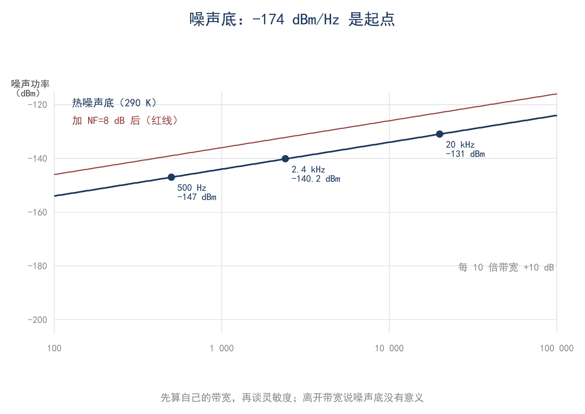
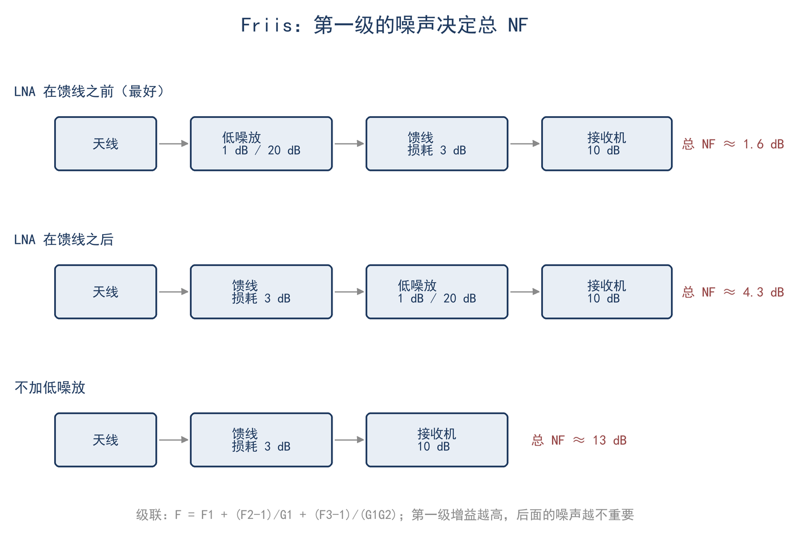
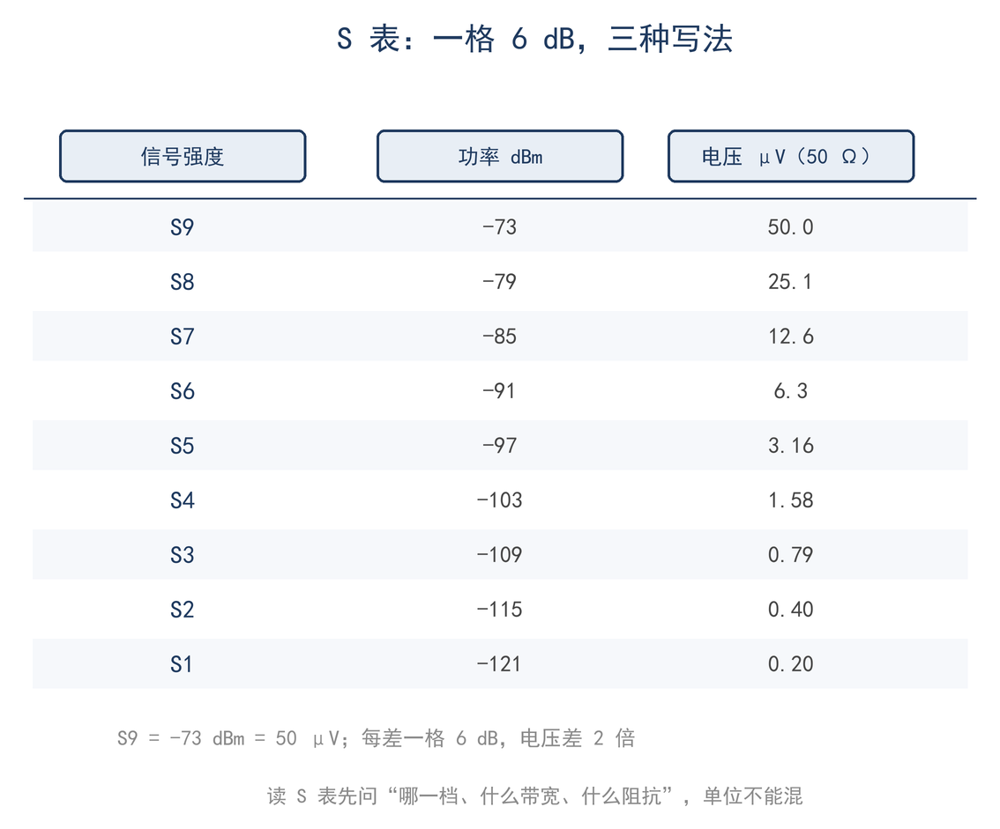
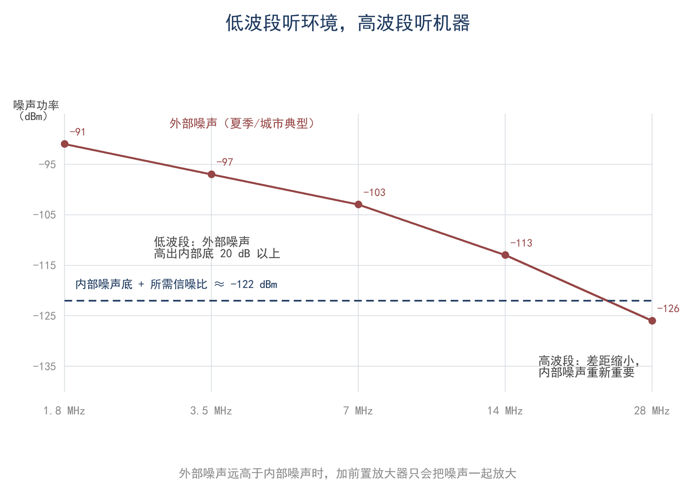

# 第 13 章 噪声、灵敏度与动态范围：接收机能听多弱

> **这一章会用到**：第 2 章的 dB 与 dBm、μV 换算，第 5 章的带宽，第 11 章的频谱，第 12 章的瑞利衰落（仅取百分位结果）。

40 米波段夏季夜间，S 表读数常停留在 S4–S6 之间，城市环境可达 S7；接收机说明书的灵敏度指标却写作 0.1 μV。二者并不矛盾：灵敏度指标描述接收机自身产生的噪声，S 表读数反映天线与外部环境送入接收机的噪声。本章分别讨论内部噪声与外部噪声的计算方法，并说明在何种条件下二者之一成为接收能力的限制。这一区分是理解接收机指标的前提：内部噪声决定机器在安静环境中的极限，外部噪声决定实际波段中可听见的最弱信号。

## 一、热噪声：−174 dBm/Hz 从哪来

任何温度高于绝对零度的电阻，其两端都存在随机电压起伏，这种现象称为热噪声。热噪声的功率谱密度在很宽的频率范围内近似平坦，带宽 B 内的噪声功率为（F13-1）：

$$ P_n = k·T·B $$

式中 k=1.38×10⁻²³ J/K 为玻尔兹曼常数，T 为绝对温度（K），B 为接收机或滤波器的噪声带宽（Hz）。取标准参考温度 T=290 K，每赫兹噪声功率为 kT≈4.0×10⁻²¹ W，换算为 dBm：

$$ 10lg(k·T/1mW) ≈ −174 dBm/Hz $$

−174 dBm/Hz 是接收机噪声计算的基础常数，其约定为温度 290 K、0 dBm 对应 1 mW。参考温度改变时该常数随之改变；工程上统一取 290 K，目的是使不同接收机的噪声系数可在同一基准上比较。任意带宽下的噪声底为：

$$ P_n = −174 dBm/Hz + 10lgB $$

以 SSB 话音常用的 2.4 kHz 为例，噪声底约为 −140.2 dBm（表 13-1）；带宽减半，噪声底下降约 3 dB。CW 听起来比 SSB 安静，直接原因在于滤波器更窄，与接收机档次无关。

**表 13-1 理想接收机（NF=0 dB）在不同带宽下的噪声底**

| 带宽 B | 10lgB | 噪声底 |
|---|---|---|
| 500 Hz | 27.0 dB | −147.0 dBm |
| 1 kHz | 30.0 dB | −144.0 dBm |
| 2.4 kHz | 33.8 dB | −140.2 dBm |
| 3 kHz | 34.8 dB | −139.2 dBm |
| 6 kHz | 37.8 dB | −136.2 dBm |

表 13-1 的用法是按带宽查出理想值，再加接收机的噪声系数。例如 2.4 kHz、NF=8 dB 时，内部噪声底为 −132.2 dBm，与第三节结果一致。带宽每翻一倍，噪声底抬高约 3 dB，表中相邻行的差值即由此而来。需要说明的是，这里的 B 是噪声带宽，不是面板标注的 −3 dB 带宽。滤波器裙边不陡，实际通过噪声的等效宽度略大于 −3 dB 宽度；对常见晶体或 DSP 滤波器，二者相差几个百分点。数量级估算可忽略该差异，精确噪声预算则应查阅手册。

如图 13-1，同一接收机更换不同带宽的滤波器时，噪声底整体平移。

热噪声公式中的 T 也可用噪声温度表述：天线的噪声温度由其所处电磁环境决定，并不等于 290 K。HF 低波段外部噪声的等效温度可达数百万 K 量级，因此 −174 dBm/Hz 不足以描述实际噪声底；VHF 天线对空时，噪声温度仅几十至几百 K。同一接收机分别连接 HF 天线与 VHF 天线，系统噪声温度差异极大。系统噪声温度由天线噪声温度与接收机噪声温度共同决定，前者在低波段占主导，后者在高波段才成为主要指标；这一对比是理解不同波段接收差异的基础，第六节将给出定量说明。

一个可手算的量级锚点：2.4 kHz 带宽内，50 Ω 电阻的热噪声电压约为 0.04 μV，小于常被引用的 0.1 μV 灵敏度指标。这说明 HF 波段的实际噪声底不可能由电阻热噪声解释，而主要来自天线接收的外部噪声。

由 −174 dBm/Hz 出发，任意带宽的噪声底均可由 10lgB 直接算出，这是本章后续计算的起点。带宽增加 10 倍，噪声底增加 10 dB；带宽减小 10 倍，噪声底降低 10 dB。该关系在估算滤波器或数字处理带宽时可直接使用，无须重复代入公式。前端带宽越宽，累计的热噪声功率越大，故宽带接收机在弱信号下的噪声底高于窄带接收机；这也是窄带模式在弱信号条件下占优的原因之一。

常数 −174 dBm/Hz 的数值也可由 kT 与 1 mW 基准直接核对：将 kT 除以 1 mW 再取 10lg，即得该值；负号来自 1 mW 远大于每赫兹的热噪声功率。这一换算是热噪声公式与 dBm 体系之间的桥梁，也说明参考温度改变时噪声底随之平移。

## 二、噪声系数与 Friis 级联

真实接收机自身也产生噪声。噪声系数（noise figure，NF）衡量信号经过某一级后信噪比下降的程度：

$$ F = SNR_in / SNR_out，NF = 10lgF $$

F 为线性倍数，NF 为其 dB 值。理想器件 F=1（NF=0 dB）；损耗为 3 dB 的滤波器或电缆，F=2，即 NF=3 dB，损耗本身即计入噪声系数。该定义依赖三个前提：源阻抗匹配至 50 Ω、源温度 290 K、测量带宽相同。数据表给出的 NF 仅在此条件下可比；源阻抗不匹配，或天线噪声温度显著偏离 290 K 时，实际系统噪声须重新计算，不能将 NF 直接视为接收机噪声底。NF 描述的是信噪比的退化程度，不是输出噪声功率或灵敏度；它将本级噪声折算至输入端，并与源阻抗、源温度绑定。

NF 也可换算为噪声温度：T_e=290(F−1) K。NF=1 dB 对应约 75 K，NF=3 dB 对应 290 K，NF=8 dB 对应约 1540 K。将机器噪声与天线噪声统一为温度后可直接相加：系统噪声温度约等于天线噪声温度与接收机噪声温度之和，第一级贡献最大。该加法成立的前提是各级增益足够大；后文将说明该前提失效的情形。

三个前提中，源温度最易被忽略：数据表的 NF 以 290 K 为参考，而 HF 天线的噪声温度可能远高于此，故机器 NF 不能直接换算为系统噪声系数。测量带宽同样须一致，否则噪声功率不同、信噪比不可比。这些条件并非形式上的限定，而是 NF 可比较的基础。

有损器件的噪声系数等于其损耗。以 3 dB 衰减器为例：它将输入信号与输入噪声同时衰减一半，但自身在输出端又加入与 290 K 源匹配时等量的热噪声，输出信噪比因此比输入低 3 dB。故衰减器在噪声计算中相当于一级 NF=3 dB 的器件；这也是天线端的第一个接头与第一段细馈线对系统噪声影响显著的原因。

天线之后的第一个有源或无源器件对系统噪声影响最大，因为其噪声会被后续增益稀释。多级级联的总噪声系数由 Friis 公式给出（F13-2）：

$$ F = F₁ + (F₂−1)/G₁ + (F₃−1)/(G₁·G₂) + … $$

式中 G 为各级功率增益，取线性倍数而非 dB。Friis 公式的每一项均折算至同一参考面，即第一级输入端；第 i 级的噪声（F_i−1）需先除以其前面各级的总增益。因此前级增益越大，后级噪声项的贡献越小。代入时须先将 dB 增益换算为线性倍数，否则第二项分母将出现错误。

Friis 公式的物理含义是：系统噪声系数主要由第一级及其之前的损耗决定，后级只按前级增益折算。提高第一级增益可以压低后级贡献，但增益本身不改善第一级的信噪比。因此前端的处理顺序是：先降低第一级损耗与噪声，再考虑增益大小。

如图 13-2，前置放大器置于天线端、馈线之后或不设前置放大器，三种接法的总噪声系数差异显著。

以 LNA 增益 20 dB、NF 1 dB、馈线损耗 3 dB、接收机 NF 10 dB 为例。设 G₁=100、F₁=1.26、F₂=2、G₂=0.5、F₃=10，代入（F13-2）：

$$ F = 1.26 + (2−1)/100 + (10−1)/(100×0.5) = 1.45 $$

得总 NF≈1.6 dB。LNA 置于馈线之后时约为 4.3 dB，不设 LNA 时约为 13 dB，详细计算见算例 2。该例表明：第一级之前的损耗会直接抬高系统噪声系数，后级增益无法补偿。若第一级之前没有损耗，后级贡献按增益缩小；一旦馈线位于第一级之前，其损耗直接计入首项，系统噪声系数由约 1.6 dB 升至 4.3 dB。

接收机 NF 与系统灵敏度的关系取决于天线噪声温度，其判据见第六节。

## 三、灵敏度与 MDS

将噪声系数代入噪声底，即得到接收机自身可辨认的最弱信号，即最小可辨信号（minimum discernible signal，MDS，F13-3）：

$$ MDS = −174 dBm/Hz + 10lgB + NF + (S/N)_req $$

以 B=2.4 kHz、NF=8 dB、S/N=10 dB 计算：

$$ MDS = −174+33.8+8+10 = −122.2 dBm $$

该值相当于 50 Ω 上约 0.17 μV，与说明书所标 0.1 μV 并不矛盾：灵敏度指标必须同时给出带宽、信噪比与阻抗，缺一项即可相差十几 dB。更须区分两个概念：MDS 是机器自身的门槛，噪声底则是环境噪声与机器噪声之和；在 HF 低波段，后者通常高出 20–30 dB，此时限制接收的是外部噪声，而非 MDS，详见第六节。

解调门限 (S/N)_req 并非常数：SSB 话音通常取 10 dB，CW 在窄滤波下 3–6 dB 即可抄收，数字模式可更低（第 14 章）。因此同一接收机的 SSB 灵敏度与 CW 灵敏度本应相差数 dB，并非指标错误。

灵敏度指标在数据表中常以 μV 给出，而 μV 与阻抗相关：同一电压在不同阻抗上对应不同功率，故比较时必须统一到 50 Ω。部分厂家给出的是开路电压而非匹配负载上的电压，二者相差约 6 dB；读取指标时应确认其口径。同一灵敏度数值若对应不同带宽，其 MDS 亦不同；比较两台接收机时，应先把带宽与信噪比统一，再比较 μV 或 dBm 值。

## 四、S 表：读数、dBm 与 μV

S 表的口径为：S9 对应 −73 dBm，即 50 Ω 上的 50 μV（有效值）；每格 6 dB，电压每格减半，向上同理。S 表是中频信号电平的近似指示，校准误差常见 ±3 dB，不能作为功率计使用。dBm 与 μV 的换算见第 2 章，读数不确定度见第 16 章。

**表 13-2 S 表读数与 dBm、μV 对照（50 Ω）**

| S 表 | dBm | μV |
|---|---|---|
| S1 | −121 | 0.20 |
| S3 | −109 | 0.79 |
| S5 | −97 | 3.2 |
| S7 | −85 | 12.6 |
| S9 | −73 | 50 |
| S9+20 | −53 | 500 |
| S9+40 | −33 | 5000 |

每格 6 dB 意味着电压每格翻倍；进行链路预算时须先将 S 表读数换算为 dBm。S 表是相对刻度：同一副天线换一台接收机，读数可能相差一格，因此不同电台的 S9 不能直接比较；记录时应同时写下换算后的 dBm 值。用 S 表比较两副天线时，3 dB 仅为半格，1 dB 不足一格，分辨力不足以判断；此外 S 表读取的是中频电平，前置放大器、衰减器、AGC 与带宽设置变化均会改变读数。

S 表读数与 dBm、μV 的对应关系如图 13-3；换算后的数值才是可比较的绝对电平。

## 五、动态范围、互调与截点

接收机既需检测弱信号，又须承受强信号而不进入非线性。线性动态范围与互调动态范围分别描述这两种限制。

线性动态范围（BDR，F13-4）定义为 1 dB 压缩点与 MDS 之差，表示接收机保持线性工作的输入范围：

$$ BDR = P_1dB − MDS $$

P_1dB 为单音输入使增益比小信号时低 1 dB 的输入功率（厂家常给出输出压缩点，可折算至输入）。BDR 描述单音过载发生前的输入余量。1 dB 压缩点并非接收机失效点：超过该点后增益继续下降，互调迅速增大；BDR 以 1 dB 压缩点为上界，原因即在此。

互调动态范围（DR₃）描述两个强信号产生的三阶互调产物尚未淹没噪声底时的输入范围，可由输入三阶截点 IIP3 估算（F13-5）：

$$ DR₃ ≈ (2/3)·(IIP3 − P_n) $$

IIP3 为输入三阶截点（dBm），P_n 为带宽内噪声底（dBm）。两式无需推导，但应理解其含义。例：IIP3=0 dBm、噪声底 −132.2 dBm 时，DR₃≈88 dB；1 dB 压缩点 −20 dBm、MDS −122.2 dBm 时，BDR≈102 dB。

2/3 系数来自两条直线的斜率。两个等幅信号输入时，基波随输入以 1 dB/dB 增长，三阶产物约以 3 dB/dB 增长。将产物电平写作 3P−2·IIP3，令其等于噪声底 P_n，解得输入 P=(2·IIP3+P_n)/3；该输入与 P_n 之差即 (2/3)(IIP3−P_n)。因此 DR₃ 描述双音产物仍埋于噪声之下时的输入范围。

互调的物理过程为：两个强信号进入非线性级（混频器或放大器）后产生 2f₁−f₂、2f₂−f₁ 等组合频率；当这些频率落入接收带宽，即成为接收机自身产生的干扰。三阶产物电平可估算：两个等幅信号各为 P（dBm）时，产物约为 3P−2·IIP3。取 IIP3=0 dBm、两信号各 −30 dBm，产物约 −90 dBm；噪声底 −132 dBm 时高出 42 dB，已可听见。若两信号降至 −60 dBm，产物约 −180 dBm，远低于噪声底，不再构成干扰。可见互调是否发生取决于强信号相对截点的位置，而非仅取决于信号强弱。

阻塞（blocking）是另一类过载：强信号不在接收频率上，却使前端进入压缩，导致整个频段噪声底抬高、弱信号不可闻。其物理机制与互调类似，均源于非线性级的过载。两者的表现不同：阻塞使整个频段噪声底抬升，互调则在特定频率产生新信号；前者可由频谱整体抬升识别，后者表现为不存在的信号。阻塞常由邻近频段的强台引起，在市区多台环境中较为常见。

是否加前置放大器或衰减器，取决于噪声底与互调哪一项先成为限制：弱信号、外部噪声低时宜增加增益；强信号、互调严重时宜加衰减。前置放大器降低噪声底、改善 MDS，但同时放大全部信号与干扰，使后级更易进入非线性；当外部噪声较高时，增加增益只提高总电平，并不能提高可辨度。

BDR 与 DR₃ 描述不同机制：BDR 对应单音过载，DR₃ 对应双音互调。二者均为输入范围指标，但适用的干扰场景不同。两项数值均可由数据表中的 P_1dB、IIP3 与 NF 直接估算，无须实测；实测值通常低于估算值，因为数据表条件与实际工作条件并不相同。两项数值均以输入功率为参考；若厂家给出的是输出截点或输出压缩点，须先减去增益再代入。动态范围的数值还与带宽有关：带宽越窄，噪声底越低，DR₃ 与 BDR 均相应增大。动态范围也并非越大越好：提高前端增益可改善 MDS、增大动态范围，但同时抬高强信号电平，可能减少过载余量。因此动态范围指标须与增益设置、噪声系数一并理解，不能孤立比较。

## 六、外部噪声：低波段真正的限制

天线接收的除信号外还有天电、宇宙噪声、电力线与电器干扰，统称外部噪声（external noise）。在低波段，外部噪声远大于接收机内部噪声。40 米波段乡村夏季夜间的典型量级为 −103…−91 dBm（2.4 kHz 带宽内），即 S4–S6。与上一节 MDS −122.2 dBm 相比，外部噪声高 20–30 dB；此时继续降低接收机内部噪声，并不能使更弱信号可闻，限制来自天线接收的噪声。如图 13-4，内部噪声底随频率缓慢变化，外部噪声在低波段高、随频率升高而下降；两条曲线的交点决定各波段由谁限制。

外部噪声可分为三类：天电噪声在低波段最强，夏季雷雨、夜间及热带方向尤为明显；人为噪声来自电器与电力线，频带宽、垂直极化分量强、随距离衰减慢；宇宙噪声与地面热噪声在 VHF 以上逐渐重要。三类噪声的频率趋势不同，这是更换波段有时比更换接收机更有效的原因；其时间规律也不同，人为噪声峰值常出现在傍晚用电高峰，天电噪声随雷雨季节变化，二者叠加可使同一波段不同时段的噪声底相差十余 dB。

昼夜差异由 D 层决定：白天 D 层吸收部分远处天电，夜间 D 层消失，同波段更嘈杂；噪声增强与信号增强是两件事，S 表读数升高不等于传播改善。垂直天线的噪声通常比水平偶极高约半个至一个 S 单位（3–6 dB），其原因是外部噪声入口更大，而非天线效率差异；主瓣朝向城市或电力线时噪声底升高，低仰角方向图收进更远处地面噪声，同一接收机更换天线噪声底相差 6 dB 并不罕见，但这是方向图与极化的差异。外部噪声的等效温度可达数百万 K，接收机的 1540 K（NF=8 dB）在其中几乎可忽略：将 NF 由 8 dB 降至 3 dB，系统噪声温度由约 1540 K 降至 290 K，而天线噪声温度仍为百万 K 量级，总噪声几乎不变。抑制效果取决于噪声来源：窄带滤波只改善听觉与邻道选择性，方向图与极化可降低噪声入口，本地电器干扰则须从源头处理。

## 七、算例与误区

**算例 1（估算级，30 秒）**：带宽 2.4 kHz、NF=8 dB、要求 S/N=10 dB。噪声底 = −174+33.8 = −140.2 dBm；加 NF 得 −132.2 dBm；再加 10 dB 得 MDS≈−122.2 dBm，即约 0.17 μV（50 Ω）。若这一波段的外部噪声是 −103 dBm，则实际能分辨的信号约为 −103+10 = −93 dBm，比 MDS 高约 29 dB，灵敏度余量很大，瓶颈在外部噪声。复核：10lg2400=33.8；−174+33.8+8+10=−122.2；√(10^(−12.22)×10⁻³×50)≈0.17 μV。再估算一次系统噪声温度：NF=8 dB 对应约 1540 K，外部噪声 −103 dBm 在 2.4 kHz 内对应约 1.5×10⁶ K，两者相加几乎还是 1.5×10⁶ K，去掉接收机那 1540 K 只省下约 0.004 dB。

**算例 2（精确级）**：LNA 增益 20 dB、NF 1 dB，后接 3 dB 馈线，接收机 NF 10 dB。LNA 在天线端时，按 Friis 公式 F=1.26+(2−1)/100+(10−1)/50=1.45，总 NF≈1.6 dB；LNA 在馈线后约 4.3 dB，不加约 13.0 dB。位置影响 2.7 dB，加与不加差 11.4 dB。复核：不加 LNA 时 F=2+(10−1)/0.5=20，即 13.0 dB。适用条件：源温 290 K、阻抗 50 Ω，增益用线性倍数代入。

**误区一：NF 就是信噪比。** 错在把"变差多少"当成"有多少"。NF 是 SNR 经过该级后的衰减量，输出信噪比还取决于输入信号与输入噪声；NF=8 dB 不代表 SNR 是 8 dB。

**误区二：前置放大器永远有用。** 错在只看 MDS、不看外部噪声与互调。外部噪声远高于内部噪声时，增益只抬高一切电平，不会提高可辨度；放错位置还会把馈线损耗算进第一级。

**误区三：S 表能分辨 1 dB 的天线差异。** 错在高估了刻度：每格 6 dB、校准误差 ±3 dB、AGC 还在动。1 dB 的差异要靠 A/B 切换和多次读数，不能靠一眼 S 表。

## 八、小结

> **只记一个关系**
>
> 噪声底 = −174 dBm/Hz + 10lgB + NF；MDS 再加解调门限。级联用 Friis：前级增益越大，后级噪声越不重要。
>
> **一组数**
>
> 2.4 kHz、290 K：−140.2 dBm；NF=8 dB：−132.2 dBm；S/N=10 dB：MDS≈−122.2 dBm≈0.17 μV；40 m 夏季乡村外部噪声约 −103…−91 dBm（S4–S6）。
>
> **一个适用条件**
>
> 全部按 290 K、50 Ω、匹配、带宽内噪声平坦计算；外部噪声远高于内部噪声时，"接收机能听多弱"由外部噪声决定，不由 MDS 决定。

自检三问：

1. 2.4 kHz 带宽、NF=8 dB 的接收机，MDS 大约是多少？换成 500 Hz 会变多少？
2. LNA 放在天线端与放在馈线之后，总噪声系数差多少？为什么？
3. 40 m 夜间 S4–S6 的噪声底说明什么？此时换一台 NF 更低的机器，能听到更弱的信号吗？

习题（答案见附录 D）：

1. ★ 某接收机 B=2.4 kHz、NF=6 dB，要求 S/N=10 dB，求 MDS（dBm 与 μV，50 Ω）。
2. ★ 一条 6 dB 损耗的馈线接在接收机前，它贡献的噪声系数是多少？如果把它放在 LNA 之后，总 NF 怎么变？
3. ★★ 两级级联：第一级增益 13 dB、NF 2 dB，第二级 NF 12 dB。求总 NF；若把第一级换成增益 20 dB、NF 2 dB，总 NF 改善多少？
4. ★★ B=500 Hz、NF=10 dB、S/N=6 dB，求 MDS；与 2.4 kHz、NF=8 dB、S/N=10 dB 的机器相比，谁更灵敏？
5. ★★★（测量）用信号发生器加步进衰减器，或利用已知强度的噪声源，估所用接收机的 MDS；再用天线的实际噪声底与之比较，判断常用波段是内部噪声限制还是外部噪声限制。
