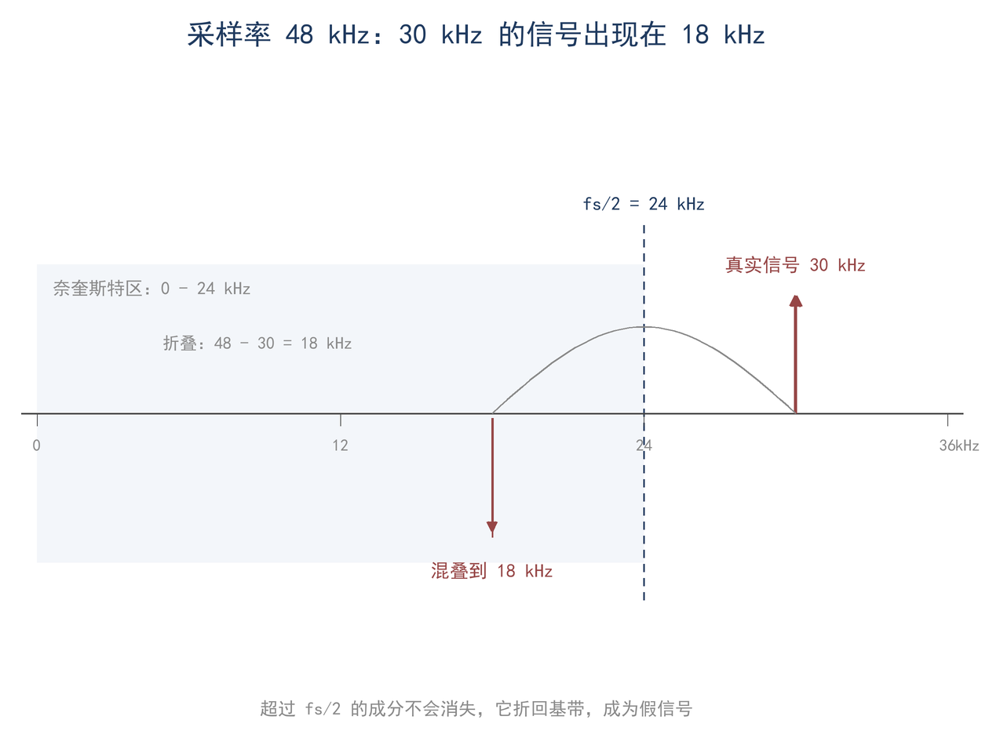
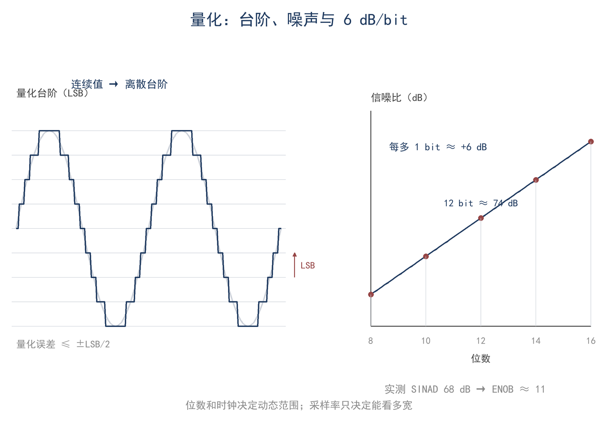
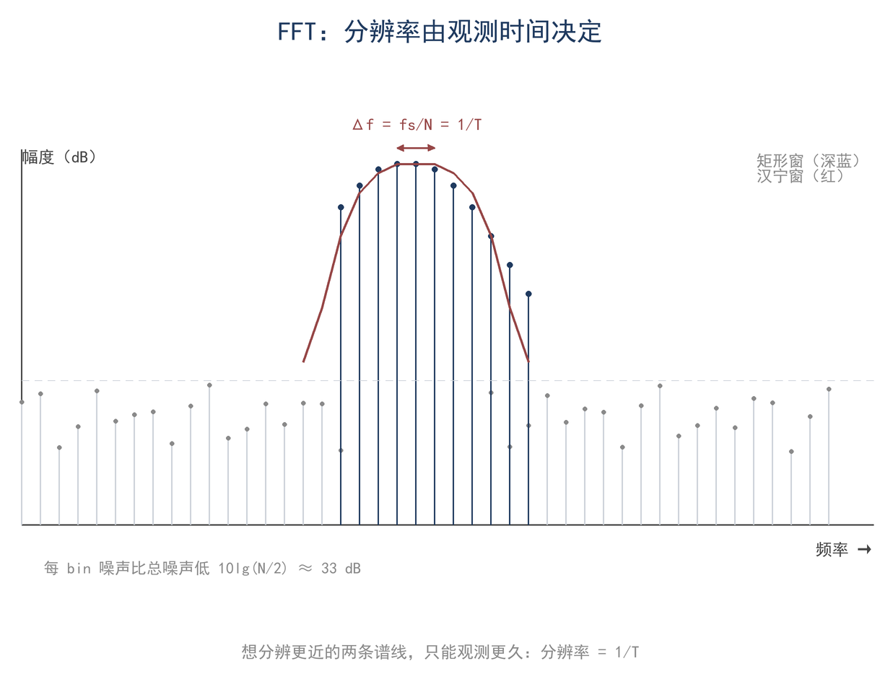
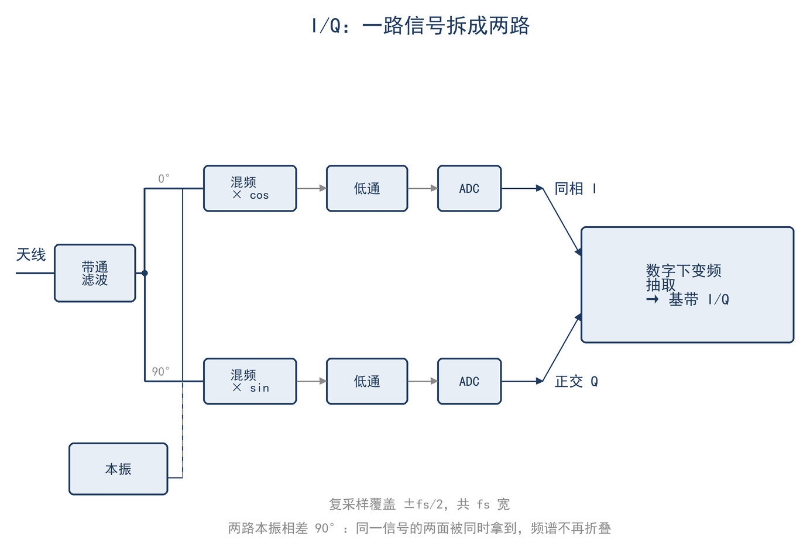

# ★ 第 14 章 采样与数字信号：SDR 的频谱是怎么算出来的

> **这一章会用到**：第 11 章的频谱与带宽，第 13 章的噪声底（kTB 的结论）；不读本章也能继续读第 15 章。

把一根短天线接到小型 SDR（software-defined radio，软件无线电）前端，输出两路音频信号，送入电脑声卡，屏幕上便出现一条 48 kHz 宽的频谱；前端调谐到 14 MHz，还能看到 SSB 与 CW 信号。声卡本身只能录音，之所以能显示射频频谱，是因为前端已经把 14 MHz 附近的信号变换到了音频频段。

## 一、声卡如何获得 48 kHz 的频谱

SDR 前端用本振与混频器把射频信号变为两路低频信号 I 与 Q，二者相位差 90°；声卡把这两路音频电压转换为数字序列，软件再对序列做混频与 FFT。屏幕上的频谱是最后一步算出来的，但它受前两步制约：前端决定取出哪一段射频频带，声卡决定可观察的带宽与最小可辨电平。

整条链路可以分成三段：前端的增益与滤波、ADC 的采样与量化、软件中的数字下变频与 FFT。同一套硬件换软件或改采样率，噪声底与动态范围就可能不同，原因都在这三段的分工上。本章依次回答三个问题：采样率要多少才不混叠；量化位数如何决定动态范围；FFT 的分辨率与每 bin 噪声底怎样计算。

## 二、采样与奈奎斯特：每秒取几个点

采样即每隔 T_s 秒读取一个电压值，采样率 f_s = 1/T_s。若信号中最高频率为 f_max，采样率必须满足（F14-1）：

$$ f_s ≥ 2f_{max} $$

这一条件称为奈奎斯特条件，f_s/2 称为奈奎斯特频率。其原因是：一个正弦波每周期至少需要两个采样点，才能由采样序列确定其频率；采样点不足时，两个不同频率会产生相同的采样序列。例如 10 kHz 与 38 kHz 两个正弦波，以 48 kHz 采样时 38k = 48k − 10k，两者的采样序列只差一个符号，38 kHz 会被误判为 10 kHz。

从频域看，采样使连续信号的频谱以 f_s 为周期复制：原位于 f 处的分量，会在 f ± n·f_s 处各产生一个副本。只要某个副本落进 0 至 f_s/2，它便与真实信号无法区分。超过 f_s/2 的频率不会消失，而是折叠回该区间，折叠后的频率由（F14-2）给出：

$$ f_a = | f − n·f_s | $$

式中 n 取使 f_a ≤ f_s/2 的整数。以 48 kHz 采样为例，30 kHz 的信号折叠到 |30 − 48| = 18 kHz；本已在 f_s/2 以内的频率则不折叠。图 14-1 画出这一过程：30 kHz 的强信号会在 18 kHz 处出现，与真实的 18 kHz 信号叠加，无法分辨。

折叠公式中的绝对值来自频率的正负对称。对实数采样，正频率与负频率对应同一采样序列，f 与 f_s − f 不可区分；若前端输出 I/Q 两路，正负频率可以区分，判定混叠须按复信号处理。

对实数采样，可表示的频率范围是 0 至 f_s/2，48 kHz 采样只能观察 0 至 24 kHz；对复采样，范围是 −f_s/2 至 +f_s/2，总宽度为 f_s，所以 48 kHz 声卡配 I/Q 前端可以观察 48 kHz。

采样率取 2 倍只是理论下限，工程上常取 2.5 至 3 倍。余量留给抗混叠滤波器的过渡带：滤波器无法在 f_s/2 处突然截止，从通带到阻带需要一段过渡，采样率留宽后这段过渡才有容身之处。48 kHz 声卡配 24 kHz 带宽属于理论极限，实际可用带宽往往只有 20 至 22 kHz。余量越大，允许的过渡带越宽，模拟滤波器的阶数要求越低，代价是数据量与处理负担增加。

混叠是采样本身的数学后果，不是数字处理中的偶然缺陷。一旦发生，便无法在数字域中去除：18 kHz 处的两个成分分别来自真实的 18 kHz 与 30 kHz，任何算法都难以区分。因此抗混叠滤波器必须在 ADC 之前、在模拟域中完成，把 f_s/2 以上的分量压低。这是 SDR 前端设置低通或带通滤波器的首要原因。

以上讨论的是基带采样，信号从零频附近开始。若信号本身是带通信号，则不须从零频采样。带通采样除要求采样率满足 f_s ≥ 2B 外，还要求整个频带落在同一奈奎斯特区 [n·f_s/2, (n+1)·f_s/2] 内；两条都满足，才能把该频段搬至低频。例如 455 kHz 中频、3 kHz 带宽的信号，以 44.1 kHz 采样时 455 − 10×44.1 = 14 kHz，落在 0 至 22.05 kHz 之内；代价是抗混叠滤波器必须抑制 30.1 kHz 处的镜像。若改用 48 kHz，频带会跨越一个分区边界，顶部 1 kHz 中约有 0.5 kHz 越过 456 kHz 边界，折回后与 455.5–456 kHz 的像重叠，整带不能落在单一奈奎斯特区，所以这个例子取 44.1 kHz。带通采样使“高频率、窄带宽”的信号能由低速 ADC 处理，在软件无线电中应用很广；其适用条件是信号位于已知频带内、整带位于同一奈奎斯特区、带外无强干扰，否则滤波器会把强干扰折叠进来。镜像位置仍由 F14-2 决定，带通采样只是把被采样的频带中心移到 f_s/2 之外。

## 三、量化：6 dB/bit 与有效位数

采样把时间离散化，量化把幅度离散化。N 位 ADC（analog-to-digital converter，模数转换器）把满幅范围分成 2^N 份，每份称为一个最低有效位（LSB，least significant bit）。量化误差约为半个 LSB，均匀分布在 ±LSB/2 之间。对满幅正弦信号，仅计量化噪声时的理论信噪比为（F14-3）：

$$ SNR ≈ 6.02N + 1.76 dB $$

每增加 1 位，信噪比提高约 6 dB；12 位的理论值约为 74.0 dB（表 14-1）。实际 ADC 还有热噪声、非线性与时钟抖动，实测信噪比低于理论值。把实测的 SINAD（signal-to-noise-and-distortion，信号与噪声加失真之比）代入下式，可得有效位数（ENOB，effective number of bits）：

$$ ENOB = (SINAD − 1.76) / 6.02 $$

实测 SINAD 为 68 dB 的 12 位 ADC，ENOB 约为 11.0 位，即只发挥了约 11 位的水平，其余一位被噪声与非线性占用。SDR 标称的 12 bit 只表示分辨率，决定动态范围的是 ENOB 与前端增益分配。同一 ADC 在不同采样率与输入频率下 ENOB 也不同：采样率越高、输入频率越接近奈奎斯特频率，ENOB 往往越低。数据表中的 ENOB 通常是特定条件下的典型值。

6 dB/bit 是相对满幅而言的，不是绝对灵敏度。量化噪声的总功率基本固定，约为 LSB²/12，输入信号越小，占用的编码越少，信噪比随输入电平线性下降。同一 ADC 在满幅时信噪比最高；输入越小，量化噪声相对信号越大，实际可用动态范围须按信号电平重新计算。

LSB 对应的电压为满幅除以 2^N。位数每增加一位，满幅被细分一倍，量化台阶减半，量化噪声功率降为四分之一，信噪比提高约 6 dB。这一关系对满幅正弦严格成立；对其他波形，常数项不同，6 dB/bit 的斜率不变。

**表 14-1 位数与理论信噪比**

| 位数 N | 理论 SNR | 大致相当于 |
|---|---|---|
| 8 | 50 dB | 老式声卡 |
| 10 | 62 dB | 入门 SDR |
| 12 | 74 dB | 常见 SDR |
| 14 | 86 dB | 较好 SDR |
| 16 | 98 dB | 高端 ADC |

以一个 12 位 ADC、满幅 2 Vpp（50 Ω 上约 +10 dBm）为例，LSB = 2/4096 ≈ 0.49 mV。前端增益过大，强信号会使 ADC 到达满幅并削波；增益过小，弱信号只占用少数几位，量化噪声相对增大。削波的后果不止是听感恶化：它会在频谱上产生大量谐波与互调分量，使强信号附近出现虚假信号，看起来像接收机故障。判别依据是这些虚假信号是否随前端衰减而变化。

> **【推导】6 dB/bit 从哪来**
>
> 设量化台阶为 q=LSB。量化误差 e 在 [−q/2, q/2] 上均匀分布，其均方值为 q²/12，故噪声有效值为 q/√12。满幅正弦的峰值为 2^(N−1)·q，有效值为 2^(N−1)·q/√2。信号功率与噪声功率之比为
>
> SNR_linear = [2^(2N−2)·q²/2] / (q²/12) = 1.5·2^(2N)
>
> 取 10lg：10lg(1.5) 约为 1.76 dB，10lg(2^(2N)) 等于 6.02N，于是得到 6.02N + 1.76 dB。q 在相除时消去，所以该式与满幅电压无关，只取决于位数；斜率的来源是每多一位，信号功率按 4 倍增长，而噪声功率不变。

图 14-2 描绘了量化台阶与量化噪声。

## 四、DFT 与 FFT：分辨率、窗与每 bin 噪声

在瀑布图上，一个时域中几乎看不见的弱信号可能呈现为清晰的一条亮线。这个反差来自 FFT 把噪声分散到许多频率格子里，而信号只落在一个格子内。理解这一点，需要先看 DFT 的定义，再看分辨率与每 bin 噪声。

采样得到 N 个点之后，离散傅里叶变换（DFT，discrete Fourier transform）把 N 个时域采样点变换为 N 个频域值，每个频域值对应一个频率“格子”（bin）。其表达式为：

$$ X[k] = Σ x[n]·e^(−j2πkn/N)，\quad k = 0, 1, …, N−1 $$

式中 x[n] 为第 n 个采样点，X[k] 为第 k 个频点的复数值；其模为幅度，相角为相位。FFT（fast Fourier transform，快速傅里叶变换）只是计算该式的快速算法，不改变结果。对实数信号，频谱对称，只有 N/2 个独立 bin 有用。频率分辨率（bin 间隔）为（F14-4）：

$$ Δf = f_s / N = 1 / T $$

式中 T = N/f_s 为参与变换的总时长。以 48 kHz 采样、4096 点为例，Δf = 48000/4096 ≈ 11.7 Hz，T = 4096/48000 ≈ 85.3 ms。要分辨更近的两个频率，需要更长的 T；T 受观测时间与信号稳定度限制，若在观测时间内频率持续漂移，再长的 FFT 也无法分辨。

Δf 只是 bin 的间隔，并不保证两个信号一定可分。相隔数个 bin 的等幅信号可以分辨；但当一个信号比另一个弱 40 dB 时，旁瓣与相位噪声仍可能把弱信号掩盖。此时需换窗、增加平均次数，或先衰减再放大。SDR 软件中的平均、平滑与 RBW（resolution bandwidth，分辨率带宽）选项，处理的正是分辨率、噪声与时间三者之间的取舍。

为什么 FFT 能让弱信号显现？一段长度为 T 的观测中，单频信号的样点同相相加，幅度随点数 N 增长；白噪声的样点相位随机，功率相加，幅度只随 √N 增长。因此该信号所在 bin 内的功率信噪比随 N 提高。换一个说法：观测时间越长，等效噪声带宽 1/T 越窄，落进这个 bin 的噪声越少。信号功率本身没有增加，是噪声被限制在更窄的频带内。

对实数信号，总噪声被分到 N/2 个 bin 中，每个 bin 的噪声功率比总噪声低 10lg(N/2)。4096 点时该值为 10lg(2048) ≈ 33.1 dB。这就是“处理增益”的来源，但它有边界：N 加倍只增加 3 dB，且要求信号在整段 T 内频率与幅度稳定；对带宽为 B 的宽带信号，当 1/T 已经小于 B 时，继续加长 T 不会提高该信号的可辨度。

DFT 对有限长度信号做变换，直接截断会产生泄漏：单频能量扩散到相邻 bin，旁瓣较高的窗函数则会掩盖弱信号。窗函数以主瓣宽度换取旁瓣抑制：主瓣窄的窗适合分辨相邻的等幅信号，旁瓣低的窗适合在强信号附近寻找弱信号。加窗还会影响幅度刻度：单频峰值被压低的比例称为相干增益，读取绝对幅度时须按窗函数与 N 校正；噪声刻度则取决于等效噪声带宽。未经校准的 FFT 只能判断有无信号，不能给出准确的功率。图 14-3 给出了频率 bin 与每 bin 噪声底的关系。

## 五、I/Q、复采样与数字下变频

实数信号的频谱左右对称，正频率与负频率幅度相同，因此只能观察 0 至 f_s/2，也丢失了相位旋转方向的信息。复信号由 I/Q 两路正交分量表示，频谱不再对称，可以区分正负频率，也可以把有用带宽整体移到零频附近处理。

I 路乘 cos(ωt)，Q 路乘 −sin(ωt)，二者相位差 90°。对输入 x(t)，复基带写作 I + jQ，幅度为 √(I²+Q²)，相位为 arctan(Q/I)。数字下变频由此变得直接：把采样信号乘以复本振 e^(−jωt)，有用信号移到零频，经低通滤除带外分量，再抽取（decimation）降低采样率。抽取 M 倍后采样率变为 f_s/M，数据量相应减少；抽取前须把带宽限制在 f_s/(2M) 以内，否则会再次混叠（F14-5）：

$$ 复采样覆盖 f_s；\quad 抽取 M 倍 → f_s/M $$

前文已给：48 kHz 实数采样只能观察 24 kHz，采用 I/Q 后可以观察 48 kHz。复采样可视为两路实采样，每路采样率为 f_s，但两路正交，合起来提供 f_s 的独立带宽。图 14-4 给出了 I/Q 与数字下变频的结构。

抽取之前的低通由抽取滤波器完成，它既决定抽取后是否混叠，也决定通带边缘的陡度。SDR 软件中的“带宽”选项改变的就是该滤波器的截止频率：带宽收窄后，噪声带宽随之减小，显示上的噪声底显得更低。带宽与采样率的取舍，最终受符号持续时间与占用频带之间关系的约束，下一节讨论这一关系。

## 六、符号长度与占用带宽

数字模式用有限长的符号承载信息，符号持续时间（时宽）与占用带宽之间有一个基本关系（F14-6）：

$$ T_s·Δf ≈ 1（音调间隔 Δf ≈ 1/T_s） $$

把每个符号看作一个矩形脉冲，其频谱是一个 sinc 函数：第一个零点在 1/T_s 处，能量主要集中在零点以内。因此要让相邻音调互不干扰，音调间隔取 1/T_s 即可，二者在接收端正交。符号越长，音调间隔越窄，占用的总带宽越小；符号越短，间隔必须越宽。时间与带宽的乘积近似为 1，这是数字模式设计的基本约束。

以 FT8 为例，一个符号为 0.16 秒，音调间隔 6.25 Hz，一帧 12.64 秒、带宽约 50 Hz。它用较长的发送时间换取较窄的带宽，从而在低信噪比下仍可检测；代价是每次发送的信息量有限。窄带与长时间积累能提高输出信噪比，依据正是上一节的分辨率与噪声带宽关系，具体折算见算例 2。

## 七、算例与误区

**算例 1（估算级）：声卡采样率能看多宽、455 kHz 中频怎么进来**

48 kHz 实数采样能看 0–24 kHz，I/Q 复采样能看全宽 48 kHz。带通采样：455 kHz 中频、3 kHz 带宽，用 44.1 kHz 采样，455−10×44.1=14 kHz，落在 0–22.05 kHz 内；镜像是 30.1 kHz，抗混叠滤波器必须挡掉。适用条件：信号已在已知频带内，且带外没有强干扰。

**算例 2（精确级）：12 bit、4096 点 FFT 与 FT8**

12 bit、满幅 2 Vpp（50 Ω 上约 +10 dBm）：LSB = 2/4096 ≈ 0.49 mV；理论 SNR ≈ 6.02×12 + 1.76 = 74.0 dB。实测 SINAD 68 dB，ENOB = (68 − 1.76)/6.02 ≈ 11.0 位。4096 点 FFT、48 kHz 采样：Δf = 48000/4096 ≈ 11.72 Hz，T ≈ 85.3 ms；噪声摊到 2048 个 bin，每 bin 比总噪声低 10lg(2048) ≈ 33.1 dB。

把这两步合起来核对 FT8 的可见性。满幅正弦的量化噪声比满幅低 74 dB，即 −74 dBFS，分布在 24 kHz 内；落到 2.5 kHz 内为 −74 − 10lg(24000/2500) ≈ −83.7 dBFS。FT8 的 −20 dB（2.5 kHz 参考）是这一带宽内的信噪比，故信号总功率约 −83.7 − 20 = −103.7 dBFS。同一信号只占 50 Hz，噪声在这 50 Hz 内为 −83.7 − 10lg(2500/50) ≈ −100.7 dBFS，信噪比约 −3 dB，仍是负的。再看单个 11.7 Hz bin：信号功率摊到该 bin 约 −103.7 − 10lg(50/11.72) ≈ −110 dBFS，每 bin 噪声底为 −74 − 33.1 ≈ −107 dBFS，信号比它低约 3 dB。

单看一个 bin，信号低于噪声，为什么瀑布图还能看见？因为 FT8 解码器在一帧 12.64 秒内做相关积累，相当于把 50 Hz 内的噪声再压窄到符号间隔 6.25 Hz，折算后信噪比回到可检测的范围；显示时的平均也会压低噪声起伏。−3 dB 的带宽内信噪比与 −107 dBFS 的绝对底不是同一口径，不能直接比较。适用条件：噪声在带宽内近似白、增益未使 ADC 削波、信号在帧内频率稳定。

**误区**

1. **“采样率越高越好”**。采样率决定能看多宽，位数和时钟决定动态范围。采样率过高会把更多噪声和杂散收进来，还会让数据量、处理量变大；48 kHz 声卡配 I/Q 看 48 kHz，对多数 HF 数字模式已足够。
2. **“FFT 就是频谱仪”**。FFT 是有限长 DFT，分辨率是 1/T，受窗和泄漏影响，幅度要校准；频谱仪是仪器，有扫描时间、RBW、检波方式。两者都能显示频谱，但读数含义不完全一样。
3. **“数字信号没有噪声”**。量化噪声、时钟抖动、ADC 非线性、混叠都会进来；位数、时钟质量和前端增益共同决定数字系统的噪声底。

## 八、小结

> **只记一个关系**
>
> 采样率决定能看多宽：实数采样看 f_s/2，复采样看 f_s；频率分辨率 Δf = f_s/N；位数给动态范围 6 dB/bit。

> **一组数**
>
> 48 kHz 实数 24 kHz、I/Q 48 kHz；12 bit 约 74 dB、SINAD 68 dB 对应 ENOB 11.0；4096 点 FFT 在 48 kHz 下 Δf ≈ 11.7 Hz、每 bin 噪声低约 33 dB；FT8 符号 0.16 s、音调间隔 6.25 Hz、带宽约 50 Hz。

> **一个适用条件**
>
> 奈奎斯特与 FFT 的结论都要求信号带限、系统线性、量化噪声近似白；不满足时先滤波、再加衰减或换位数。

自检三问：

1. 48 kHz 采样，一个 30 kHz 的信号会出现在频谱的哪个位置？为什么？
2. 12 bit ADC 的理论信噪比是多少？实测 SINAD 只有 68 dB，说明有效位数是多少？
3. 为什么 4096 点 FFT 能看见时域里几乎看不见的弱信号？这个“处理增益”是从哪来的？

习题（答案见附录 D，标"拓展"）：

1. ★ 48 kHz 采样，分别求 20 kHz、25 kHz、30 kHz 三个信号的混叠频率；哪些会落在 0–24 kHz 内？
2. ★ 判断：16 bit ADC 的理论信噪比约 98 dB，所以它一定比 12 bit ADC 的接收机灵敏。这句话对不对？错在哪？
3. ★★ 某 12 bit ADC 的实测 SINAD 为 60 dB，求 ENOB；若采样率 96 kHz、FFT 8192 点，求 Δf 和每 bin 噪声的处理增益。
4. ★★ 一个 455 kHz 中频、带宽 3 kHz 的信号，用 44.1 kHz 采样做带通采样；求混叠后的中频位置和需要挡掉的镜像频率。
5. ★★★ 上机：用 Python（或表格）生成 1 kHz 正弦加噪声，48 kHz 采样、4096 点 FFT，量出峰的位置、Δf 和噪声底；把 N 改成 8192 再算一遍。校核：Δf 分别为 11.72 Hz 和 5.86 Hz，噪声处理增益差 3 dB。
