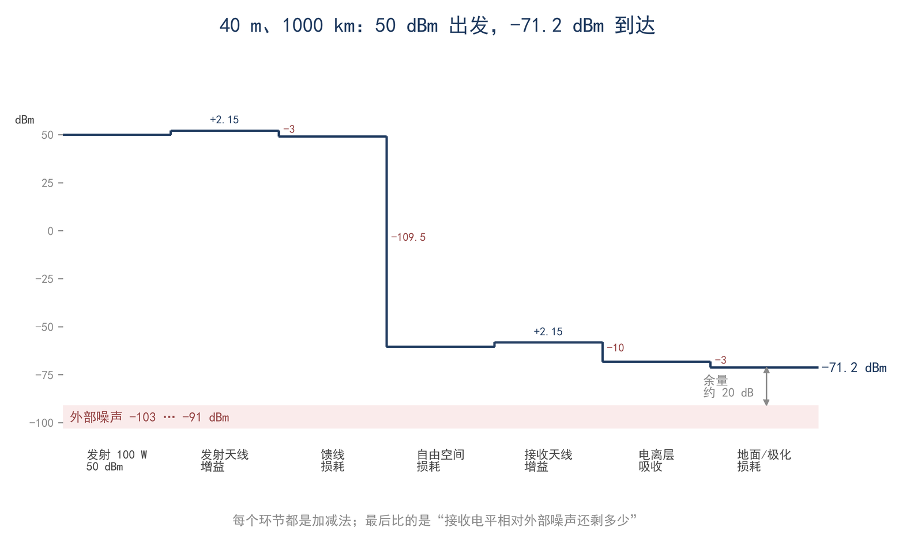
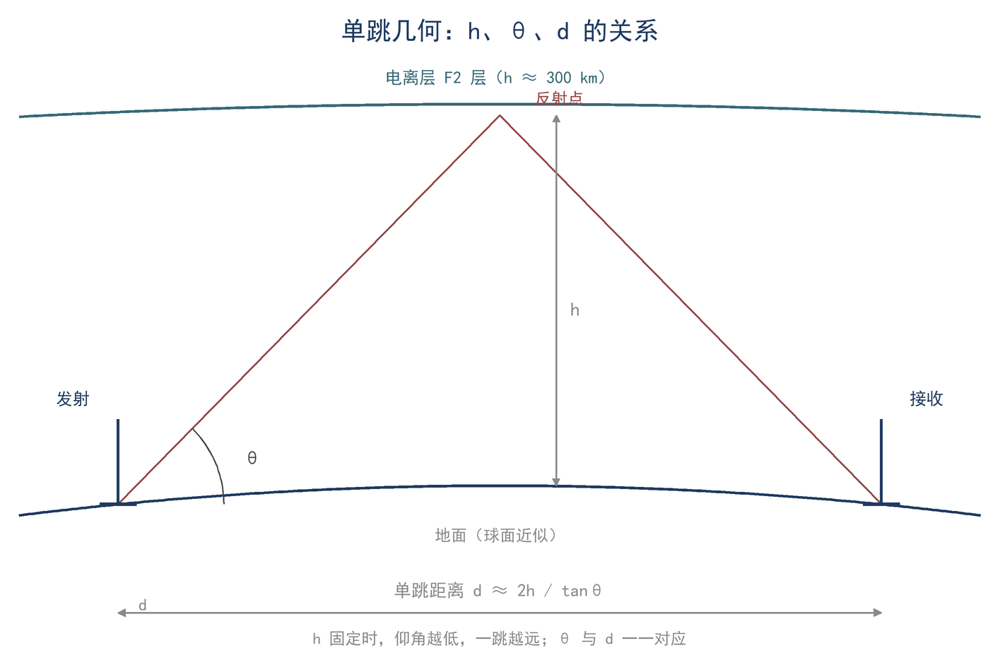
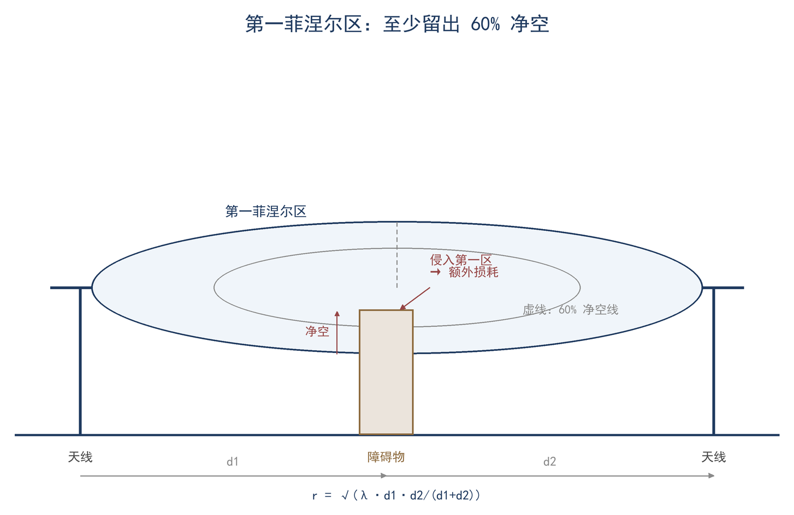
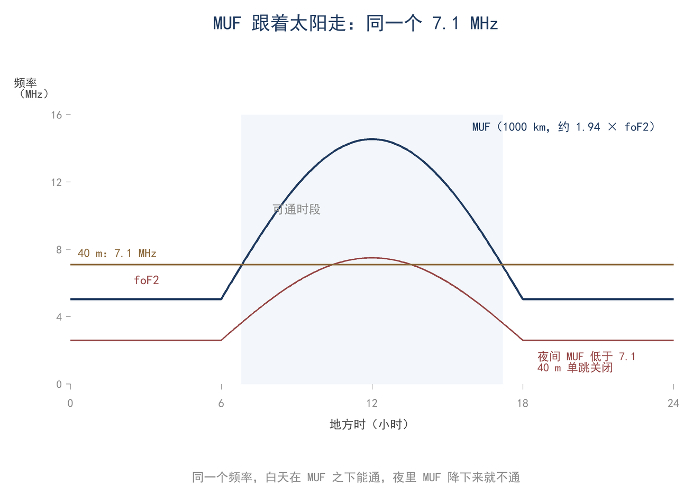
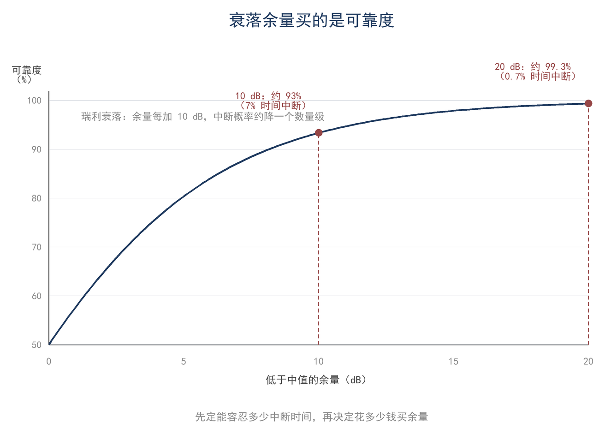

# 第 15 章 传播与链路预算：1000 km 之外还剩多少

> **这一章会用到**：第 2 章的 dB 加法，第 9 章的增益与有效面积，第 12 章的瑞利衰落，第 13 章的外部噪声。

同一部 40 米波段电台、同样的 100 W 与偶极天线，白天在数百公里内清晰可辨，夜间却可通至两三千公里外。其原因涉及电离层吸收、临界频率与外部噪声三个量，而三者随昼夜变化的方向并不相同。本章将链路预算写成 dB 加法，逐项说明各量在昼夜间的变化，并给出判断路径可用性的计算方法。

本章所有功率以 dBm 表示，损耗与增益以 dB 表示，整条链路因此只含加减运算。链路预算的作用是逐项列出损耗与增益，从而看出哪一项在变化；其价值在于比较与判断，而非给出唯一精确值。dB 加法之所以成立，是因为各环节的功率比相乘，取对数后乘法变为加法；预算表中各项可交换顺序而总和不变，但任何一项估计错误都会直接进入总和，无法由其他项补偿。

## 一、链路预算：从发射机到接收机的 dB 链路

链路预算（link budget）是一张加法表：发射功率自 dBm 起算，加天线增益、减各级损耗，最终得到接收功率。写为一行即（F15-1）：

$$ P_r = P_t + G_t + G_r − FSPL − L_extra $$

式中 P_t 为发射功率（dBm），G_t、G_r 为收发天线增益（dBi），FSPL 为自由空间损耗（dB），L_extra 为除自由空间扩散外的全部额外损耗（dB），P_r 为接收功率（dBm）。额外损耗包括馈线损耗、电离层吸收、地面反射与极化失配、接头损耗；每一项都应有明确来源与适用条件。

**表 15-1 40 m 波段、1000 km 路径的完整链路预算（示例）**

| 项目 | 数值 | 说明 |
|---|---|---|
| 发射功率 P_t | +50 dBm | 100 W |
| 发射天线增益 G_t | +2.15 dBi | 半波偶极，第 9 章 |
| 接收天线增益 G_r | +2.15 dBi | 同上 |
| 发射端馈线 | −1.5 dB | 假设 |
| 接收端馈线 | −1.5 dB | 假设 |
| 自由空间损耗 FSPL | −109.5 dB | 7.1 MHz、1000 km，见第二节 |
| 电离层吸收 | −10 dB | 单程、中等吸收，见第五节 |
| 地面反射与极化 | −3 dB | 估算 |
| **接收功率 P_r** | **≈−71.2 dBm** | 上行各项相加 |

表 15-1 逐项相加得 −71.2 dBm。该值与第 2 章的 −56.7 dBm 不同，原因在于后者未计电离层吸收与地面、极化损耗；−71.2 dBm 约在 S9 附近，与 1000 km 单跳的经验值处于同一量级。如图 15-1，瀑布图将各项依次画出，可直观看出各级损耗的相对大小。

将距离改为 3000 km 可观察夜间 DX 的典型情形。自由空间损耗增至约 119 dB，额外损耗按两跳计约 9 dB，得约 −76.7 dBm；噪声为 −91 dBm 时，信噪比约 14.3 dB，扣除 10 dB 解调门限后仅余约 4 dB，遇 10 dB 衰落即中断。该路径可以建立，但余量很小，这解释了夜间远距离通信信号微弱且时断时续的现象。

链路预算给出的是平均信号强度，不等于必然可通。能否通联还取决于噪声、衰落与干扰；其中只有噪声可以并入同一张表，衰落须另留余量，干扰无法预测。预算用于判断链路余量与瓶颈所在，不构成通联保证。此外，预算中每一项都对应明确假设：吸收 10 dB 对应中等吸收时段，地面/极化 3 dB 对应常见失配条件；假设改变时结果随之改变，计算的意义在于核对假设，而非套用数字。

## 二、自由空间损耗里的两个 20lg

自由空间损耗（free-space path loss，FSPL）常被误解为空气吸收了功率，其实它是球面扩散与接收天线有效面积共同造成的几何结果。P_t 经各向同性天线扩散至距离 d 的球面，功率密度为 P_t/(4πd²)；接收天线的有效面积为 Gλ²/(4π)。两者相乘，接收功率正比于 (λ/(4πd))²。取 10lg，即得

$$ FSPL = 32.45 + 20lg f(MHz) + 20lg d(km) $$

该推导说明两个 20lg 的来源：其一来自 d，功率密度按 d² 下降，功率比开方为幅度比后取 20lg，即得 20lg d；其二来自 λ，有效面积与 λ² 成正比，频率越高波长越短、有效面积越小，同取 20lg 后成为 20lg f。将 f 换为 MHz、d 换为 km，常数合并为 32.45。两个 20lg 并非两条独立经验项，而是 d/λ 这一无量纲比值的分子与分母各取一次对数。其适用条件为自由空间、远场、收发天线增益固定，且无地面反射与吸收。常数 32.45 的成立依赖 f 以 MHz、d 以 km 计；若改变单位，常数与两个 20lg 的系数均须重算。

FSPL 是路径损耗的下限，并非全部损耗。天波还须减去电离层吸收与地面、极化损耗，这些均不包含在 FSPL 内。将 FSPL 视为电波在空气中被吸收的功率，是本章最常见的概念错误。FSPL 随频率与距离单调增加：频率或距离各翻一倍，FSPL 均增加约 6 dB；因此距离加倍需要增加约 6 dB 的功率或天线增益。

以 20 m 波段对照：14.1 MHz、1000 km 的 FSPL 约为 115.4 dB，比 7.1 MHz 同距离多约 5.9 dB。同一副 10 米长偶极在 20 m 波段的电长度仅为 40 m 波段的一半，增益与方向图均不同；比较两个波段时，须将增益、有效面积与吸收一并计入。

## 三、天线的增益与有效面积

链路预算中两个天线增益各出现一次，这并非巧合。发射端，增益表示功率向目标方向集中的程度；接收端，增益换算为有效面积 A_e=Gλ²/(4π)（第 9 章）。同一增益在两个方向上对应同一物理量，即互易定理。

20 m 波段的半波偶极，2.15 dBi 对应 A_e≈0.13λ²≈59 m²。一副 10 米长的导线，其接收窗口为 59 平方米。该数值说明 HF 天线的有效面积远大于物理面积，且波长越长、同样增益对应的面积越大；低波段适合较大的天线，高波段的小天线也可具有可观的有效面积。有效面积并非天线的物理截面，而是其从入射波前截获功率的等效面积，大小与波长平方成正比。

**表 15-2 半波偶极（2.15 dBi）的有效面积随波段变化**

| 波段 | 频率 | λ | A_e≈0.13λ² |
|---|---|---|---|
| 40 m | 7.1 MHz | 42.3 m | 约 233 m² |
| 20 m | 14.1 MHz | 21.3 m | 约 59 m² |
| 10 m | 28.5 MHz | 10.5 m | 约 14.4 m² |
| 2 m | 145 MHz | 2.07 m | 约 0.56 m² |

表 15-2 表明，同一副半波偶极在 40 m 波段的接收窗口约为 2 m 波段的四百倍。用 S·A_e 与链路预算分别计算接收功率，结果应一致；若不一致，通常源于增益、有效面积或距离的单位换算错误。实际链路中，天线增益并非标称值：地面反射改变仰角方向图，极化失配扣除若干 dB，馈线损耗在两端各计一次；表 15-1 将其分列，便于核对。

## 四、路径几何：视距、单跳、仰角

天波路径的几何可先采用平面近似。设电离层反射点的等效高度为 h，地面距离为 d，电波以仰角 θ 射出，则单跳距离近似为（F15-2）

$$ d ≈ 2h/tanθ $$

式中 h 为反射层等效高度（km），θ 为仰角（°），d 为单跳地面距离（km）。该式假设地面与电离层均为平面并忽略地球曲率；在数百至两三千公里量级，其数量级足够，精确值须按球面几何修正。

取 F2 层等效高度 h=300 km，得表 15-3。

**表 15-3 仰角与单跳距离（h=300 km，平面近似）**

| 仰角 θ | 单跳距离 d |
|---|---|
| 60° | 约 350 km |
| 45° | 约 600 km |
| 31° | 约 1000 km |
| 20° | 约 1650 km |
| 15° | 约 2240 km |
| 10° | 约 3400 km |

表 15-3 是仰角决定距离的定量表述：高仰角覆盖近处，低仰角覆盖远处。300 km 以内的近距离覆盖需要 60° 以上的高仰角，即近垂直入射（NVIS）；2000 km 以上则须将能量压至 15° 以下。天线高度决定仰角（第 9 章），仰角又决定单跳距离，三者构成一条链。该表也可反向使用：由目标距离确定所需仰角，再判断天线高度能否满足。

平面近似有其边界：h=300 km 相对地球半径 6371 km 不可忽略，同样的 h 与 d 下，平面假设会高估仰角、高估单跳距离。1000 km 量级的判断可使用该近似；3000 km 以上或需要精确仰角时，误差可达数度，应改用球面公式或传播软件。

短波还有两条不经电离层的路径。地波沿地表传播，频率越低、地面电导率越高则传播越远，在 160 m、80 m 波段的近距离（数十至一两百公里）有效，但衰减较快；视距传播用于 VHF/UHF，天线越高看得越远。天波、地波与视距属不同机制，链路预算中不可共用同一距离模型。地波随距离呈指数衰减，视距则近似按距离平方反比，两者的衰减规律也不相同。

NVIS 是单跳几何的特例：仰角接近 90°，电波近乎垂直射向电离层后返回，覆盖半径数百公里且中间无越距（单跳可达而高仰角近距不可达的区间）。其成立需要两个条件：频率低于 foF2（否则穿层），以及天线在高仰角方向有足够辐射（水平偶极架低至 0.25λ 附近）。40 m 与 80 m 波段常用 NVIS 进行区域通信，这是白天数百公里内清晰的物理基础。

如图 15-2，将发射点、反射点、接收点与 h、θ、d 画出，可见仰角越低，路径在电离层中的斜切越平缓，单跳距离越远。

VHF/UHF 的视距公式量级为 d≈3.57(√h₁+√h₂) km（h 以米计，已含 4/3 地球半径修正）；HF 天波不使用该式，但天线越高、视距越远的结论同样成立。

## 五、电离层：foF2、MUF、LUF 与吸收

电离层是折射率随高度变化的等离子体层。对 HF 传播，三个量具有决定意义。

foF2 为 F2 层的临界频率，即垂直入射时仍能反射回地面的最高频率（MHz）。它随昼夜、季节与太阳活动变化，白天较高、夜间较低。MUF 为斜入射时的最大可用频率，与 foF2 的几何关系为（F15-3）：

$$ MUF ≈ foF2·secφ，FOT ≈ 0.85·MUF $$

式中 φ 为反射点处的入射角（自垂直方向量起）。secφ 使斜路径的等效长度增加，仰角越低、φ 越大，MUF 越高。FOT 取 0.85 倍 MUF 作为最佳工作频率，以留出余量。LUF 为最低可用频率，频率更低时将被 D 层吸收而无法到达 F 层。foF2 与 MUF 的区别在于入射角：垂直入射时仅能使用 foF2，斜入射时可使用更高的 MUF；仰角越低，路径越倾斜，MUF 越高，这一关系是选择工作频率的依据。

D 层是吸收层。白天太阳辐射使 D 层电离，其电子密度低但碰撞频繁，HF 穿越时损耗较大，且频率越低吸收越强（大致按 1/f² 变化）。低仰角路径在 D 层中行程更长，吸收更重；夜间 D 层消失，吸收显著下降，低仰角远距离传播才得以打开。

上述三个量的昼夜变化，构成本章开头现象的解释。白天 D 层吸收强而 foF2 高：高仰角短跳穿越 D 层的路径短、损耗可接受，故数百公里内清晰；低仰角长路径在 D 层中行程长、吸收大，因而白天难以远通。夜间 D 层消失、吸收下降，低仰角多跳打开，两三千公里的 DX 成为可能。与此同时，夜间 foF2 降低，高仰角单跳的 MUF 可能先降至工作频率以下，数十至数百公里的短跳先行关闭，出现越距；这与远距离多跳的打开并不矛盾，同一时刻可以近处不通而远处可通。

如图 15-3，将 foF2 的昼夜曲线、MUF 的 secφ 放大效应与工作频率线画在一起，选频即判断工作频率是否位于 MUF 与 LUF 之间。

## 六、菲涅尔区、地面反射与衰落余量

菲涅尔区是视距与地波路径上的几何问题。第一菲涅尔区（first Fresnel zone）的边界，是反射路径比直射路径长半个波长的点所构成的椭球面；将该几何展开，其半径可写为（F15-4）

$$ F₁ = 17.32·√(d₁d₂/(f·D)) $$

式中 d₁、d₂ 为障碍点到两端天线的距离（km），D=d₁+d₂ 为总距离（km），f 为频率（GHz），F₁ 的单位为米。该形式与以波长表示的版本等价，仅单位换为 km/GHz。以 144 MHz、两端相距 10 km、障碍位于中点（d₁=d₂=5 km）为例，F₁≈72 m。中点的菲涅尔区最大，越靠近天线端越小；判断净空时，应先检查路径中点附近最高的障碍。

障碍侵入第一菲涅尔区会造成绕射损耗。侵入小于半径的 40%（即净空大于 60%）时，附加损耗通常仅零点几 dB；侵入更深时，损耗随侵入比例迅速上升。工程上以 60% 净空作为常用判据，原因即在于此。如图 15-4，椭球内障碍所占比例决定附加损耗的大小。

菲涅尔区仅适用于存在确定直射路径的传播：视距、地波与对流层散射。HF 天波不适用，因电波在电离层中折射，路径并非直线，讨论第一菲涅尔区净空没有意义。

地面反射在 HF 天波预算中通常计入 L_extra 的地面/极化一项（表 15-1 取 3 dB）。若需更细的模型，可采用两径模型：直射波与地面反射波干涉，垂直面方向图出现波瓣，主瓣仰角满足 sinθ≈λ/4h（推导见第 9 章）。对天线高度而言，该式说明架高的必要性；对链路预算而言，其主要影响是能量是否射向目标仰角。地面反射对水平与垂直极化的相位不同，同一高度、同一路径下两种极化的仰角波瓣亦不同，不可互相套用。

链路预算给出的是平均接收功率，实际信号随时间起伏。短波的主要起伏来自电离层快衰落（多径干涉），幅度近似服从瑞利分布（第 12 章）。因此预算中须保留衰落余量（fade margin），其计算为一个减法：余量 = P_r − N − (S/N)_req，三项均以 dB 计。N 为接收带宽内的噪声功率（dBm），(S/N)_req 为解调门限。余量的物理含义是接收功率高于解调门限的 dB 数：余量越大，低于门限的概率越小；余量为零时，约有一半时间处于门限以下。代入表 15-1 的 −71.2 dBm 与第 13 章的外部噪声 −103…−91 dBm，并要求 S/N=10 dB：安静环境下余量约 22 dB，嘈杂环境下约 10 dB。遇 10 dB 衰落时，安静端尚余 12 dB，嘈杂端恰降至门限，这是同一副天线有时清晰有时断续的定量解释。

衰落余量并非固定常数，而对应一定的中断概率。如图 15-5，横轴为衰落深度，纵轴为中断概率；余量越大，曲线越向右移动，可靠度越高。按第 12 章的瑞利统计，留 10 dB 余量时约 6.7% 的时间低于门限，留 20 dB 时约 0.69%。这说明链路预算恰好等于门限时通信将频繁中断；业余条件下通常留 10–20 dB 余量，具体取值取决于可接受的中断时间。

噪声与衰落是两类不同的起伏，不能合并为同一余量。噪声底在分钟至小时尺度上缓慢变化（昼夜、季节、本地电器），衰落则为秒级快起伏；前者决定该时段能否建立通信，后者决定该分钟能否听清。

## 七、算例与误区

**算例 1（估算级，30 秒）**：40 m、7.1 MHz、1000 km、100 W、收发偶极。FSPL=32.45+17.02+60=109.5 dB；按表 15-1 逐项相加得 −71.2 dBm。再与噪声比：外部噪声 −103…−91 dBm 时，扣掉 10 dB 解调门限，余量约 22…10 dB；10 dB 的衰落占约 6.7% 时间，安静端稳、嘈杂端会断续。复核：−71.2−(−103)−10=21.8，−71.2−(−91)−10=9.8。

**算例 2（精确级）**：单跳几何与 MUF。h=300 km、d=1000 km → tanθ=2h/d=0.6，θ≈31°；φ=59°，secφ≈1.94。白天 foF2=5 MHz（示意值）：MUF≈9.7 MHz，FOT≈8.2 MHz，7.1 MHz 可用（低于 FOT，余量够）；夜间 foF2=2.5 MHz（示意值）：MUF≈4.9 MHz、FOT≈4.1 MHz，7.1 MHz 高于 MUF，这条 31° 单跳关闭。改看低仰角：θ=10° 对应 φ=80°，secφ≈5.76，MUF≈14.4 MHz，7.1 MHz 可用，所以夜间多跳 DX 打开。复核：2×300/1000=0.6，arctan0.6≈31°；1/cos59°≈1.94；5×1.94=9.7；2.5×5.76=14.4。球面几何下 MUF 约高 5%–10%（经验量级），本例的结论不变。

**误区一：功率翻倍，距离翻倍。** 错在把 dB 当线性量。距离翻倍 FSPL 加 6 dB，功率翻倍只补 3 dB；要让距离翻倍，功率得加 4 倍，或者两端天线各加 3 dB。

**误区二：MUF 越高越好。** 错在只记上限。工作频率通常取 0.85 倍 MUF（FOT）附近：高于 MUF 电波穿层而过，低于 LUF 被 D 层吸收，太靠近两端都不稳。MUF 是能不能用的门槛，不是越高越好的指标。

**误区三：把白天与夜间当成一个结论。** 错在把三个量揉成一个。白天 D 层吸收强、foF2 高；夜间吸收弱、foF2 低、外部噪声高。结果是：白天近处清楚、远处被吸收；夜间远处打开、近处可能越距。只用一句"晚上传播好"概括，会漏掉夜间高仰角单跳关闭这一面；反过来用一句否定整晚传播的话概括，也会漏掉 DX 打开这一面。

## 八、小结

> **只记一个关系**
>
> 接收功率 = 发射功率 + 收发天线增益 − 自由空间损耗 − 额外损耗；能不能听清，再用它减噪声功率、减解调门限，得到衰落余量。
>
> **一组数**
>
> 7.1 MHz、1000 km：FSPL≈109.5 dB；表 15-1 的完整预算≈−71.2 dBm；噪声 −103…−91 dBm 时余量约 22…10 dB；单跳几何 h=300 km、θ=31°→d≈1000 km。
>
> **一个适用条件**
>
> FSPL 只适用于自由空间、远场、无吸收无地面反射；天波还要减电离层吸收、地面与极化损耗，并按白天/夜间的吸收、foF2、噪声三项分别判断，不能一刀切。

自检三问：

1. 100 W、7.1 MHz、1000 km 的自由空间损耗是多少？接收功率为什么是 −71.2 dBm 而不是 −56.7 dBm？
2. 为什么夜间低 foF2 会让 1000 km 的高仰角单跳关闭，却让更远的多跳打开？
3. 同样一副天线，安静乡村与嘈杂城市的链路余量差多少？这对应多少衰落深度、多少中断时间？

习题（答案见附录 D）：

1. ★ 求 14.1 MHz、2000 km 的自由空间损耗；与 7.1 MHz、1000 km 相比差多少 dB？
2. ★ 某链路发射 50 dBm、收发增益各 2.15 dBi、馈线共 3 dB、额外损耗 13 dB、FSPL 109.5 dB，求接收功率。
3. ★★ h=300 km，仰角 20° 与 15° 的单跳距离各是多少？哪一种更适合 2000 km 以上的 DX？
4. ★★ foF2=6 MHz、φ=70°，求 MUF 与 FOT；7.1 MHz 是否可用？若夜间 foF2 降到 2.5 MHz，同样的 φ 呢？
5. ★★★（测量）选一个稳定的远地信标或 FT8 台，连续记录白天与夜间同一路径的信号强度（用 SDR 或接收机 dBm），各取中值；用本章三个量（吸收、foF2/MUF、外部噪声）解释昼夜差异，并说明哪些差异不是天线造成的。
