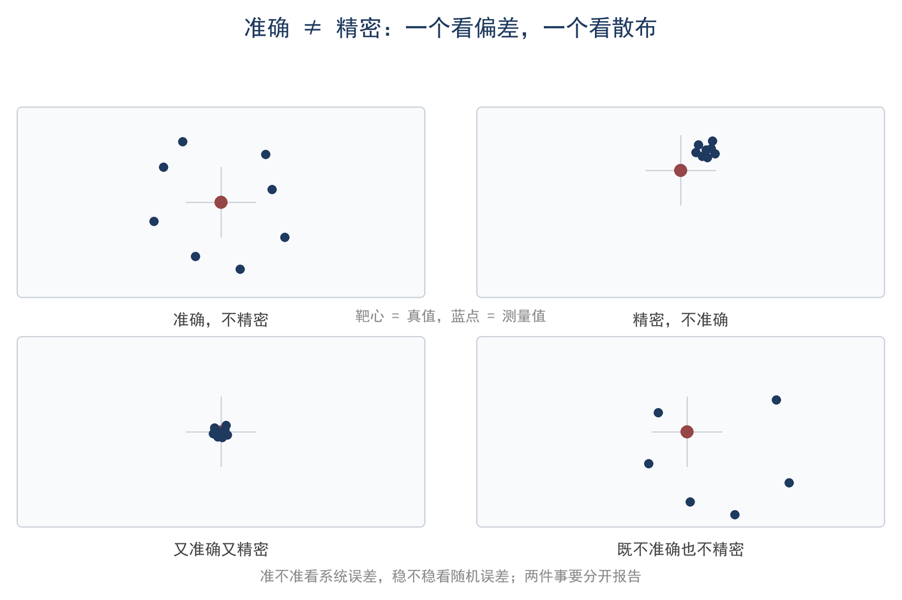
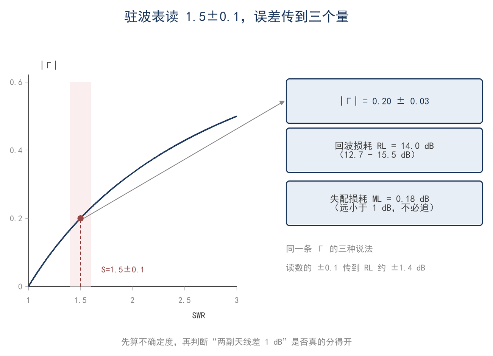
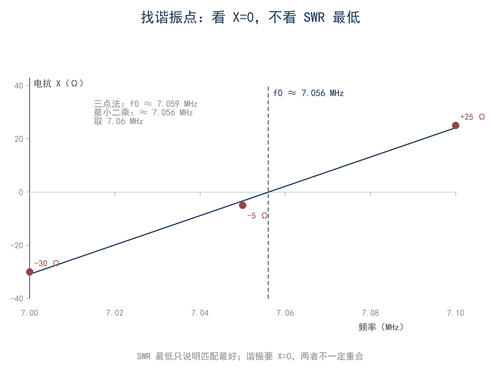

# 第 16 章 测量、误差与数据：让数字可信

> **这一章会用到**：第 2 章的 dB 定义；第 8 章的 Γ、SWR、RL、ML 四式；第 6 章的近远场判据与第 9 章的方向性。

## 一、读数、真值与误差：准确不等于精密

一副 20 m 垂直天线，驻波表读数为 1.5；把天线分析仪接到天线端，同一频点读数为 1.32；换到较低频点，驻波表读数又变成 1.45。三个数值来自不同的测量位置、仪表和频率，其中任何一个都不是“天线的真值”。

三个读数不同，是因为测量条件不同。测量只能给出区间和条件，不能给出真值；真值定义为待测量在指定条件下的值，实际能比较的是参考值，如标准负载、校准过的仪器或另一台仪表。读数与参考值之差称为误差。误差按性质分三类：每次都朝同一方向偏的称为系统误差，围绕某个值随机散布的称为随机误差，明显离群、由接错端口或看错量程造成的称为粗大误差；粗大误差只能剔除重测。三类误差的来源与处理列于表 16-1。

**表 16-1 三类误差的来源与处理**

| 类型 | 典型来源 | 表现 | 处理 |
|---|---|---|---|
| 系统误差 | 校准偏置、测量位置、公式近似 | 每次都朝同一方向偏 | 校准、换测量位置、修正 |
| 随机误差 | 噪声、接触、读数晃动 | 多次读数围着某值散布 | 多次平均、改善接触与信噪比 |
| 粗大误差 | 接错端口、看错量程、单位错 | 明显离群 | 剔除、重测 |

真值不可得，因此日常报告的是不确定度，即对误差可能范围的估计。误差是客观存在但不可知的数；不确定度是可以记录、可以比较的区间。后文统一用 u 表示标准不确定度。

准确与精密是两件事：准确指读数接近真值，精密指多次读数彼此接近。一块表可以很精密而不准确：重复性很好，但内部校准偏了 10%，整体偏高；也可以很准确而不精密：多次平均接近真值，单次散布很大。如图 16-1，四个象限对应四种典型状态。

另有分辨力：数字表显示 1.503，说明能分辨到末位 0.001，并不说明末位可信。分辨力描述刻度的细密程度，准确度描述刻度是否正确，它为不确定度设定下限；实际不确定度还包含校准、测量位置与重复性，通常明显大于分辨力。因此报告只写到不确定度所在的那一位。

单个读数的误差可以这样描述；若用几个读数算出一个结果，误差会沿公式传播，问题变成输入的不确定度如何合成为输出的不确定度。

## 二、误差传播：三条够用规则

先测几个量再代入公式，是电台里常见的操作；输入各差百分之一二，结果是否也只差百分之一二？答案取决于公式如何组合这些输入。

设结果 y=f(x₁,x₂,…)，各输入的标准不确定度为 uᵢ，且彼此独立、误差足够小，则合成标准不确定度由一阶展开给出（F16-1）：

$$ u_c = √Σ(∂f/∂xᵢ · uᵢ)² $$

式子分两步：每个输入先按敏感度折算成对结果的贡献，再把各贡献平方、相加、开方；u_c 为合成标准不确定度。

输入有小的偏差 Δxᵢ 时，结果偏差近似为

Δy ≈ Σ (∂f/∂xᵢ) · Δxᵢ。

两边取方差。各输入独立时，不同输入的误差交叉项平均为零，只剩下各自的平方项：

u_c² ≈ Σ (∂f/∂xᵢ)² · uᵢ²。

所以先平方相加，再开方；独立是交叉项消失的前提。偏导 ∂f/∂xᵢ 称为敏感度，表示输入变化一个小量时结果按什么比例变化。

手算时不必每次求偏导。三条规则覆盖常见情形，它们都是上式在特定函数形式下的结果：

1. 和与差：绝对不确定度方和根，u_c=√(u₁²+u₂²)。两个数相减时，绝对误差不会相消，可能更大。
2. 积与商：相对不确定度方和根，u_c/|c|=√[(u₁/x₁)²+(u₂/x₂)²]。
3. 幂次：y=xⁿ，则 u_c/|c|=|n|·u_x/|x|。平方关系使 2% 的电压误差放大为 4% 的功率误差。

以功率为例。P=U²/R，测得 U=50.0 V、u_U=1.0 V，R=50.0 Ω、u_R=0.5 Ω；相对不确定度分别为 2% 与 1%。由 F16-1，∂P/∂U=2U/R，∂P/∂R=−U²/R²，相对形式为

u_P/P = √[(2u_U/U)² + (u_R/R)²] = √[(2×2%)² + 1²] ≈ 4.1%。

P=U²/R=50 W，故 u_P≈50×4.1%≈2.1 W，结果写作 50.0±2.1 W。这个例子说明：电压与电阻只测到 1%–2% 的精度时，功率不宜承诺到 0.1 W。

三条规则的前提是各输入相互独立。同一块表、同一次校准引入的系统误差是相关的，不能直接方和根。同一台功率计前后测两次，读数差 0.3 dB，可能只是表在漂移；换一台表交叉比对，才能暴露系统误差。差分测量正是为了让相关的系统误差相消：比较两副天线时，使用同一台接收机、同一根馈线、同一频点，只更换天线，读数差值即可抵消接收机校准、馈线损耗与传播慢变化等共同项，剩余的主要是随机部分与两副天线自身的差异；前提是两次测量之间环境未变。

判断相关性要看两次测量是否共用同一路径与同一参考；若共享标准器或同一次校准，应把共同项单独列为相关分量，不能直接方和根。

射频测量中还有一条传播链：SWR→|Γ|→RL/ML。驻波比误差先经 d|Γ|/dS 变换，再经 20lg 化为 dB；同一条链在不同 SWR 上的灵敏度差别很大。图 16-2 画出这条链，数值见第五节表 16-2。

误差较大时，一阶展开会失真：平方关系在误差增大后偏离线性，被测量接近零点时很小的绝对误差会变成很大的相对误差。此时按上下界各算一次并给出区间，比套用方和根可靠；更复杂的非线性情形可用第 17 章的蒙特卡洛方法。

## 三、dB 的运算与平均

两次场强测量分别得到 0 dB 与 −10 dB，平均是多少？凭直觉把两个数相加除以二，得到 −5 dB；回到功率域计算，平均值却是约 −2.6 dB，相差 2.4 dB。dB 值不能直接算术平均，原因不在单位换算，而在平均的对象不同。

dB 是对数。设一组功率比读数 L₁、L₂、…、L_N（dB），对应的线性功率比为 10^(Lᵢ/10)。平均功率比应为这些线性值之和除以 N，再取对数，于是得到（F16-2）：

$$ L̄ = 10lg[(1/N)Σ10^(Lᵢ/10)] $$

以 0 dB 与 −10 dB 为例：线性功率比为 1 与 0.1，平均 0.55，取对数得 −2.6 dB。算术平均 −5 dB 对应 0.316，把两个 dB 值等权相待，等于在功率域给弱读数过大的权重。

差值较小时，算术平均的误差可以接受：读数跨度在 1 dB 以内时，两种平均相差不到 0.03 dB；跨度约 2 dB 时约 0.11 dB。一旦跨越数 dB，尤其在链路预算、平均噪声底与天线比较中，必须回到功率域。

这条规则还决定“平均什么”：功率谱上应平均功率密度，S 表读数应说明采用功率平均还是中值；记录时保留原始读数并注明算法，否则比较“天线改动前后”会得到不同结论。

平均处理的是同一量的多次读数。另一类数据是一串随频率变化的读数，要从曲线里找谐振点，做法不是平均，而是拟合。

## 四、拟合：从扫频曲线找谐振点

天线分析仪扫频时，屏幕上先出现一条 VSWR 曲线，最低点常落在两个采样点之间。很多人把最低点直接当作谐振点，但 VSWR 最低点受馈线变换、匹配网络与测量位置影响；谐振的定义是电抗 X 过零，即天线自身的电抗条件。两者在简单天线上往往接近，概念却不同（第 8 章）。

扫频步进通常为几十 kHz，X 的零点常落在两个采样点之间。三点法取三个等间隔频点 f₁、f₂、f₃，先计算相邻两段的斜率，取平均作为该段 X(f) 的斜率 b，再用靠近零点的频点 f₂ 外推（F16-3）：

$$ f₀ ≈ f₂ − X₂/b，b = ½[(X₂−X₁)/(f₂−f₁) + (X₃−X₂)/(f₃−f₂)] $$

两段斜率之差可用于检查线性：差值越大，说明曲线越弯，平均斜率的代表性越差。更稳妥的方法是对一段 X(f) 拟合直线 X=a+bf，让残差平方和 S(a,b)=Σ(Xᵢ−a−bfᵢ)² 最小。对 a、b 求偏导并令其为零，得正规方程 Σ(Xᵢ−a−bfᵢ)=0 与 Σfᵢ(Xᵢ−a−bfᵢ)=0；解得（F16-4）：

$$ b = Σ(fᵢ−f̄)(Xᵢ−X̄) / Σ(fᵢ−f̄)²，a = X̄ − b·f̄，f₀ = −a/b $$

最小二乘将噪声摊到所有点上，代价是要求该段确实接近直线。谐振点附近 X 变化最快，频段取得过宽会使二次项将零点拉偏。三点法只利用局部斜率，最小二乘利用多个点；点数多时后者更稳定，两者都要求曲线接近直线。

拟合之后应检查残差：各点近似在一条直线上时，残差随机分布；中间点系统性偏上或偏下，说明曲线弯曲，应缩小频率范围重测或改用二次拟合。残差远大于仪表分辨力时，多半是测量期间环境变了。

零点的不确定度由 X 的读数误差与斜率共同决定：u_f0≈u_X/|b|。取读数误差 1 Ω、斜率数百 Ω/MHz，零点不确定度约为 kHz 量级；这比修剪灵敏度（两臂各剪 1 cm 约升数 kHz）更细，因此将天线修剪到 1 kHz 以内没有实际意义。三点法与最小二乘的几何关系如图 16-3。

找到谐振点只解决了“中心在哪里”。若两副天线只差 1 dB，还要判断差异是否真实；这需要把不确定度写成可比较的区间。

## 五、不确定度与“能不能分辨”

同一频点上，两副天线的增益读数分别为 5.2 dBi 与 4.2 dBi，差 1.0 dB。这个差异是否足以说明第一副更好？单看两个数字无法回答，必须先知道每个读数的不确定度。

测量结果的标准写法是“结果 ± 不确定度”。标准不确定度按评定方法分两类：A 类由多次测量的散布统计得到，B 类由说明书、校准证书或经验估计得到。A 类描述重复性，增加测量次数可使其减小；B 类描述校准与系统偏差，增加次数不会改变。两类折算为标准不确定度后按方和根合成；若某项分量明显大于其余项，应优先改善该项。报告“95% 置信”区间时取包含因子 k=2，写成结果±2u；有效位数只写到不确定度所在的那一位。

两套方案能否分辨，用比对判据判断。设两次独立测量为 x₁、x₂，标准不确定度各为 u₁、u₂，则差值的不确定度由和差规则给出：

u_diff=√(u₁²+u₂²)。

在 95% 水平上取 2u_diff 作为判据：若 |x₁−x₂|<2u_diff，差异不显著。写成式子即（F16-5）：

$$ u_diff = √(u₁² + u₂²)，若 |x₁ − x₂| < 2u_diff 则差异不显著 $$

这个判据的前提是两次测量独立、各 u 为标准不确定度、区间取 95%。回到 5.2 dBi 与 4.2 dBi 的例子：各 u=0.5 dB，则 u_diff=√(0.5²+0.5²)≈0.71 dB，2u_diff≈1.4 dB。1.0<1.4，该差异在 95% 水平上不显著，不能据此判断第一副更优；要作出判断，需降低不确定度或增加重复次数。

A 类的典型例子是重复测量：同一频点测 10 次谐振频率，得到 7.060、7.058、7.061 MHz 等，平均 7.059 MHz，单次标准差 1.5 kHz；平均值的标准不确定度为 1.5/√10≈0.5 kHz。增加次数只减小随机部分，系统误差不会消失，故两类须分开评定再合成。报告写“7.059 MHz，u=0.5 kHz（A 类）”；计入校准、扫频步进等 B 类分量后，u 通常达到 1 kHz 量级，k=2 时可写成 7.059±0.002 MHz。

由第 8 章 |Γ|=(S−1)/(S+1)，对 S 求导得 d|Γ|/dS=2/(S+1)²。设驻波表读数的不确定度 u_S=0.1，不同 SWR 下 |Γ| 与 RL 的不确定度如表 16-2。

**表 16-2 同一块驻波表（u_S=0.1）在不同 SWR 下的不确定度**

| SWR | \|Γ\| | d\|Γ\|/dS | u_\|Γ\| | RL（dB） | u_RL（dB） |
|---|---|---|---|---|---|
| 1.1 | 0.048 | 0.45 | 0.045 | 26.4 | 8.3 |
| 1.5 | 0.20 | 0.32 | 0.032 | 14.0 | 1.4 |
| 2.0 | 0.33 | 0.22 | 0.022 | 9.5 | 0.6 |
| 3.0 | 0.50 | 0.13 | 0.013 | 6.0 | 0.2 |

末列值得关注：SWR 越接近 1，RL 的 dB 不确定度越大。接近匹配时，读数误差可将 RL 的不确定度推到很大，以回波损耗判断“天线是否良好”没有意义；失配较大时 RL 较稳定。因此驻波表适合保护发射机与判断大致范围，不适合在接近匹配时作精细比较。

增益测量的不确定度须按整条链预算。采用替代法测量增益时，典型来源与量级见表 16-3。

**表 16-3 一次业余增益测量的不确定度预算（典型量级）**

| 来源 | 典型 u（dB） | 说明 |
|---|---|---|
| 功率计校准 | 0.2 | 说明书±5%折算 |
| 接头与短馈线 | 0.1 | 两只接头、1 m 线 |
| 参考天线增益 | 0.2 | 偶极标称 2.15 dBi 的偏差 |
| 重复性与位置 | 0.2 | 换位置、重架 |
| 合成 | 0.36 | 方和根 |

合成后为 0.36 dB，2u≈0.72 dB。两副天线若仅差 1 dB，已处于可分辨边缘；差 0.5 dB 则完全无法区分。该值宜记入测量记录，其参考价值高于任何标称“高增益”数值。

## 六、电台里的测量：功率、驻波、分析仪、S 表、增益与方向图

第一节的三个读数说明，同一副天线在不同位置会得到不同结果。功率计、驻波表、天线分析仪与 S 表的读数，其不确定度主要有三项来源：测量面（读数取自发射机端还是天线端，含义不同）、校准（标准器与刻度偏差）与重复性（接触、噪声与环境变化）。

三项之中，测量面最易被忽略。接在发射机端测到的是经馈线变换后的阻抗，不能直接视为天线端阻抗；反射很小时，定向耦合器漏波还会抬高 |Γ|。馈线的电长度、损耗与特性阻抗都参与变换，所以记录必须写明测量面。

校准与重复性决定读数的稳定程度。校准偏差是系统性的，换一台仪表或送检才能发现；重复性属于随机部分，多次平均可以减小。各仪表的特性见第 8、13 章；增益与方向图还须满足远场条件，判据见第 6 章，参考天线的增益偏差与测量不确定度归入本章第五节的预算。

因此，测量结果只应回答当前条件下匹配是否合理、读数是否稳定；效率与噪声特性须另作测量或计算，不能由驻波比直接推出。

## 七、算例与误区

**算例 1（估算级）：驻波表读 1.5±0.1，这个数能说明什么**

某 20 m 垂直天线，驻波表读 S=1.5，估 u_S=0.1。由 |Γ|=(S−1)/(S+1)=0.20、d|Γ|/dS=2/(S+1)²=0.32，得 |Γ|=0.20±0.03；RL=−20lg0.20=14.0 dB，用 S=1.4 与 1.6 两个端点（RL≈15.6 与 12.7 dB）得 RL≈14.0±1.4 dB。ML 取 0.18 dB（第 8 章），误差传递得 u_ML≈1.81×0.032≈0.06 dB。接近匹配时 RL 的不确定度远大于 ML，判断天线好坏不能只看 RL。

**算例 2（精确级）：三点法、最小二乘与谐振频率的不确定度**

一副 40 m 偶极扫频，步进 50 kHz，记录 X：7.00 MHz 为−30 Ω、7.05 MHz 为−5 Ω、7.10 MHz 为+25 Ω。两段斜率 500 与 600 Ω/MHz，取平均 b=550 Ω/MHz；由 f₀≈f₂−X₂/b 得 7.05+5/550≈7.059 MHz。取 X 读数误差 1 Ω，u_f0=1/550≈0.0018 MHz，即约 1.8 kHz；2u≈3.6 kHz。最小二乘给出 7.056 MHz，与三点法相差 3 kHz，小于 2u，统一报 7.06 MHz。适用条件：局部线性、步进足够细；只看 SWR 最低点可能把匹配点误当谐振点。

**误区**

1. **读数精确就是准确**。表显示 1.503，只说明分辨力是 0.001；没做校准、没固定测量位置，末位是假精确。错在把分辨力当成了准确度。
2. **一次测量就是结论**。两副天线读数差 1 dB，就下结论“第一副好 1 dB”。错在没算不确定度：单次 u=0.5 dB 时，2u≈1.4 dB，1 dB 的差异不显著。
3. **dB 值直接算术平均**。0 dB 与−10 dB 平均成−5 dB，正确值是−2.6 dB。错在把对数当线性量，平均时没回到功率域。

## 八、小结

> **只记一个关系**
>
> 不确定度按“和差方和根、积商相对相加、幂次乘 n”传播；dB 值不能直接算术平均，要回到功率域。
>
> **一组数**
>
> 驻波表 S=1.5±0.1 给出 |Γ|=0.20±0.03、RL=14.0±1.4 dB、ML=0.18±0.06 dB；0 dB 与−10 dB 的功率平均是−2.6 dB；两方案差 1 dB、各自 u=0.5 dB 时，2u≈1.4 dB，差异不显著。
>
> **一个适用条件**
>
> 方和根只适用于相互独立的误差；同一块表、同一次校准的系统误差是相关的，要用差分测量或交叉比对，不能直接合成。

自检三问：

1. 驻波表读 1.5，为什么不能直接说“回波损耗 14 dB”？（RL 在接近匹配时的不确定度有多大？）
2. 三次读数 −3、−6、−10 dB，平均是多少？算术平均错在哪一步？
3. 两副天线测出来差 0.8 dB，你的测量不确定度各 0.4 dB，这个差异可信吗？

习题（答案见附录 D）：

1. ★ 驻波表读 S=2.0±0.1，求 |Γ|、RL、ML 及 RL 的不确定度。
2. ★ 两个功率读数 −3 dB 与 −6 dB，按功率平均是多少 dB？算术平均又是多少？
3. ★★ 用 P=U²/R 算功率，U=12.0±0.2 V，R=50.0±0.5 Ω，求 P 及其相对不确定度。
4. ★★ 扫频得 X(14.00)=−20 Ω、X(14.05)=+3 Ω、X(14.10)=+26 Ω，用三点法求谐振频率与斜率，并估 u_X=1 Ω 时的频率不确定度。
5. ★★★ 用驻波表在目标波段测 3 个频点的 SWR，记录仪表、量程与测量位置，写出“结果±不确定度”，并判断两副天线差 0.5 dB 能否分辨。
