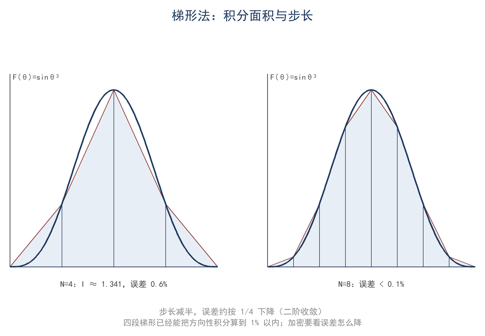
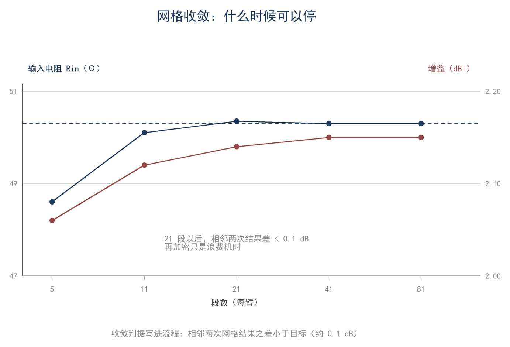
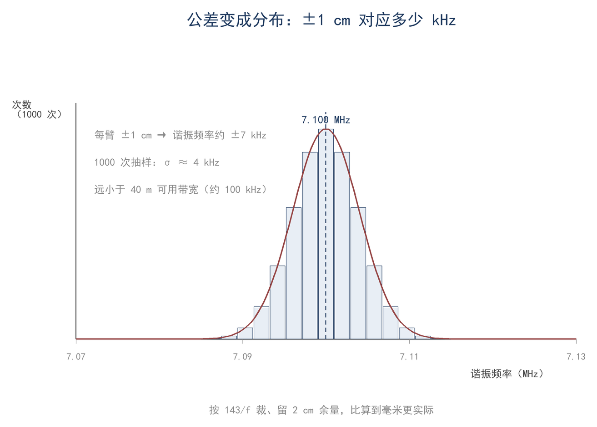

# ★ 第 17 章 建模：计算机在算什么，什么时候不能信

> 本章是 ★ 拓展章：不读本章也能继续读结语。

> **这一章会用到**：第 9 章的方向性与辐射电阻、第 10 章的方向图、第 16 章的测量不确定度与比对判据。

## 一、计算机在解什么：积分、求根、解线性方程组

仿真软件报告某 14.1 MHz 三单元八木的增益为 8.0 dBi、馈电点阻抗 50.3 Ω、SWR 1.02；按此尺寸架设后以参考偶极对比，实测仅为 6.0 dBi。2 dB 的差异究竟来自何处，须从软件在计算什么入手。软件并不理解"天线"，它只完成三件事：积分、求根、解线性方程组。

积分将电流分布化为辐射功率、方向性与增益；求根在扫频曲线上确定谐振点与波束零点；解线性方程组则在将导线分为若干段后求出各段电流。三个环节对应三类误差：输入误差（尺寸、线径、地参数、频率）、离散误差（分段、步长）与求解误差（矩阵条件数、迭代收敛）。前两类是实际问题的主要来源；软件只给出一个数，须分清误差类别才能确定修改方向。

三类误差的可控程度不同。输入误差可通过核对尺寸、线径与地参数消除；离散误差可通过加密网格减小；求解误差通常只在矩阵条件数很差或迭代未收敛时出现。实际排查应从输入开始，因为输入错误不会被加密或更高阶的算法修正。

## 二、数值积分与求根

方向性、辐射电阻与增益均归结为对方向图函数的球面积分，实际计算采用数值积分。梯形法将区间等分为 n 段（F17-1）：

$$ ∫_a^b f(x)dx ≈ h/2·[f₀ + 2f₁ + 2f₂ + … + 2f_{n−1} + f_n] $$

辛普森法将每两段拟合为抛物线（F17-2）：

$$ ∫_a^b f(x)dx ≈ h/3·[f₀ + 4f₁ + 2f₂ + 4f₃ + … + 4f_{n−1} + f_n] $$

步长减半时，梯形法误差约降至 1/4，辛普森法约降至 1/16。求根用于确定谐振点与波束零点；牛顿法（F17-3）收敛较快：

$$ f_{n+1} = f_n − X(f_n)/X′(f_n) $$

数值积分与求根都需判断离散误差是否足够小，判据见第四节；步长与误差的关系如图 17-1。

## 三、矩量法与 NEC：分段、基函数、矩阵

天线上的电流连续分布，计算机只能求解有限个未知量。NEC（Numerical Electromagnetics Code）即基于矩量法的常用计算程序。矩量法将导线分为 N 段，设每段电流由一个简单函数（基函数）表示，并要求每段表面的切向电场为零，从而得到 N 个方程，解出 N 个未知电流。写成矩阵形式即（F17-4）：

$$ [Z]·[I] = [V] $$

其中 [I] 为 N 个待求电流，[V] 为激励向量（仅馈电点附近非零），[Z] 为 N×N 阻抗矩阵。矩阵元的物理含义是互阻抗：第 j 段单位电流在第 i 段表面产生的电场，对角元为自阻抗。各段通过空间场相互耦合，矩阵因此是稠密的；求解后所得电流分布，即为模型对"电流如何分布"的回答。软件填充该矩阵并解线性方程组，得到电流分布；再由电流积分得到远场、增益、输入阻抗与 SWR。阻抗矩阵的对角元与导线半径密切相关，非对角元随段间距离衰减；改变分段密度首先影响未知量的数量，改变线径首先影响自阻抗，改变地模型则同时影响各段之间的互阻抗。三者的作用途径不同，不能通过同一种调整相互补偿。

矩阵形式解释了三项输入为何关键。第一是分段：正弦电流在一个波长内完成一个周期，段长通常取 λ/10 以下方可描绘其形状；分段过粗会抹平电流分布，使谐振点偏移。第二是线径：自阻抗项与 log(段长/半径) 有关，线径改变会影响谐振频率、带宽与 Q 值。第三是地模型：理想导体地按镜像法处理，结果最乐观；真实地按频率、极化与入射角给出反射系数，需要相对介电常数与电导率；自由空间则无地面。同一副垂直天线在理想地与平均地上的增益可相差 1–2 dB，仰角亦随之变化。地模型改变的是反射系数或镜像源，从而改变各段之间的耦合；垂直天线的低仰角辐射对此最敏感。

八木天线是必须解矩阵的典型。反射器与引向器不接馈线，其电流由激励器感应产生，又反过来影响激励器；多个单元互相耦合，无法以单一公式解析。矩量法将各振子分段，把所有段的互阻抗填入矩阵，一次解出全部电流，八木尺寸优化依赖软件的原因即在于此。半波偶极只有一根导线，电流近似正弦，解析式已足够，软件主要用于验证。

矩阵方法亦有边界：它默认导线很细（半径远小于段长与波长）、无介质、无馈线外皮。真实天线存在绝缘子、馈线与共模电流，这些因素不在模型中；模型与实测的差异常来自未纳入模型的输入，而非矩阵求解本身。

## 四、网格与收敛：什么时候可以停

数值解均含离散误差。判断其是否足够小，可加密后重算：以 N 段与 2N 段分别计算，比较输入阻抗、增益与谐振点；若两次结果之差小于所关心的精度，即可停止。常用判据为（F17-5）：

$$ |G_{2N} − G_N| < 0.1 dB，且 |R_{2N} − R_N| / R_N < 1% $$

增益收敛较快，输入阻抗收敛较慢，尤其在谐振点附近电抗过零、R 变化剧烈处。因此不能仅以增益通过判据为准，还须检查 R、X 与扫频曲线的关键点。判据比较的是 N 与 2N 两次结果；加密一倍是最小成本的检验，结果变化小于门限时，继续加密收益更小。该判据并非收敛性证明，只说明当前精度下已稳定。0.1 dB 与 1% 是人为门限，依据工程需要与测量不确定度；测量本身常有 0.4 dB 量级的不确定度，将模型精度追到 0.01 dB 并无意义。

表 17-1 以示意数字说明判断方法：段数由 11 增至 21 时，R_in 与增益仍在变化；由 21 增至 41 时变化已小于判据，故取 21 段。收敛曲线如图 17-2，后续趋于平台，平台出现处即"够用"的位置。

**表 17-1 段数收敛检查（示意数字，用来说明判断方法）**

| 段数 | R_in（Ω） | X_in（Ω） | 增益（dBi） |
|---|---|---|---|
| 5 | 68.0 | −18.0 | 1.95 |
| 11 | 71.2 | −4.5 | 2.08 |
| 21 | 72.1 | −1.2 | 2.13 |
| 41 | 72.3 | −0.6 | 2.14 |

收敛检查应至少覆盖三个位置：波段中心、波段边缘与 X 过零附近。中心检查增益，边缘检查 SWR 曲线是否变形，过零附近检查 R_in 与 X 的斜率。三种量对电流误差的敏感方式不同：增益为远场功率在全空间的积分，各段电流的相位误差在积分中相互抵消，故对分段不敏感；输入阻抗由馈电点附近的电流与场决定，局部误差直接进入结果，谐振点附近很小的电流误差即可造成明显偏移。仅查中心点可能掩盖边缘误差。收敛快慢的差异亦源于此：增益是全空间积分量，输入阻抗是局部量，同一网格下增益可能已经稳定，而 R_in 仍在变化，故判断收敛应以后者为准。

加密过度亦有代价：段长小到与导线半径可比时，细线假设失效，自阻抗项变得敏感，结果反而波动；矩阵条件数变差，数值噪声被放大。停止判据是：加密后结果不再变化。此外，收敛只说明离散误差减小，不说明模型正确；若地模型设为理想地，再加密仍得理想地答案，该问题由下一节讨论。

## 五、模型验证：与实测对照、灵敏度分析

验证的第一步是对照能够测量的量：天线端的输入阻抗、谐振频率与 SWR 曲线。测量面应位于天线端；若接在发射机端，测得的是经过馈线变换后的阻抗。一段 50 Ω 的 1/4 波长线可将 36 Ω 变换为约 69 Ω（Z_0²/Z_L），以发射机端读数对照模型，所得结果与天线端完全不同。第二步是对照增益与方向图，这一步受远场条件与参考天线限制（第 16 章）。第三步是灵敏度分析：将每个输入单独变动，观察输出变化，找出"最不能错"的一项。

验证可按顺序进行：先检查天线端阻抗与谐振频率，再检查波段两端的 SWR 曲线形状，然后检查增益量级（±1 dB 以内），之后检查方向图主瓣宽度与仰角，最后改变架设高度或地面条件，比较模型敏感性与实测是否一致。前三项最易实施，后两项需要转台或第二副天线。这些对照项的重要性不同：输入阻抗与谐振频率对模型中的几何与地参数最敏感，增益与方向图还叠加了测量条件的影响；因此应先以可精确测量的量检验模型，再讨论增益差异。

**表 17-2 输入灵敏度（示意量级，实际随天线与环境变化）**

| 输入变化 | 典型输出变化 |
|---|---|
| 振子总长 ±2 cm | 谐振频率 ∓7 kHz |
| 架设高度 ±0.5 m | R_in 变化约 1–2 Ω，最大辐射仰角变化约 1°–2° |
| 地模型：理想地→平均地 | 增益 −0.5…−2 dB（垂直天线更敏感） |
| 导线半径 1 mm→2 mm | Q 下降、带宽变宽，谐振频率略降 |

表中的量级说明：地模型与尺寸公差对结果的影响常比段数由 21 增至 41 大一个量级；因此，将时间用于加密段数，不如先确认地参数与实际尺寸。

判断模型是否可信，不能只看一次比对。单次差异可能是偶然；在多个频率、多种架设条件下重复出现同向偏差，才说明模型存在系统性偏差。这也决定了改进方向：随机差异靠重复测量压缩，系统偏差靠修正输入消除。

回到开头的 8 dBi 与 6 dBi。先计算显著性：增益测量的标准不确定度各取 0.5 dB，两次比对合成 u_diff≈0.7 dB，2u≈1.4 dB；2 dB 的差异大于 1.4 dB，在 95% 水平上显著。既然显著，说明存在输入不一致。按顺序检查：地模型是否设为理想地；模型是否包含馈线与共模电流；实际架高、周围金属与地面条件与模型相差多少；测量是否满足远场条件、参考天线是否经过校准。软件并未出错，它计算的是所输入的模型。

反之，若模型与实测仅差 0.5 dB，而测量不确定度已有 0.7 dB，则该差异不应作为修改模型的依据。将不可分辨的差用于调参，只会使模型拟合测量误差。报告模型结果时，应同时注明所用输入条件与不确定度。

显著性判据只说明差异是否超出测量不确定度，不说明模型一定错误。若差异显著，应优先检查对结果影响最大的输入，而不是调整算法或加密网格；若差异不显著，则应记录测量条件与不确定度，待条件改善后再比较。模型验证的目的是找出可解释的偏差来源，而非使计算值与某一次实测值吻合。

## 六、蒙特卡洛：把公差变成概率

尺寸公差、架设误差与地面参数都取一个范围，而非确定值。蒙特卡洛方法的做法是：为每个输入按分布抽取一个值，运行一次模型并记录输出；重复 N 次，得到输出的分布，再计算均值、标准差与百分位。输出的平均值标准误由（F17-6）估计：

$$ u_mean = s/√N $$

其中 s 为 N 次输出的标准差。N=1000 时，标准误约为标准差的 1/32，足以看清分布形状；若需再稳定一倍，N 须增至四倍。该方法的意义不在于将结果算得更准，而在于回答"公差会造成多大偏离、偏离的概率多大"。

以公差为例：±1 cm 的裁剪公差对应谐振频率约 ±7 kHz；均匀分布下标准差约 4 kHz，而 40 m 波段可用宽度约 100 kHz，4 kHz 所占比例很小。因此按 143/f 裁切、留出余量并依实测修剪，比将尺寸算到毫米更为实际。图 17-3 为这类模拟的典型直方图。

蒙特卡洛有两个前提。第一，分布须设置正确：材料长度误差常为均匀分布或正态分布，架设高度误差可能是偏态的，不能一律按正态处理。第二，输入之间的相关性须纳入：两臂使用同一卷线、同一次裁切时，误差相关，不能作为独立变量抽取。分布设置错误时，N 再大也只是将错误假设算得更精细。

结果应以分布而非单一数值报告：均值给出中心位置，标准差给出分散程度，百分位给出极端情形。仅报告均值会掩盖公差造成的尾部风险，仅报告最坏值则可能过于保守。分布的形状还提示改进方向：若输出主要由某一输入支配，减小该输入的公差比增加抽样次数更有效。

它与误差传播是同一问题的两种情形。输入误差小、关系近似线性时，方和根公式足够，数行手算即可；关系明显非线性，或需要了解分布尾部（例如最坏 5% 的情形）时，则采用蒙特卡洛。前者给出一个 u，后者给出一条分布曲线；报告中采用哪种，取决于所要回答的问题。报告时应同时写明所用分布与抽样次数，否则结果无法复现。

## 七、算例与误区

**算例 1（估算级）：用四段梯形算短偶极的方向性**

短偶极方向图 F(θ)=sinθ，方向性积分 I=∫₀^π sin³θdθ，精确值 4/3；四段梯形得 I≈1.341，D=2/I≈1.49（精确 1.5，误差约 0.6%）。

**算例 2（精确级）：段数收敛与公差蒙特卡洛**

7.1 MHz、20 m 偶极，按表 17-1 检查：11 段到 21 段，R_in 变 0.9 Ω（1.3%），超过 1%；21 段到 41 段，R_in 变 0.2 Ω（0.3%）、增益只变 0.01 dB，均小于判据，取 21 段。两臂 ±1 cm 对应 ±7 kHz；均匀分布下 σ=7/√3≈4 kHz，1000 次抽样标准误约 0.13 kHz，远小于波段可用宽度，按 143/f 裁后修剪即可。判据以工程精度为准。

**误区**

1. **软件输出等于真值**。软件解的是所输入的模型，输入错了，结果会精确地错。错在跳过输入检查，直接拿 8 dBi 去和 6 dBi 比较。
2. **网格越密越好**。加密只减小离散误差，模型误差一点没变；段长小到接近导线半径，细线假设失效，数值噪声反而变大。错在把"算得细"当成"算得对"。
3. **模型与实测不符就是软件错**。2 dB 的差可能来自地模型、馈线共模、实际尺寸、周围金属或测量方法。错在没按灵敏度从大到小排查，先怀疑算法。

## 八、小结

> **只记一个关系**
>
> 软件输出 = 模型输入经过"积分—求根—解矩阵"的映射；先问输入，再问算法，末了才问收敛。
>
> **一组数**
>
> 短偶极方向性积分：4 段 1.341（D≈1.49），8 段 1.334（D≈1.499），精确 4/3（D=1.5）；20 m 偶极 21 段后 R_in 变化 <1%、增益变化 <0.1 dB；两臂各 ±1 cm → 谐振频率 ±7 kHz，均匀分布 σ≈4 kHz。
>
> **一个适用条件**
>
> 0.1 dB / 1% 的收敛判据只说明离散误差够了，不说明模型对；模型与实测差 2 dB 时，先用 2u 判据判断显著性（第 16 章），再按灵敏度从大到小查输入。

自检三问：

1. 梯形法 4 段与 8 段算同一个积分，误差一般按 h² 量级下降；本例为什么降得更快？
2. 矩量法里把导线半径从 1 mm 改成 0.5 mm，为什么谐振频率会变？
3. 模型说 7.5 dBi、实测 6.8 dBi，各有 0.5 dB 不确定度，这 0.7 dB 的差该不该拿来改模型？

习题（答案见附录 D）：

1. ★ 用梯形法 n=4 计算 ∫₀^π sin³θdθ，并求 D=2/I。
2. ★ 已知 X(14.00)=−20 Ω、X(14.05)=+3 Ω，用线性插值求零点；再用牛顿法从 14.00 出发走一步。
3. ★★ 表中给出 11、21、41 段的 R_in 与增益，按 0.1 dB/1% 判据判断 21 段是否够用。
4. ★★ 两臂各 ±1 cm 公差、灵敏度 7 kHz/2 cm，若公差按均匀分布，求谐振频率的标准差；N=400 时均值标准误是多少？
5. ★★★ 用你手头的建模软件把一副偶极从 11 段加密到 41 段，记录 R_in、X_in、增益，写一段"什么时候可以停"的判断，并与实测谐振频率对照。
